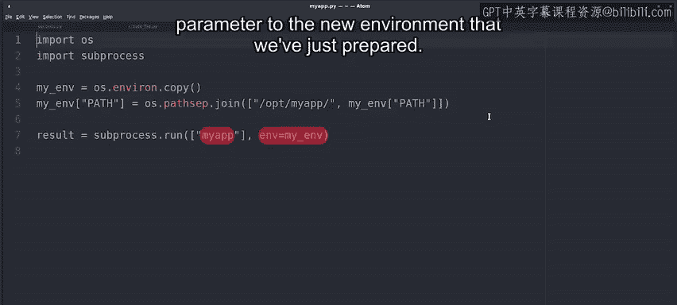
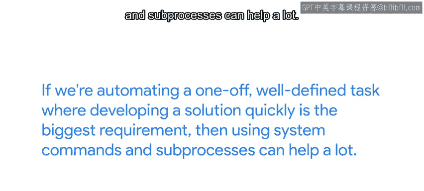

# 谷歌《用Python进行IT自动化办公1、2课（Python、控制操作系统）｜Google IT Automation with Python》中英字幕 - P125：51_高级子进程管理.zh_en - GPT中英字幕课程资源 - BV1gw411E7E1

All right。 So we've seen how to run system commands from Python。

 how to check the exit value and how to manipulate the normal output and error output of the command。

 The subpro module offers a lot of extra options that we can use in our scripts， for example。

We called out in an earlier video that one way of providing information to our processes is to modify the environment variables。

Using this mechanism， we can change where the process looks for executable files。

 which commands uses interact with some parts of the system。

 the kind of output ill'll generate and a bunch more things。

 The usual strategy for modifying the environment of the child process is to first copy the environment seen by our process do any necessary changes and then pass that as the environment that the child process will see。

Let's take a look at this。So in this code， we start by calling the copy method of the OS and Byron dictionary that contains the current environment variables。

 This creates a new dictionary that we can change as needed without modifying the original environment。

 The change that we're doing in this script is adding one extra directory to the path variable。

Remember， the path variable indicates where the operating system will look for the executable programs。

By adding one entry to the path， we're telling the OS to look for programs in an additional location to create the new value。

 we're calling the join method on the OS path S string。

This joins elements of the list that we're passing with a path separator corresponding to the current operating system。

So here we're joining slashOt/lash My app and the old value of the path variable to the path separator。

Finally， we call the my app command setting the end parameter to the new environment that we've just prepared。

 So to recap， this script is modifying the contents of the path environment variable by adding a directory to it。

 We then call the my app command with that modified variable。 Do it this way。

 the command will run in the modified environment with the updated value of path。😊。

There are a bunch more options that we can use with the run function。For example。

 we can use the CWD parameter to change the current working directory where the command will be executed。

This can be really helpful when working with a set of directories where you need to run a command on each of them。

We could also set the timeout parameter。This would cause the run function to kill the process if it takes longer than a given number of seconds to finish。

This might be useful if you're running a command that you know might get stuck， for example。

 if it's trying to connect to a network and your computer is offline。

Or we can also set the shell parameter if we set this to true。

 Python will first execute an instance of the default system shell and then run the given command inside of it。

This means our command line could include variable expansions and other shell operations。

 without the shell parameter。 This would not be possible。

 We'll learn more about the things that we can do of the shell later in this course。 For now。

 just keep in mind that if you need to expand variables or globs， you'll need to set this parameter。

But using this can be a security risk。 So make sure you actually need it and be careful when using it。

 if you do。Before we finish our discussion of the subproces module， a word of caution。

Interfacing with the underlying system directly in your Python scripts via subprocesses and system commands can be useful。

 especially if you need to do a specific task quickly， but it comes with some drawbacks。

Using these system level commands builds assumptions into our scripts about the infrastructure our automation will run on。

And if those assumptions change， it can lead to unexpected effects or failures。

These kinds of assumptions can change in multiple ways。

What would happen to our automation if the flags were a terminal command change。

 and our script continues to use the old flags？What happens if we switch operating systems from Linux to Windows？

Will our scripts fail outright or will they succeed in unintended and possibly harmful ways？

Any change to the system or external commands our scripts use increases the chances of something breaking。

Sometimes that break might be obvious and other times it might be difficult to detect。

If we're automating a one off well defined task where developing a solution quickly is the biggest requirement。

 then using system commands and subprosses can help a lot。

But if we're doing something more complex or long running。

 it's usually a good idea to use the baked in or external modules that Pyon provides。

So before deciding to use the subprocesses， it's a good idea to check the standard library or PyPe repository to see if we can do the task with native Python and to check if someone has already created the automation that we wanted to write。

Remember that we never want to reinvent the wheel。 How's this all sounding。

That was a lot of info about advanced subprosses， and it may take a little time for it to all well sink in。

Now it's a good time to use your local Python installation and try out some functions and commands that we saw。

 Check out the cheat sheet in the next reading， which sums up how to use a sub processces module。😊。

See if you can come up with other ideas and other things that you can do with system commands and try those out once you feel ready to take the plunge。

 there's a quick quiz waiting for you after that。