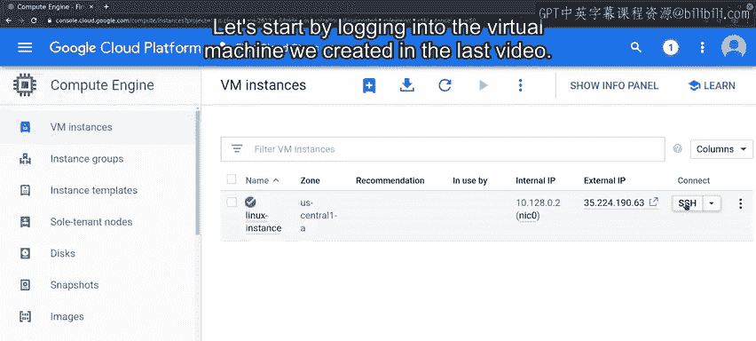
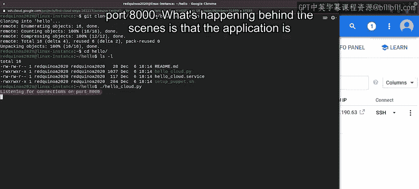
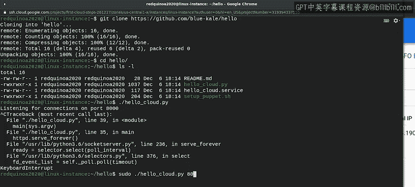
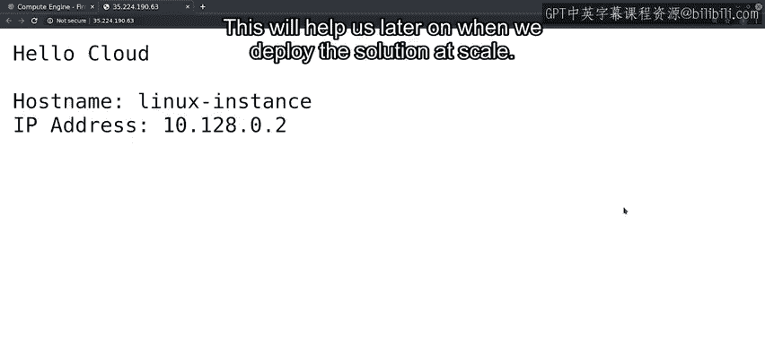
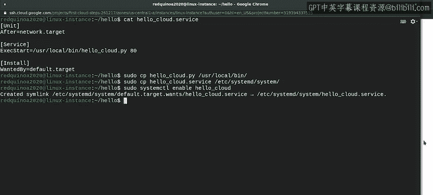
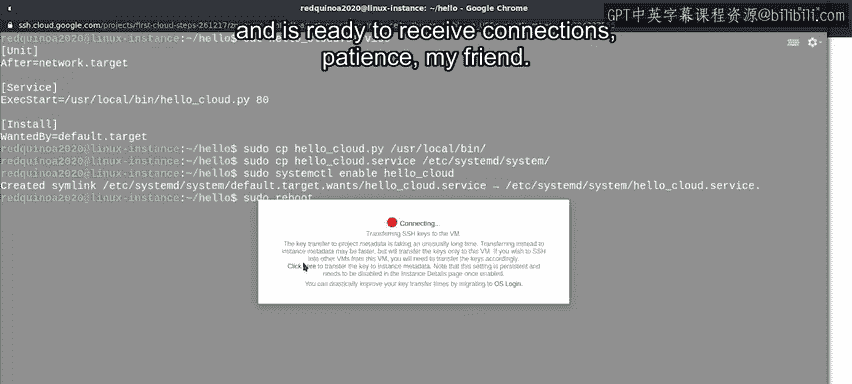
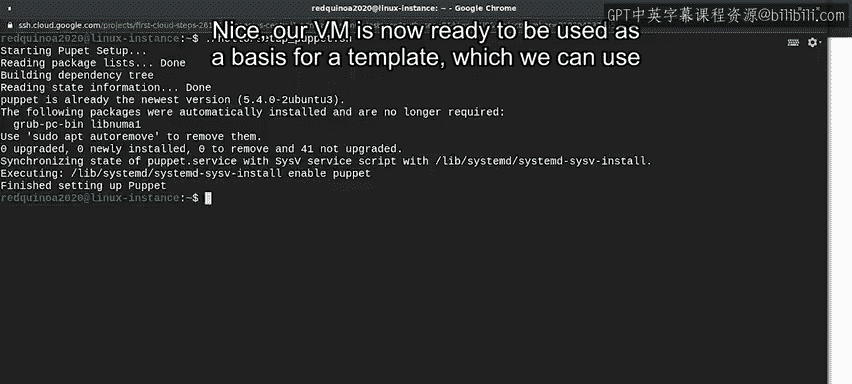

# 谷歌《用Python进行IT自动化办公3、4、5、6课（Git、debug、云端、实践）Google IT Automation with Python》中英字 - P125：8_在 GCP 中定制虚拟机.zh_en - GPT中英字幕课程资源 - BV1LW4y1F7XW

In our last video， we checked out how to create a single virtual machine in the cloud。 That's cool。

 but not too useful at cloud scale。 Remember， cloud scale deployments are often comprised of hundreds or thousands of machines。

 So creating a single server is only the beginning。

 Let's make some changes to that Vm so that we can deploy it at scale。😊，Once we're done。

 we'll use the instance that we configured as the base for our reference image。

 Remember that a reference image is just a file or configuration that we can deploy repeatedly and with automated tools。

 This is important because it lets us build scalable services very quickly。

 Let's start by logging into the virtual machine we created in the last video。

We'll use Git， which will let us clone the repository with the code for the app we want to deploy。

The repo we've cloned includes a very simple web serving application written in Python。

 Let's run it to see what happens。Our script prints a single line saying that it's listening for connections on port 8。

000。

What's happening behind the scenes is that the application is opening a socket and listening for HTTP connections on that port。

 In this case， it's running on port 8000。 And if we were running this locally on our machine。

 we could connect to that port。But this is running on a virtual machine in the cloud。

 which has a firewall and only a couple of ports enabled。What are our options。

 The script actually lets us pass the port number that it will open as a parameter。

We want it to run on the HTTP port that we configured in our last video， which is port 80。

And because this is a system port to let our application use it。

 we'll need to run it with admin privileges， so let's stop the running process now by press and control C and then run it again with pseudo and Pass 80 as the parameter。

Stop。Sudo。80。

Now we can visit the website served by our VM and see its contents。 Let's navigate to it。

Our Web app is extra symbol。 It just prints Hello Cloud to the web page generated when we make a request。

 It also prints the host name and I P address of the machine。

 This will help us later on when we deploy the solution at scale。

All right， we have a web serving application running on the HTP port。 That's nice。

 but we had to start the application manually， so this doesn't scale。

To get our application to start automatically， we need to configure this as a service。Fortunately。

 our repo already includes the service definition that we can use。

 Let's check out the contents of that file。😊，This is a system D file。

 which is the initializing system used by most modern Linux distributions。

Don't worry if you don't understand what's going on here。

You don't need to understand the details of this file to know how to deploy services to the cloud。

 Just notice that the configuration expects the script that we want to execute to be in slash user local bin。

We need to copy that file over to there and then copy the service file to slash EC system D System。

 which is the directory used for configuring system D services。And finally。

 we need to tell the system CTL command that we want to enable this service so that it runs automatically。

 Okay， now that we've done this， anytime this machine starts。

 it will start the web app that we've configured and we'll be able to see the content that we saw before。

 Let's try it out by triggering a reboot。

We've rebooted the machine。This will take a while to complete。

It tells us that the connection was lost and that we can ask our terminal to reconnect。

 This will take a bit of time until the machine has finished rebooting and is ready to receive connections。

Patience， my friend。Okay， our VM has rebooted。 We can check if our application is running by using the PSAX command to get a list of the running processes and filter it so we keep only the ones matching a pattern using the GP command。

 In this case， we'll use hellello as the pattern。Yay， our application is now running on startup。

 We're almost ready to turn our configured VM into a template for creating a lot more of them。

 But before we do that， we need to think about how we'll upgrade our web app when we want to make changes to it。

😊，There's a bunch of different options here。One option is to create a different reference image each time there's a new version of the app。

This would mean deleting all the old Vms and creating new ones based on the new image。

 Another option is to add a configuration management system to the images so that we can use that to manage any changes after the Vm's created。

 We already know how to manage changes with puppet。

 Remember our puppet master training from earlier videos。😊。

Let's install the puppet client in this instance so it's ready to use puppet in the future。Now。

 when we looked into the puppet server and client setup。

 we saw that there was a bunch of steps that we need to run on the client side to have it ready to apply the rules。

The reappo we cloned includes a script we can run， which will do the initial configuration for us。

 It will also set the puppet process to run automatically on boot。Let's run that now。Yes。Now。

 anytime this machine starts， it will serve our website。

And if we want to update that website's content， we can do that using our puppet infrastructure。Nice。

😡。

Our VM is now ready to be used as a basis for a template。

 which we can use to create as many instances as we need。 Up next。

 we'll check out how to create the template and how to create instances based on it。

