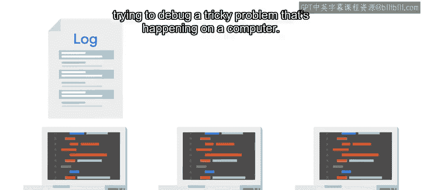
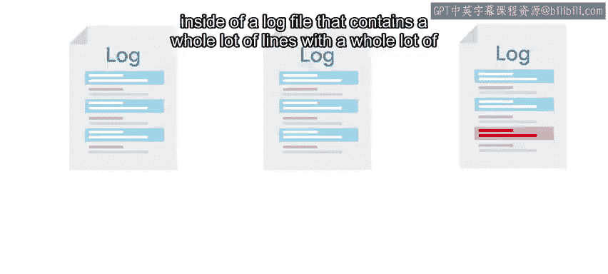

# 谷歌《用Python进行IT自动化办公1、2课（Python、控制操作系统）｜Google IT Automation with Python》中英字幕 - P126：52_什么是日志文件.zh_en - GPT中英字幕课程资源 - BV1gw411E7E1

🎼。う。

Whoa， you're on a roll working through these new techniques。So far。

 we've learned a bunch of new concepts that let us interact with the system。

We've learned how to read and write files， how to use regular expressions to process them。

 how to interact with the system shell， and how to execute commands in that environment。

That's really impressive。 So take a quick moment to think about how far you've come and about all the new cool stuff you'll be able to do by interacting with the system。

😊，Now we're going to take a look at how we can use these tools to help us with our day to day work。

In the next few videos， we'll dive into a concrete example centered around processing chunks of data。

 the kind of data you might find in assist log file or a web request log。

The different events that happen in programs that are running in a system and aren't connected to a terminal are usually written into log files。

 Lo files contain a lot of useful information， particularly when you're trying to debug a tricky problem that's happening on a computer On the flip side。

 Sometimes it can be overwhelming to try to find something inside of a log file that contains a whole lot of lines with a whole lot of things in them。

 So it's a good idea to learn how we can process these files and get our tools to extract information that we want out of them。

To do this， we'll go back to our knowledge of regular expressions。

Using ReEx's in our scripts gives us a great deal of flexibility when processing log files and other text data sources too。

In a script， we can program any kind of behavior we want so we can manipulate and process text data and get results we need。

We're going to show you how you can do this in the next couple of videos。All right。

 let's get started。