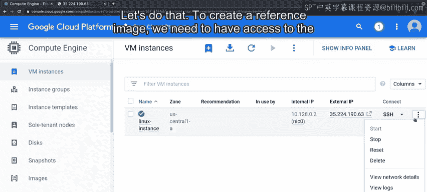
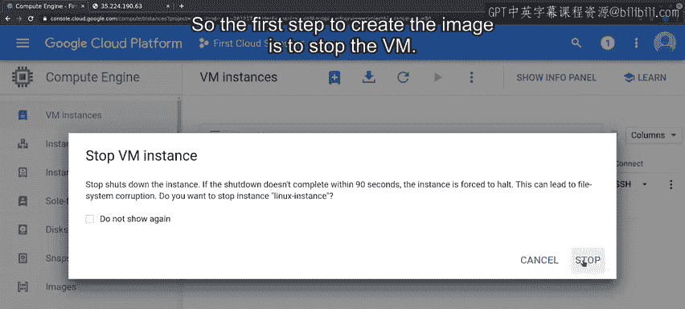
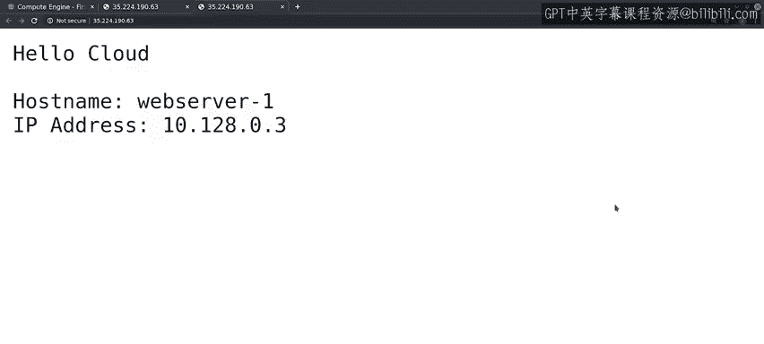
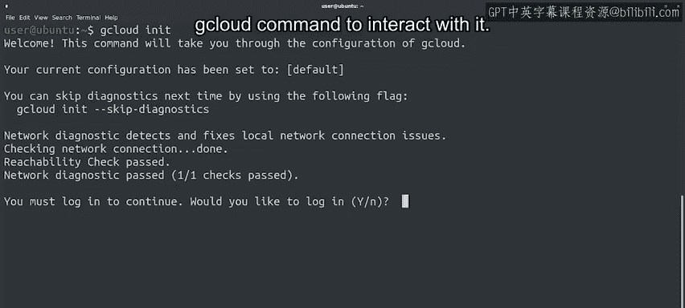
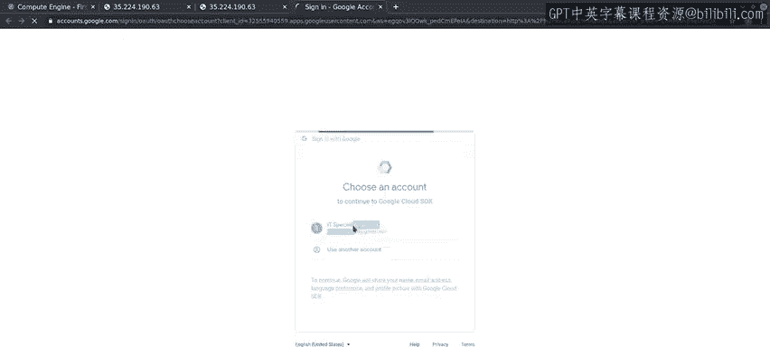
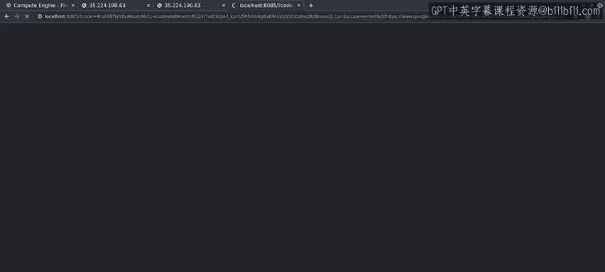
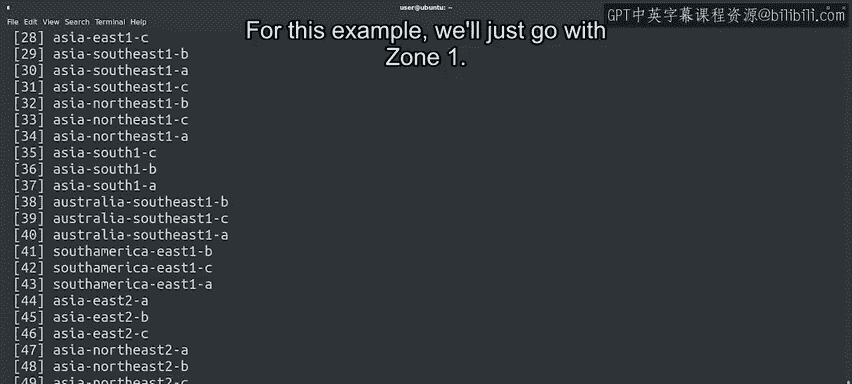

# 谷歌《用Python进行IT自动化办公3、4、5、6课（Git、debug、云端、实践）Google IT Automation with Python》中英字 - P126：9_模板化定制虚拟机.zh_en - GPT中英字幕课程资源 - BV1LW4y1F7XW

In the last few videos， we created a VM and then made sure that it was set up to serve our web app and to stay updated via a puppet。

 we can now use this VM as a basis for creating an instance template and then use the template to create a bunch of VMs based on it。

Let's do that。To create a reference image， we need to have access to the current virtual disk that's running on the computer。

 So the first step to create the image is to stop the Vm。

 It takes a while for the machine to shut down cleanly。 Once it's finished。

 we can click on the machine's name to see all its details， and then we can click on the boot disk。

These are the details of the disc attached to the Vm。

We can create a snapshot which is a full copy of the current state of the disk or an image which lets us create a template based on it。

 let's click createate imagem。Well call our image web serverver dash image。Here。

 the creation wizard shows that we'll be creating the image based on the Linux dashash instance disk。

 which is what we want。For this example， we'll leave the rest of the settings with the default values。

 Okay， let's create our image。This is now creating the image that we'll use for our template。

As we called out earlier， the tools will keep most of the contents of the image but remove things that should be different across VNs。

 Once it's finished creating， it shows us the list of all images that we can access。As you can see。

 this is a long list that includes a bunch of stuff along with our image。

 The other images are public images that we can use to deploy different types of VMs。 Allright。

 we're now ready to create our instance template to do that。

 We'll go to the instance template option and then click createate new In template。😊，As usual。

 we're shown a wizard that includes a bunch of different options that we can set。

We'll keep most of the defaults and change only a couple of things。 We'll name our template。

 web server dash template。We'll change the boot disk to use the image we've created。In this screen。

 we can see the list of all the available images。 By default。

 the list shows the official operating system images provided by the platform。For our template。

 we want to use the custom image we've created。And finally。

 we'll also want to enable HTTP access to the instances created with this template。That's it。

 we're ready to create our new template。This takes a little bit of time to create。 Once it's done。

 we can create instances based on our images。 We'll do it once more from the web interface。

 and then we'll check out how to do it from the command line。

 Let's go back to the VM instances entry and then click on create instance。😊，This time。

 instead of creating an instance from scratch， we'll use the template we've prepared。

We'll name our instance web server1， everything else we' leave as is。

Check out how it says that it will use the base image we selected and that HTTP traffic will be allowed。

Al right， we've created our second VM based on the template。

 We didn't have to change any options because all of the values were already preselected in the template。

And the web app that we want is ready to run without us having to configure anything。

 Let's check that out。

Yes， our application is already running successfully on this machine。 This is great。

 but it's still a bit cumbersome if we want to create 10 Vms like this one。😊。

For a batch action like that， it's better to use the command line interface。

 So let's do that to interact with Google Cloud。 we'll be using the GC command。

 We've already installed the G cloud command on this machine。

 You'll find pointers on how to install G cloud on different platforms in the next reading。

 We'll start by running the G cloud init command， which sets up the authentication mechanisms between this computer and Google Cloud。

We need to authenticate to the Google Cloud system to be able to use the GCud command to interact with it。

 Let's say yes here。

This opened a new tab in our browser that we can use to authenticate with our account。

Let's follow the process here and authenticate。

We're now logged into our cloud account。 we can choose which will be our default project。

 Let's select one here。We've selected the default project on top of that。

 the initializing wizard lets us select the default region and zone。

It's a good idea to select this as the commands that we use in the future will use that zone and region if we don't specify a different one。

This is a long list。 There are a lot of different zones available for our instances。

As we called out earlier， when selecting where to Run your services。

 you should go with the one that's closest to you。For this example， we'll just go with zone one。

Once we've completed this authentication， we can use the GCud command to operate on our cloud project。

We can modify the VMs we've created， create new ones， delete some of the existing ones。

 and a lot more。For our example， we'll use it to create five additional VMs， it goes like this。

First we call GCud， then we pass the compute parameter that's used for everything that has to do with virtual machines。

Then we pass the instances parameter as we'll be dealing with the VM instances themselves。

So then we pass Create as we want to create instances。

We'll say that we want to use the source instance template called Web Server Dash templatelate。

And finally， we'll give the name of the instances that we want to deploy。 Let's call them WS1， WS2。

 WS3， WS4， and WS5。It takes only a short while until all instances are created。

 This is definitely much faster than going through the web interface and much easier to automate through our scripts。

😊，And with that， we've seen how we can create a virtual machine， customize it。

 create a template out of it， and use that template to create a bunch of new identical virtual machines。

I hope you're starting to see how useful this can be when creating new IT deployments。Up next。

 there's a reading where you'll find a bunch more information about all the tools that we've demonstrated。

 and then a quick quiz to practice everything that you've just learned。

