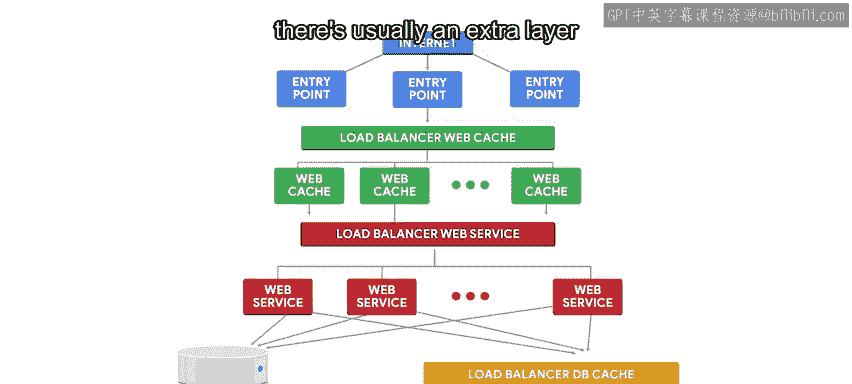

# 谷歌《用Python进行IT自动化办公3、4、5、6课（Git、debug、云端、实践）Google IT Automation with Python》中英字 - P127：10_云端大规模部署.zh_en - GPT中英字幕课程资源 - BV1LW4y1F7XW

Over the past few videos， we've checked out some of the features we can use when running services in the cloud。

As we called out before， the biggest advantage of using cloud services is how easily we can scale our services up and down Now。

 to make the most out of this advantage， we need to do some preparation。

We'll set up our services so that we can easily increase their capacity by adding more nodes to the pool。

These nodes could be virtual machines， containers or even specific applications。

 providing one service。 Whenever we have a service with a bunch of different instances serving the same purpose。

 we'll use a load balancer。 A load balancer ensures that each node receives a balanced number of requests。

When a request comes in， the load balancer picks a node to serve the response。

There's a bunch of different strategies as the load balancer uses to select the node。

The simplest one is just to give each node one request called roundund Robbin。

More complex strategies include always selecting the same node for requests coming from the same origin。

 selecting the node that's closest to the requester and selecting the one with the least current load。

 As we called out， instance groups like these are usually configured to spin up more nodes when there's more demand and to shut some nodes down when the demand falls。

This capability is called auto scaling。 It allows the service to increase or reduce capacity as needed。

 while the service owner only pays for the cost of the machines that are in use at any given time。

Since some nodes will shut down when demand is lower。

 their local disks will also disappear and should be considered ephemeral or short lived。

 If you need data persistence， you'll have to create separate storage resources to hold that data and connect that storage to the nodes。

 That's why the services that we run in the cloud are usually connected to a database。

 which is also running in the cloud。This database will also be served by multiple nodes behind a load balancer。

But this is typically managed by the cloud provider using the platform as a service model。

To check out how this works in practice， let's look at an example of a web application with a lot of users。

 When you connect to a site through the internet， your web browser first retrieves an IP address for the website that you want to visit。

This IP address identifies a specific computer， the entry point for the site。Commonly。

 there will be a bunch of different entry points for a single website。

This allows the service to stay up， even if one of them fails on top of that。

 it's possible to select an entry point that's closer to the user to reduce latency in a small scale application。

 this entry point could be the web server that serves the pages， and that would be it。

For large applications where speed and availability matter。

 there will be a couple of layers in between the entry point and the actual web service。

 The first layer will be a pool of web caching servers with a load balancer to distribute the requests among them。

One of the most popular applications for this caching is called varnish， but of course。

 it's not the only one。The engine X webserving software also includes this caching functionality。

 and there's a bunch of providers that do webcaching as a service like Cloudflare and fastly。

 No matter the software used， the result is basically the same。 When a request is made。

 the caching servers first checked if the content is already stored in their memory。 If it's there。

 they respond with the contents。 If it's not， they ask their configured backend for the content and then store it so that it's present for future requests。

 This configured backend is the actual web service that generates the web pages for the site。

 and it will also normally be a pool of nodes running under a load balancer。😊。

To get any necessary data， this service will connect to a database。

 but because getting data from a database can be slow。

 there's usually an extra layer of caching specific for the database contents。

The most popular applications for this level of caching are memcash D and Redis。 As you can see。

 there's a lot of different nodes in this scheme。 Fortunately。

 once you've done your homework and prepared your setup。

 you can rely on the capabilities offered by the cloud provider to automatically scale the system up and down as necessary。

 The infrastructure will take care of adding and removing instances， distributing the load。

 making sure that each geographical region has the right capacity and a bunch more things。 Up next。

 we'll talk about some of the things we can do when we need to have more control over the instances that are running our service。

😊。