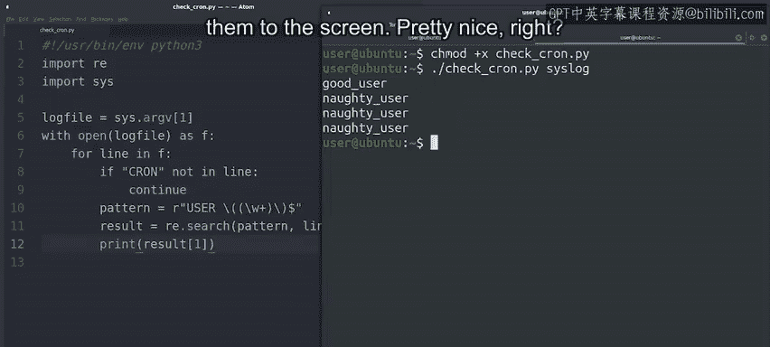

# 谷歌《用Python进行IT自动化办公1、2课（Python、控制操作系统）｜Google IT Automation with Python》中英字幕 - P127：53_使用正则表达式过滤日志文件.zh_en - GPT中英字幕课程资源 - BV1gw411E7E1

When working with log files in a script， our first step is usually to open them so our code can access their contents。

We've discussed various methods of operating on files。

 The usual technique is to call the open function， which returns a file object and then iterate through each of its lines using a for loop。

For example， to open a file received as a parameter of our script， we can use code like this one。

Remember that for performance reasons， when files are large。

 it's generally a good practice to read them line by line instead of loading their entire content into memory。

For our example， let's say the log file contains these messages。

The server that generates this log file has been acting strangely。

 and we suspect it's due to a Cr job started by one of the system administrators。

You may remember that Chon jobs are used to schedule scripts on Uni based operating systems。

To find out what's happening with the server， we want to audit the log files and see exactly who's been launching Chrome jobsbs。

By looking at the sample log， we can see that the lines that will be most interesting to us are the ones that contain the Chron substring。

 These lines also show the user who started the Chon job wrapped in parentheses With this info。

 we can ignore any line without the Chon substr in it。We can check for this using the N keyword。Here。

 we're using the continue keyword， which tells our loop to go to the next element。

So if the line doesn't contain a string that we're looking for。

 we'll skip it and go to the next line。Once we know we're processing the right log line。

 we can use our knowledge of regular expressions to extract the username。

We can do this in a bunch of different ways。 In this example， we'll use escape characters。

 capture groups， and the end of string anchor。Before we add the expression to our script。

 we'll construct it and test it out in an interpreter。Let's take a closer look at this expression。

Since the username is found at the end of the log line。

 we use the dollar sign anchor to only match text that is at the end of the line to find the username。

 we look for the word user followed by a string wrapped in parentheses。

 as that's how these lines are structured。This means that we need to escape those parentheses with a backslash。

And since we want to extract the actual username， we use another couple of parentheses to create a capturing group。

And for the username itself， we're matching any alphanumeric characters by using backslash W+。

With that cleared out， let's test it out with a sample line。

Tisk disk looks like we've got a knotaughtty user。On the plus side。

 it seems that our regular expression works correctly。We can now use expression in our code。

Let's add it to our script。Okay， our script should be able to process the log file that we showed earlier。

Let's save it， make it executable and run it， passing the example cis log file that we showed。

Our script is shaping up nicely。We've located each user that started a Chon job in our log file and printed them to the screen。

Pretty nice， right？We took a few steps to craft this script。If any of these steps were unclear。

 review the video and practice on your own until you get it。Up next。

 we'll do a bit more processing with those results。

