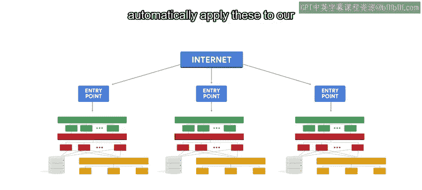

# 谷歌《用Python进行IT自动化办公3、4、5、6课（Git、debug、云端、实践）Google IT Automation with Python》中英字 - P128：11_什么是编排.zh_en - GPT中英字幕课程资源 - BV1LW4y1F7XW

Throughout this course and the entire program， we've been talking about automation。As a reminder。

 automation is the process of replacing a manual step with one that happens automatically。

In the past few videos， we've mentioned a few ways that let us automate the creation of cloud instances。

 We can use templating to create new virtual machines。

 We can run a command line tool that automatically creates new instances for us。

 or we can choose to enable auto scaling and let the infrastructure tools take care of that。

 depending on the demand。 But all of this automatic creation of new instances needs to be coordinated。

 so that the instances correctly interact with each other。

 And that's where orchestration comes into play。 Ortion is the automated configuration and coordination of complex I systems and services。

😊，In other words， orchestration means automating a lot of different things that need to talk to each other。

 This will always include a lot of different automated tasks and will generally involve configuring a bunch of different systems。

 Ta the example of the website infrastructure that we saw in our last video。

 We've seen how we can automate the creation of each instance in the system。Now。

 say you wanted to deploy a new copy of the system in a separate data center where you have no instances yet。

 you'll need to also automate the whole configuration of the system。

 the different instance types involved， how each instance finds the others。

 what the internal network looks like and so on， so how does this work？

The key here is that the configuration of the overall system needs to be automatically repeatable。

There's a bunch of different tools that we can use to do that。

These tools typically don't communicate with the cloud systems through the web interface or the command line。

They normally use an application programming interface or API that lets us interact with the cloud infrastructure directly from our scripts。

 We'll talk more about other APIs in a later course。In the case of cloud provider APIs。

 they typically let you handle the configuration that you want to set directly from your scripts or programs without having to call a separate command。

This combines the power of programming with all of the available cloud resources。

 The APIs offered by the cloud providers let us perform all the tasks that we mentioned earlier。

 like creating， modifying and deleting instances， and also deploying complex configurations for how these instances will talk to each other。

 All of these actions can also be completed through the web interface or the command line。

 but doing them from our programs gives us extra flexibility。

 which can be key when automating complex setups。 say you want to deploy a system that combines some services running on a cloud provider and some services running on premise。

😊，This is known as a hybrid cloud setup。Where only part of the services are in the cloud。

The setup is super common in the industry right now。

 Ortion tools can be a pretty useful tool to make sure that both the on premise services and the cloud services know how to talk to each other and are configured with the right settings。

 Go back to the website example that we discussed earlier to make sure the service is running smoothly。

 We should set up monitoring and alerting。This lets us detect and correct any problems with our service before users even notice this is a critical piece of infrastructure。

 but setting it up correctly can take quite some time by using orchestration tools。

 we can automate the configuration of any monitoring rules that we need to set。

 which metrics we want to look for， when we want to be alerted and so on。

 and automatically apply these to our complete deployment。

 no matter which data center the services are running in。😡。

This might seem like a super complex task， but fortunately。

 there are tools available to make our lives easier。 We'll talk about those in our next video。

