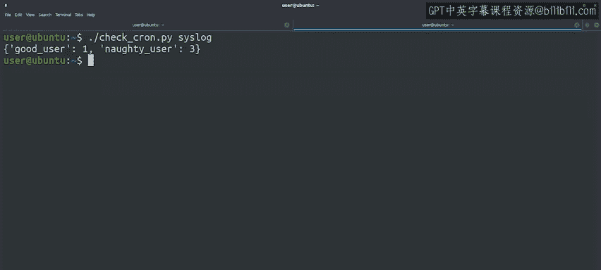

# 谷歌《用Python进行IT自动化办公1、2课（Python、控制操作系统）｜Google IT Automation with Python》中英字幕 - P128：54_理解数据.zh_en - GPT中英字幕课程资源 - BV1gw411E7E1

In the last video， we wrote a script that processed a log file and extracted the names of each user who had started a Chon job in the machine that we were investigating。

This can be really helpful， but there's more information that we might need。To improve our output。

 it would be a good idea to have account of how many times each username appears in our log。

Can you think of what we can use to do that？If you guess a dictionary， then you're right。

As we've seen in earlier examples， dictionaries are a great structure to use when we want to count appearances of strengths。

We'll store the username as a keys of a dictionary and we'll use the value to count the number of times that each username appears in the file。

To do this in fewer lines， we'll use the get method that we saw earlier in another video。

Let's try it out in the interpreter before adding it to our code。First。

 we'll create an empty dictionary using curly brackets。Then we'll set the variable name as good user。

 for example。And now we'll set the value associated with the key as one more than the current value。

 and we'll use the get method to get the current value like this。Again。

 we're taking the current value in the dictionary but passing a default value of zero so that when the key is imp present in the dictionary。

 we get a default value。We then add one and set it as a new value associated with that key。

Let's check out the current contents of the dictionary。Great。

 and what happens if we do the same operation again。Fantastic。

 we see that this operation works successfully， both when the key is already in the dictionary and when it isn't。

😊，Now let's add the source our script we'll need to initialize the empty dictionary at the beginning of our code。

And before we add any values to the dictionary， we want to check that we actually got a match to our regular expression。

Do you remember how we can do that？We can check if the result variable is none。

We'll use that same technique as before and use the continue keyword if the result is none。Okay。

 we can now add the values to the dictionary as we process the file instead of printing them。

To do that， we'll define a name variable that will store the captured group。

And then we'll use that one as a key for a dictionary。And finally。

 let's print the resulting dictionary once we're done going through the file。Nice。

 our modified script is ready。 Let's try it out with our test file。Cool。

Our script now allows us to very quickly see who's been starting Chon jobs in the server and at what frequency。

Now we can use the information to investigate the issue more deeply。

It's pretty cool to see how all these different ways of managing data and processes come together in a real world example。

 isn't it。😊，Nice job。Hopefully， these examples are helping you see how your Python programming skills can help you quickly get the information that you want when you're debugging a problem。

We'll keep expanding on this topic in this and later courses。Up next。

 a quiz to let you put all this new knowledge to work。

