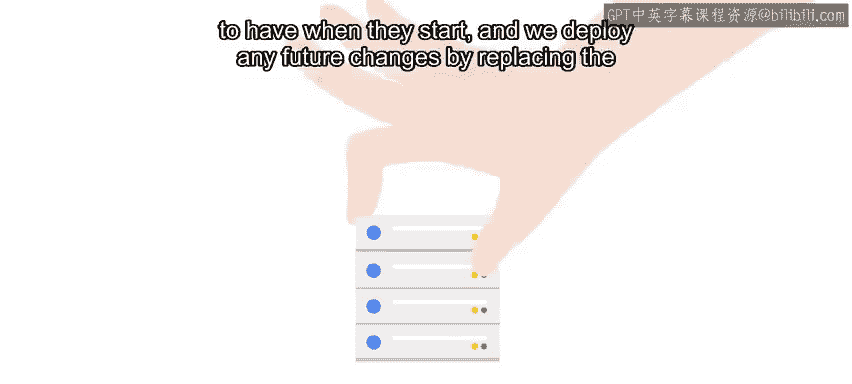

# 谷歌《用Python进行IT自动化办公3、4、5、6课（Git、debug、云端、实践）Google IT Automation with Python》中英字 - P129：12_基础设施即代码.zh_en - GPT中英字幕课程资源 - BV1LW4y1F7XW

In our last video， we talked about how we need to orchestrate complex cloud setups。

This includes handling a bunch of different nodes with different workloads。

 managing the complexity of deploying a hybrid setup or modifying deployments across several data centers Back at the beginning of the course。

 we talked about infrastructure as code。And we called out that storing our infrastructure in a code like format lets us create repeatable infrastructure。

And that using version control for the storage means that we can keep a history of what we've done and easily roll back mistakes。

 These principles also apply to cloud infrastructure。The way we store it might be a little different。

 depending on the tools that we use， but we'll still be storing this configuration in a code like format using version control to keep track of the changes。

 This lets us manage large scale solutions with a small team。

We can very quickly have an idea of what the deployment looks like by looking at the configuration。

We can try new things out and roll back if anything goes wrong。

 We can look at the history of changes to figure out why a specific change was made and much more。

 Most cloud providers offer their own tool for managing resources as code。

 Amazon has cloud formation。 Google has cloud deployment manager。

 Microsoft has Azure resource manager。 and Openstack has heat orchestration templates。

 These tools are specific to the cloud provider， which means it can be complex and cumbersome to move to a different provider or combine a cloud deployment with an on premisem deployments。

 An option that's becoming really popular in the orchestration field is called Terraform。

Similar to Puppet，  Terraform uses its own domainspecific language。

 which lets us specify what we want our cloud infrastructure to look like。

 The cool thing about terraform is that it knows how to interact with a lot of different cloud providers in automation vendors。

 So you can write your terraform rules to deploy something on one cloud provider and then use very similar rules to deploy the service to a different cloud provider。

😊，Terraform uses each cloud provider's API to accomplish this。

 This keeps you from having to learn a new API when moving to a different cloud provider and lets you focus on the infrastructure design。

 We saw in earlier videos how we can have a puppet rule that specifies that a computer should install a given package and that the local puppet agent analyzes the computer and decides which installation mechanism to use depending on the operating system。

 the specific Linux distro and so on。😊，A similar thing happens with terraform。

 The rules that define the resources like the Vms or containers to use will use specific values related to the cloud provider。

 like selecting which machine type to use or in what region to deploy it。

But a lot of the overall configuration is independent of the provider and can be reused if we decide to move our configuration to a different provider。

 or we want to use a hybrid setup。And， of course，  Terraform isn't the only option。

 Puppet itself also ships with a bunch of plugins that can be used to interact with the different cloud providers to create and modify the desired cloud infrastructure。

Finally， let's spend a moment talking about the contents of the nodes or instances managed by the orchestration tools。

 when dealing with nodes in the cloud， there are basically two options。

 Either they're longli and their contents need to be periodically updated。

 or they are shortlive and updates are made by deleting the old instances and deploying new ones。

Long lived instances are typically servers that are not expected to go away。

 Things like your company's internal mail server or internal document sharing servers will manage these instances using a configuration management system like puppet。

 which can deploy any necessary changes to the machines while they're running。

 This keeps them updated to the latest state。On the flip side。

 short lived instances come and go very quickly。 For these cases。

 it makes less sense to apply changes while they're running。 Instead。

 we normally apply the configuration that we want the instances to have when they start。

 and we deploy any future changes by replacing the instances with new ones。

We can still use puppet for the initial setup， but we don't need to run the agent periodically。

 only at the start。 If all this sounds super complex， that's okay。

 There's a lot to learn about cloud orchestration。 And many of these concepts will make more sense once you've tried them out。

 Up next， we've gathered some additional info you can use。 if you want to find out more。

 Then there's a quick quiz to put all of these concepts together。

