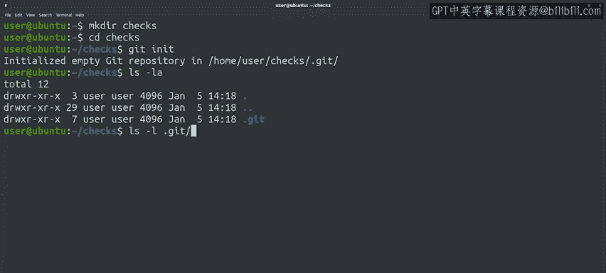
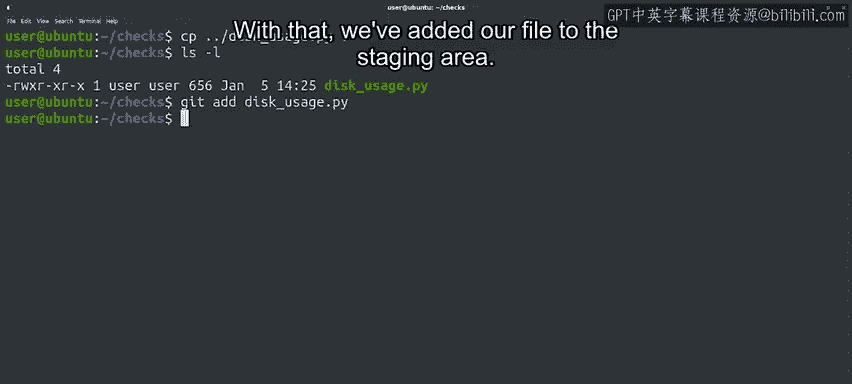
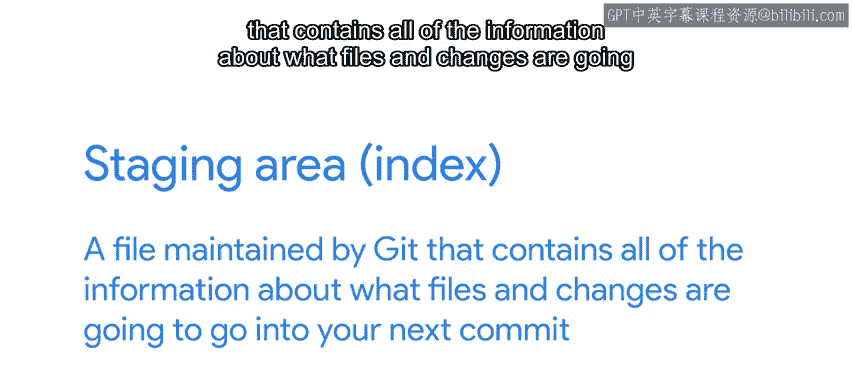
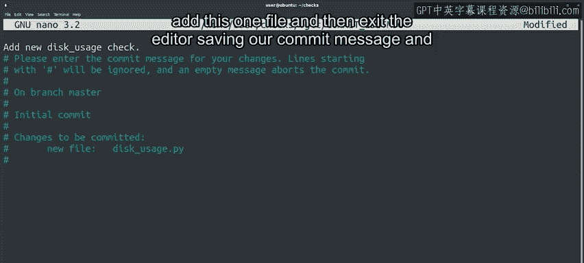

# 谷歌《用Python进行IT自动化办公3、4、5、6课（Git、debug、云端、实践）Google IT Automation with Python》中英字 - P12：11_Git 入门.zh_en - GPT中英字幕课程资源 - BV1LW4y1F7XW

When starting with Git， there are a bunch of concepts that we need to learn to understand how things are organized and how our files attract。

Over the next few videos， we'll introduce some of the main gi concepts。

 If any of these seem confusing at first， don't panic。

We'll dive into all of them as we expand our get knowledge。

 Let's start by setting some basic configuration。 Remember when we said that a Vc S tracks who made which changes。

For this to work， we need to tell get who we are。We can do this by using the Git Config command and then setting the values of user。

 email and user。 name to our email and our name。Like this。

We use the D dashash Global flag to state that we want to set this value for all Git repositories that we use。

 We could also set different values for different repositories。With that done。

 there are two ways to start working with a git repository。

 We can create one from scratch using the Git in it command。

 or we can use the Git clone command to make a copy of a repository that already exists somewhere else。

We'll talk about remote repositories later in the course。For now。

 let's start by creating a new directory and then a git repository inside that directory。

So when we run Git in it， we initialize an empty git repository in the current directory。

The message that we get mentions a directory called dot Git。

We can check that this directory exists using the LSL command。

 which lists files that start with a dot。We can also use the Llfl。

git command to look inside of it and see the many different things it contains。

This is called a Git directory， you can think of it as a database for your Git project that stores the changes and the change history。

We can see it contains a bunch of different files and directories。

 We won't touch any of these files directly。 We'll always interact with them through Git commands。

 So whenever you clone a repository， this Git directory is copied to your computer。

Whenever you run Git in it to create a new repository， like we just did。

 a new Git directory is initialized。The area outside of the Git directory is the working tree。

The working tree is the current version of your project。

 You can think of it like a workbench or a sandbox where you perform all the modification you want to your file。

This working tree will contain all the files that are currently tracked by Git and any new files that we haven't yet added to the list of track files。

Right now， our working tree is empty。 Let's change that by copying the disk usage。

 that pie file that we saw in an earlier video into our current directory。Okay。

 we now have a file in our working tree， but it's currently untracked by Git to make git track our file will'll add it to the project using the Git Add command。

 passing the file that we want as a parameter。With that， we've added our file to the staging area。

 The staging area， which is also known as the index。

 is a file maintained by Git that contains all of the information about what files and changes are going to go into your next commit。

We can use the Git status command to get some information about the current working tree and pending changes。

 Let's check that one out。We see that our new file is marked to be committed。

This means that our change is currently in the staging area。

To get it committed into the Git directory， we run the Git commit command。 Let's try that now。

When we run this command， we tell Git that we want to save our changes。

 It opens a text editor where we can enter a commit message。 If you want。

 you can change the editor used to your preferred editor。In our case。

 this computer has nanoconfired as a default editor。

The text that we get tells us that we need to write a commit message。

And that the change to be committed。Is the new file that we've added。

We'll deep dive into commit messages later for now， let's enter a simple description of what we did。

 which was to add this one file。And then exit the editor， saving our commit message。

And with that， we've created our first Git commit w up next。

 we'll talk more about the life cycle of each track file in a Git repository。

