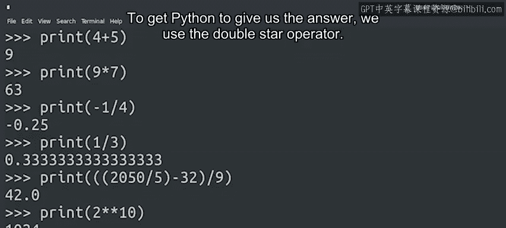

# 谷歌《用Python进行IT自动化办公1、2课（Python、控制操作系统）｜Google IT Automation with Python》中英字幕 - P12：11_Python 可以作为你的计算器.zh_en - GPT中英字幕课程资源 - BV1gw411E7E1

There's a ton of things that you could do with Python。 and you'll learn many of them in this course。

 But before we dive into complex subjects， let's have some fun with another simple task that you could do with Python。

 We're going to make Python our calculator。 And let's start with something easy。😊，So，4 plus 5 is 9。

9 times 7 is 63。-1 divided by 4 is -。25 easy。Repeating or periodic numbers are printed in a longer format。

 Let's try one divided by 3。In math theory， when one is divided by 3。

 the digit3 repeats forever after the decimal point。Of course。

 it's hard to display something that repeats forever。

 So instead we have a representation showing lots of decimal places。Not too hard， right？

Let's give the computer something a bit trickier。 Let's say we want to divide 2050 by5。

 then subtract 32 and then divide the result by9。To do this。

 we'll need to use parentheses just as we do in typical math problems。

You can also use Python to get squares， cubes， or any power of n of a number。 For example。

 let's say we want to find out what 2 to the power of 10 is to get Python to give us the answer。

 we use the double star operator。

If you're starting to worry that this is becoming an algebra course， relax。

 we're not going to do anything more complex than what we've just seen。And if you're thinking。

 why would I use Python instead of just a normal calculator？That's a valid question。

 experimenterimenting in this way， you get familiar with the language's math capabilities。

 And in I T jobs， there are many tasks that require you to use math calculations。

 You might need to count how many times a certain word appears in a text or work out the average time it takes for an operation to complete or how much you have to compress an image to fit in certain size constraints。

 Whatever you need to calculate writing a script can help you do it faster and with more accuracy。

 So you need to know what mathematical operations are available to you。

 Python actually has a lot more advanced numeric capabilities that are used for data analysis。

 statistics， machinech learning and other scientific applications。

 We won't get into these in this course。 but if you want to learn more about them on your own。

 there's a wealth of online resources available。 Next up。

 a cheat sheet to help you with programming concepts that we've just covered。 And after that。

 it's time for another quiz。 This time， with a few small coding exercises。 Remember。

 if something isn't clear， you can rewatch the videos as many times as you need。😊，Ready。

 you've got this。