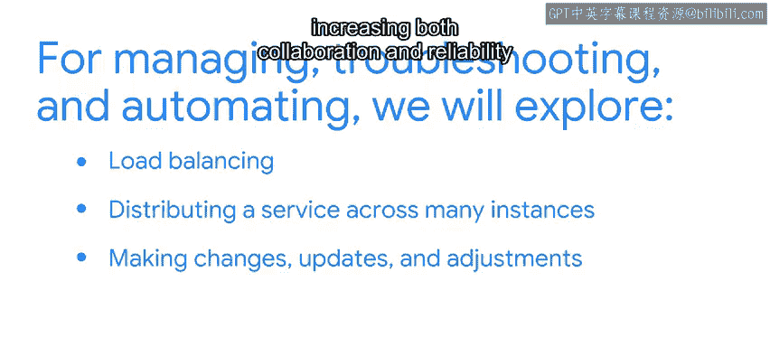

# 谷歌《用Python进行IT自动化办公3、4、5、6课（Git、debug、云端、实践）Google IT Automation with Python》中英字 - P130：13_大规模管理云实例.zh_en - GPT中英字幕课程资源 - BV1LW4y1F7XW

Welcome back！Now that you're familiar with some of the basics of the cloud and cloud services like Google Cloud providervider or GCP。

 we should spend a little time talking about using and managing cloud instances。

If you're working in I T for a small company， you may not do very much with the cloud outside of archiving and storing records and financial information in a protected location。

If that's the case， you might get everything you need from the prepackaged applications available through your cloud services provider。

 But for larger and growing companies， this cursory level of cloud cover may not be enough。

You may need to begin developing your own applications based on the platforms and infrastructure models from cloud providers。

Developing your own apps gives your I team more control and flexibility。

 allowing you to create and customize applications to better meet the company's needs and goals。

 but it also brings new challenges。You and the rest of your team will need to。

Figure out how different applications and components work together and separately。

Make sure every tool and application runs reliably every time。😡。

Know how to troubleshoot problems and compatibility issues if and when they come up and。

Define an account for scaling up or scaling back services based on the most current workflows。

 This course is designed to help you understand， plan and respond to these issues。

We've already touched on the various cloud services that are available。

 how to evaluate them based on your company's needs and migration and scaling in terms of building or adapting software in the cloud。

 We've taken a look at virtual machines， Vms， orchestration and deployments within the cloud infrastructure。

As we move forward in the course， you have the opportunity to learn about managing and troubleshooting applications you've adapted or created。

 as well as automating their use。For managing， troubleshooting and automating。

 we will explore load balancing。Distributing a service across many instances。Making changes。

 updates and adjustments without breaking the applications or the relationships between them。

 increasing both collaboration and reliability。

And examining some of the limitations you might encounter running software applications in the cloud。

We also want to manage your expectations and provide needed context。

 especially when something doesn't work out the way it's supposed to。

Sometimes software and even systems fail。That's okay。

 The important thing here is to figure out why a problem or an issue occurred and determine how best to fix it。

 To that end， course will also give you access to tips and procedures you can use to respond to and troubleshoot issues that might arise working with services in the cloud。

 And later， you'll even have the opportunity to debug and fix common problems。

That's knowledge you can apply throughout your career。Finally。

 we'll wrap up by introducing some best practices， such as measuring your operations with a monitoring system and setting up alerts so you're automatically notified if things don't go as planned。

😊，Excited， maybe even a little nervous。 There's no need to be。

 We'll be with you every step of the way。Plus， the discussion prompts and forums will allow you to share ideas。

 questions and victories with your peers along the way。Feel better。😊，Good。

 because we've still got a lot more ground to cover。Let's jump back in。

