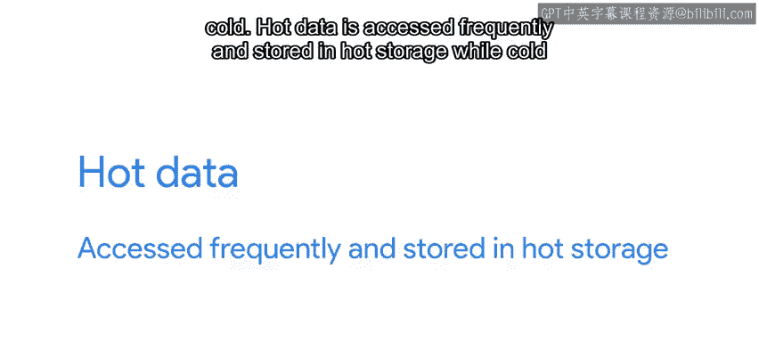

# 谷歌《用Python进行IT自动化办公3、4、5、6课（Git、debug、云端、实践）Google IT Automation with Python》中英字 - P131：14_在云端存储数据.zh_en - GPT中英字幕课程资源 - BV1LW4y1F7XW

Almost all IT systems need to store some data。 Sometimes it's a lot of data。

 Sometimes it's only bits and pieces of information。

 Cloud providers give us a lot of storage options， Pick the right solution for data storage will depend on what kind of service you're building you'll need to consider a bunch of factors like how much data you want to store what kind of data that is what geographical locations you'll be using it in。

 whether you're mostly writing or reading the data how often the data changes or what your budget is。

 This might sound like a lot of things to consider。

 but don't worry it's not that bad We check out some of the most common solutions offered by cloud providers to give you a better idea of when to choose what when choosing a storage solution in the cloud。

 you might opt to go with traditional storage technologies like block storage。

Or you can choose newer technologies like object or blob storage。

 Let's check out what each of these mean。As we saw in an earlier video。

 when we create a VM running in the cloud， it has a local disk attached to it。

These local disks are an example of block storage。 This type of storage closely resembles the physical storage that you have on physical machines using physical hard drives Block storage in the cloud acts almost exactly like a hard drive。

The operating system of the virtual machine will create and manage a file system on top of the block storage just as if it were a physical drive。

There's a pretty cool difference， though。These are virtual disks so we can easily move the data around for example。

 we can migrate the information on the disk to a different location。

 attach the same disk image to other machines， or create snapshots of the current state。

All of this without having to ship a physical device from place to place our block storage can be either persistent or ephemeral。

 persistent storage is used for instances that are longli and need to keep data across reboots and upgrades。

On the flip side， ephemeral storage is used for instances that are only temporary and only need to keep local data while they're running。

Ephemeral storage is great for temporary files that your service needs to create while it's running。

 but you don't need to keep。This type of storage is especially common when using containers。

 but it can also be useful when dealing with virtual machines that only need to store data while they're running。

In typical cloud setups， each VM has one or more disks attached to the machine。

 The data on these disks is managed by the OS and can't be easily shared with other VMs。

 If you're looking to share data across instances you might want to look into some shared file system solutions that cloud providers offer using the platform as a service model when using these solutions that data can be accessed through network file system protocols like NFS or CFs。

 This lets you connect many different instances or containers to the same file system with no programming required block storage and shared file systems work fine when you're managing servers that need to access files。

But if you're trying to deploy a cloud app that needs to store application data。

 you'll probably need to look into other solutions like Object storage。

 which is also known as blob storage Object storage lets you place and retrieve objects in a storage bucket。

😡，These objects are just generic files like photos or cat videos encoded and stored on disk as binary data。

 These files are commonly called blobs， which comes from binary large object。And as we called out。

 these blobs are stored in locations known as buckets。

Everything that you put into a storage bucket has a unique name。 There's no file system。

 You place an object into storage with a name。 And if you want that object back。

 you simply ask for it by name。 to interact with an object store。

 You need to use an API or special utilities that can interact with the specific object store that you're using on top of this。

 We've called out in earlier videos that most cloud providers offer databases as a service。

 These come in two basic flavors。 SQl and no SQl SQL databases。

 also known as relational use the traditional database format and query language。

 Data is stored in tables with columns and rows that can be indexed and we' retrieve the data by writing SQL queries。

 A lot of existing applications already use this model。

 So it's typically chosen when migrating an existing application to the cloud。

 No SQL databases offer a lot of advantages related to scale。

They're designed to be distributed across tons of machines and are super fast when retrieving results。

 but instead of a unified query language， we need to use a specific API provided by the database。

 This means that we might need to rewrite the portion of the application that accesses the DB。

When deciding how to store your data， you'll also have to choose a storage class。

Cloud providers typically offer different classes of storage at different prices。

Variables like performance， availability， or how often the data is accessed will affect the monthly price。

 The performance of a storage solution is influenced by a number of factors， including throughput。

 iOs and latency。Let's check out what these mean The throughput is the amount of data that you can read and write in a given amount of time。

The throughput for reading and writing can be pretty different For example。

 you could have a throughput of one gigabte per second for reading and 100 megabytes per second for writing。

 iOs or input output operations per second。😡，Measures how many reads or reads you can do in one second。

 no matter how much data you're accessing。Each read or write operation has some overhead。

 so there's a limit on how many you can do in a given second。

 and latency is the amount of time it takes to complete a read or write operation。

This will take into account the impact of IOs， throughput。

 and the particulars of the specific service。Readed latency is sometimes reported as the time it takes a storage system to start delivering data after a read request has been made。

 also known as time to first Bte。While right latency is typically measured as the amount of time it takes for a right operation to complete。

 when choosing the storage class to use， you might come across terms likeho and cold。

 hot data is accessed frequently and stored in hot storage while cold data is accessed infrequently and stored in cold storage。

These two storage types have different performance characteristics。 For example。

 hot storage backends are usually built using solid state disks。

 which are generally faster than the traditional spinning hard disks。

 So how do you choose between one and the other？Say you want to keep all data your service produces for five years。

 but you don't expect to regularly access data older than one year you might choose to keep the last one year of data in hot storage so you have fast access to it。

And after a year， you can move your data to cold storage where you can still get to it。

 but it will be slower and possibly cost more to access。

 There's a lot more to say about storage in the cloud。

 It's really quite a hot topic but we won't go into more detail here we'll provide links to more info in the next reading in case you want to learn more。

Up next， we're going to look at a different cloud scale characteristic that we've already touched on using multiple machines for the same surface。

