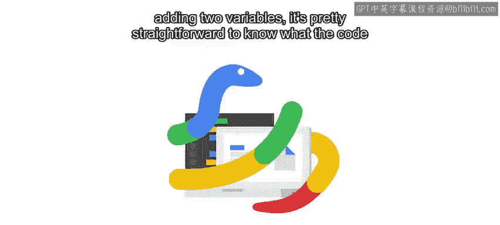
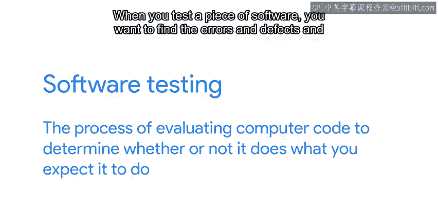
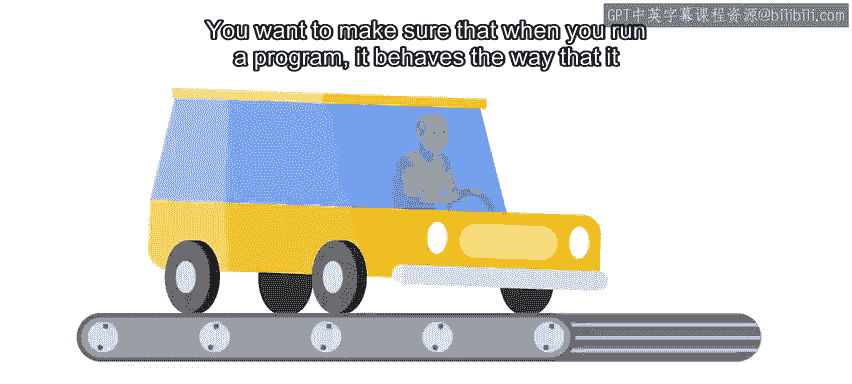
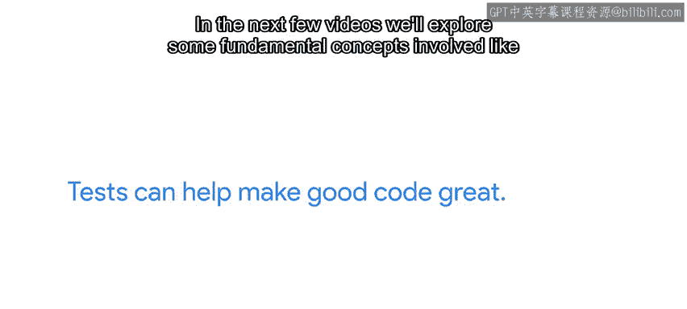

# 谷歌《用Python进行IT自动化办公1、2课（Python、控制操作系统）｜Google IT Automation with Python》中英字幕 - P131：57_什么是测试.zh_en - GPT中英字幕课程资源 - BV1gw411E7E1

🎼。う。

When you're writing a very simple piece of code， say， for example， that you're adding two variables。

 it's pretty straightforward to know what the code does and be sure that it does it correctly。

As the operation has become more complex， using loops， conditionals， calling more and more functions。

It's harder to really be confident that the code will do what it's supposed to。

This is where software testing comes into play。Software testing is a process of evaluating computer code to determine whether or not it does what you expect it to do when you test a piece of software。

 you want to find the errors and defects and see where things go wrong。

 Software testing is similar in lots of ways to the test performed in the manufacturing process of a new piece of machinery。

When a new car comes off the line， you want to make sure that when you press the gas。

 the car will go and when you press the brakes， the car will stop。

It's the same idea of a software。 You want to make sure that when you run a program。

 it behaves the way that it should。 then you can really put the pedal to the metal room， room。

Scrips and programs can fail in all sorts of strange ways。

 especially as they become more and more complicated。In all but the most simple programs。

 it's next to impossible to test for everything that could go wrong。

Even though this means that a certain number of bugs might exist in your scripts without you realizing it。

 don't worry， writingri tests can help you eliminate a whole bunch of bugs。

 helping to improve the reliability and the quality of automation Test can help make good code great。

The field of software testing is pretty broad。 In the next few videos。

 we'll explore some fundamental concepts involved like automated testing， unit test。

 integration tests and test driven development。😊，As with lots of topics covered in the course。

 we'll do a quick rundown of the many concepts around testing。

It won't be enough instruction for you to become a testing expert。

 but it should help you with automatically testing your scripts。Up next。

 we'll talk about the differences between manual and automated testing。

 so let's shift gears and get started。