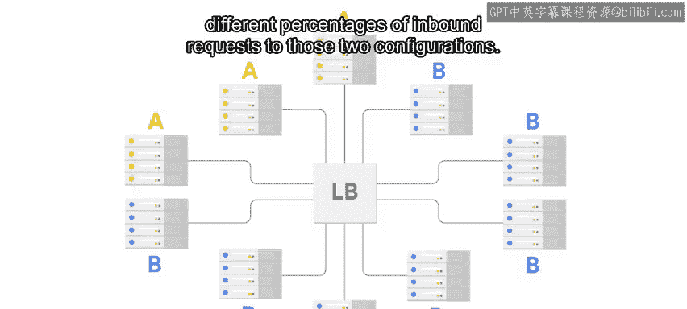

# 谷歌《用Python进行IT自动化办公3、4、5、6课（Git、debug、云端、实践）Google IT Automation with Python》中英字 - P133：16_变更管理.zh_en - GPT中英字幕课程资源 - BV1LW4y1F7XW

You've come a long way。 You now know how to get your service running in the cloud。 Next。

 let's talk about how to keep it running。 Most of the time when something stops working。

 it's because something changed。If we want our cloud service to be stable。

 we might be tempted to avoid changes altogether， but change is a fact of cloud life。

 If we want to fix bugs and improve features in our services， we have to make changes。

 but we can make changes in a controlled and safe way。This is called change management。

 And it's what lets us keep innovating while our services keep running。

 Step1 in improving the safety of our changes。 We have to make sure they're well tested。

This means running unit tests and integration tests。

 and then running these tests whenever there's a change。 In an earlier course。

 we briefly mentioned continuous integration or C。 but here's a refresher。

 A continuous integration system will build and test our code every time there's a change。Ideally。

 the CI system runs even for changes that are being reviewed。That way。

 you can catch problems before they're merged into the main branch。

 You can use a common open source C system like Jenkins， or if you use Github。

 you can use its Travis C integration。 Many cloud providers also offer continuous integration as a service。

 Once the change is committed， the C I system will build and test the resulting code。

Now you can use continuous deployment or CD to automatically deploy the results of the build or build artifacts。

 continuous deployment lets you control the deployment with rules。 For example。

 we usually configure our CD system to deploy new builds only when all of the tests have passed successfully。

On top of that， we can configure our CD to push to different environments based on some rules。

What do we mean by that in an earlier video， we mentioned that when pushing puppet changes。

 we should have a test environment separate from the production environment。

Having them separate lets us validate that changes work correctly before they affect users here。

 environment means everything needed to run the surface。

It includes the machines and networks used for running the service， the deployed code。

 the configuration management， the application configurations and the customer data productionion。

 usually shortened of prod is the real environment the ones users see and interact with。

Because of this， we have to protect love and nurture prod。

 The test environment needs to be similar enough to prod that we can use them to check our changes work correctly。

 You could have your C system configured to push new changes to the test environment。

 You can then check that the service is still working correctly there。

 and then manually tell your deployment system to push those same changes to production。

If the service is complex and there are a bunch of different developers making changes to it。

 you might set up additional environments where the developers can test their changes in different stages before releasing them。

 For example， you might have your C D system push all new changes to a development or dev environment。

 Then have a separate environment called preprod， which only gets specific changes after approval。

And only after thorough testing， these changes get pushed a pro。

See you're trying to increase the efficiency of your service by 20%。

 but you don't know if the change you made might crash part of your system。

You'll want to deploy it to one of those testing or development environments to make sure it works correctly before you ship it to Prod。

Remember， these environments need to be as similar to pro as possible。

They should be built and deployed in the same way。 And while we don't want them to be breaking all the time。

 it's normal for some changes to break dev or even preprod。

 We're just happy that we can catch them early so that they don't break prod。

Sometimes you might want to experiment with a new service feature。 You've tested the code。

 You know it works， but you want to know if it's something that's going to work well for your users。

 when you have something that you want to test in production with real customers。

 you can experiment using A B testing in A B testing。

 Some requests are served using one set of code and configuration。

 A and other requests are served using a different set of code and configuration， B。

This is another place where a load balancer and instance groups can help us out。

 You can deploy one instance group in your A configuration and a second instance group in your B configuration。

😊，Then， by changing the configuration of the load balancer。

 you can direct different percentages of inbound requests those two configurations。

If your A configuration is today's production configuration and your B configuration is something experimental。

 you might want to start by only directing 1% of your requests to B。

Then you can slowly ramp up the percentage as you check out whether the B configuration performs better than A or not。

Heads up， make sure you have basic monitoring so that it's easy to tell if A or B is performing better or worse。

 if it's hard to identify the backend responsible for serving A requests or B requests。

 then much of the value of AB testing is lost to AB debugging。

So what happens if all the precautions we took aren't enough and we break something in production？

Remember what we discussed in an earlier course about postmortems。 We learn from failure。

 and we build the new knowledge into our change management。

Ask yourself what did I have to do to catch the problem Can I have one of my change management systems look for problems like that in the future？

Can I add a test or a rule to my unit tests， My C ICD system or my service health checks to prevent this kind of failure in the future。

 So remember， if something breaks， give yourself a break。 Sometimes in I T， these things happen。

 no matter how careful you are。And as you use and refine your change management systems and skills。

 you'll gain the confidence to make changes to your service more quickly and safely。

