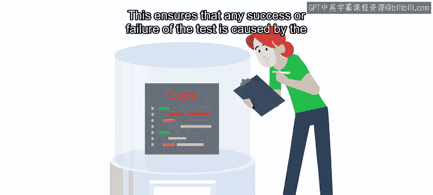
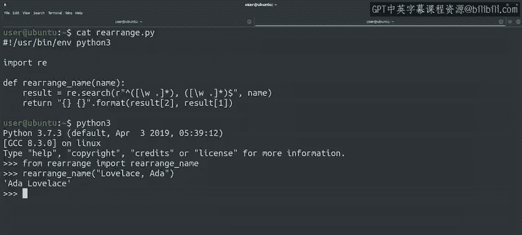

# 谷歌《用Python进行IT自动化办公1、2课（Python、控制操作系统）｜Google IT Automation with Python》中英字幕 - P133：59_单元测试.zh_en - GPT中英字幕课程资源 - BV1gw411E7E1

As we mentioned， there are lots of different types of tests that we can write to perform automatic testing。

The most common type is a unit test。Unit tests are used to verify that small。

 isolated parts of a program are correct。 Unit tests are generally written alongside the code to test the behavior of individual pieces or units like functions or methods。

Unit Test help assure the developer that each piece of code does what it's meant to do。

An important characteristic of a unit test is isolation。

Unit tests should only test the unit of code they target。The function or method that's being tested。

This ensures that any success or failure of the test is caused by the behavior of the unit in question and doesn't result from some external factor。

 like the network being down or a database server being unresponsive。

In other words， when testing a function or method， we want to make sure that we're focusing on checking that the code and that function or method behaves correctly。

 We don't want our test to fail for external reasons。 On a related note。

 our tests should never modify the production environment。

This is a live environment that runs a software that users interact with。When developing tests。

 if for any reason we do need to interact with some other software。

 we'll normally do that in a test environment where we'll have control over how it behaves It's our house。

 our rules。 So the goal of the unit test is to verify that small。

 isolated parts of the program are correct。How do we do that？

It generally boils down to a simple pattern。Given a known input。

 does the output of our code match our expectations？

Let's take a piece of code similar to what we wrote a while back to rearrange a name in the format。

 last name， comma， first name。And think about how we test it。

How do you think we can test that it works the way you expect it to？

Let's start by manually validating that for a given input， it produces expected result。

We'll check this by importing the function in an interpreter。To do that。

 we'll use a keyword that we haven't seen before from。Like this。In this case。

 rearrange is a name of the module that contains the rearrange name function。

By importing it in this way， we can call the function without having to write the module name each time we want to call it。

Like this。The function has produced the output we expected given the input we provided。

 and so it has passed this particular unit test。

Gold star。 Hang it on the fridge。The tests focused on a small。

 isolated piece of the code and validated our assumption about how it worked。

Because the scope of the test is restricted to a small specific unit。

 these types of tests usually run pretty quickly and debugging them is simple。

 since there are a limited number of reasons for them to fail。

Creating unit tests for our code will mean writing a bunch of test cases that verify that when we input some parameters。

 we get the output that we want。 Of course， the whole point is to run these tests automatically so that we don't have to manually do this ourselves each time。

 Up next， we'll talk about how we can actually write automatic tests in Python Exing， right。😊。

