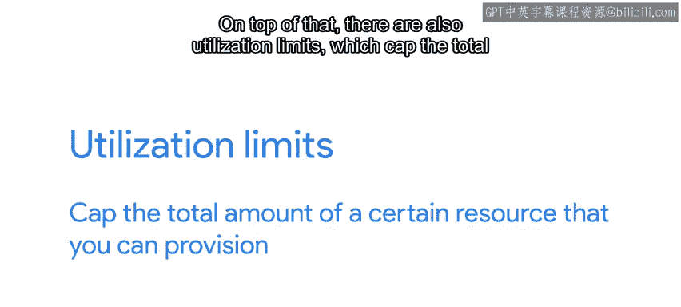

# 谷歌《用Python进行IT自动化办公3、4、5、6课（Git、debug、云端、实践）Google IT Automation with Python》中英字 - P134：17_了解限制.zh_en - GPT中英字幕课程资源 - BV1LW4y1F7XW

We've spent a while talking about how to make your service run smoothly in the cloud。

Now let's take a moment to talk about some of the problems that you might come across。Personally。

 I find that when writing software to run on the cloud。

 it's important to keep in mind how my application will be deployed。

 The software I'm creating needs to be fault tolerant and capable of handling unexpected vents。

 Inss might be added or removed from the pool as needed， and if an individual machine crashes。

 my service needs to breeze along without introducing problems。

And not every problem results in a crash。 Sometimes we run into quotas or limits。

 meaning that you can only perform a certain number of operations within a certain time period。

 For example， when using blob storage， there might be a limit of 1000 rights to the same blob in a given seconds。

If your service performs a lot of these operations routinely， it might get blocked by these limits。

 in that case， you'll need to see if you can change the way you're doing the operations。 For example。

 by grouping all of the calls into one batch， switchitching to a different services。

 sometimes an option 2。 Some API calls used in cloud services can be expensive to perform。

So most cloud providers will enforce rate limits on these calls to prevent one service from overloading the whole system。

For example， there might be a rate limit of one call per second for an expensive API call On top of that。

 there are also utilization limits which cap the total amount of a certain resource that you can provision。

These quotas are there to help you avoid unintentionally allocating more resources than you wanted。

Imagine you've configured your service to use auto scaling。

 and it suddenly receives a huge spike in traffic。This could mean a lot of new instances getting deployed。

 which can cost a lot of moneys for some of these limits。

 you can ask for a quota increase from the cloud provider if you want additional capacity。

And you can also set a smaller quota than the default to avoid overspending。

This can be a great idea when you're running a service on a tight budget。

If your service performs expensive operations routinely。

 you should make sure you understand the limitations of the solution that you choose。

 A lot of platform as a service and infrastructure as a service offerings have cost directly related to how much they're used。

 They also have usage quotas。 If the service you've built suddenly becomes very popular。

 you can run out of quota or run out of budget。By imposing a quota on an auto scaling system。

 the system will grow to meet user demand until it reaches the configured limit。

The trick here is to have good monitoring and alerting around behavior like this。

 If your system runs out of quota， but there is an increased demand for puppy videos。

 the system may have problems， Degraded performance or worse yet an outage。

 So you want to be notified as soon as it happens so that you can decide whether to increase your quota or not。

 Finally， let's talk about dependencies。 when your service depends on a platform as a service offering like a hosted database or C ICD system。

 you're handing the responsibility for maintenance and upgrades of that service off to your cloud provider。

 That's great。 fewer things to worry about and maintain but it also means that you don't always get to choose what version of that software you're using。

😊，You might find yourself on either side of the upgrade cycle。

 either wanting to stay at a version that's working well for you or wanting the cloud provider to hurry up an upgrade to resolve a bug that's affecting your service。

 Your cloud provider has a strong incentive to keep its service software fairly up to date。

 keeping software as a service solutions up to date ensures that customers aren't vulnerable to security flaws that bugs are promptly fixed。

 and that new features get released early。 At the same time。

 the cloud provider has to move carefully and test changes to keep disruption of the service to a minimum。

They will communicate proactively about changes to the services that you use。

 and in some cases cloud providers might give you access to early versions of these services。

For example， you can set up a test environment for your service that uses the beta or pre releaselease version of a given software as a service solution。

 letting you test it before it impacts production。Hopefully you're starting to get an idea of the tradeoffs that you'll need to make to get the most from deploying your software to the cloud。

Now head on over to the reading for links to additional information on all this。

 then there's a quick quiz for you。