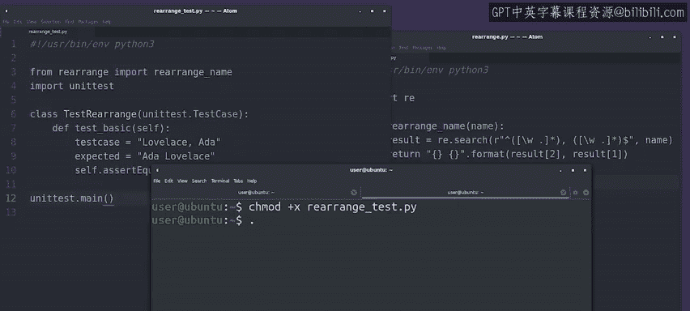

# 谷歌《用Python进行IT自动化办公1、2课（Python、控制操作系统）｜Google IT Automation with Python》中英字幕 - P134：60_在 Python 中编写单元测试.zh_en - GPT中英字幕课程资源 - BV1gw411E7E1

We've now looked at the principles behind automatic testing。We know that by having automatic tests。

 we can run them as many times as necessary to make sure that our code does what we want it to do。

So how do we do this in Python？We need to write some code that runs the test and verifies the output。

This way， we can get our computer to do the work for us to demonstrate the testing workflow。

 we'll create unit tests for the rearranged name function from the previous video。

As we touched on earlier， automatic tests are usually written alongside the code that we want to test。

What this means in practice is creating a separate Python file with the test。

The convention is to call the script with the same name of the module that it's testing and appending the suffix underscore test。

So for our rearrange module， we'll create the rearrange test stop P file。

We'll test the rearrange name function of the rearrange module。

 so let's import that function the way we did before in the interpreter。Okay。

 we're ready to start writing the test。To help us with that。

 Python provides a module called unit Test。 Thanks Python。

 This module includes a number of classes and methods that let us easily create unit test for our code。

😊，The first thing we'll do is import the unit test module we'll need for testing。

The unit test module provides a test case class with a bunch of testing methods ready to use to access this functionality。

 we create our own class that inherits from test case， thus inheriting all those testing methods。

 so we're going to write our own test rearrange class that inherits from test case。

Do you remember what the syntax for that was， we need to include the class that we want to inherit from in the parentheses。

We called our test class test rearrange and indicated that it should inherit functionality from the test case class located in the unit test module。

 any methods we define in our test rearrange class that start with the prefix test will automatically become tests that can be run by the testing framework。

So we're ready to write our first test case， what's it going to be？In our last video。

 we manually tested one simple case。Let's turn that manual test into an automatic test that verifies the basic names are formatted correctly。

With this method， which we've called test basics， we kick off by setting up our expected inputs and outputs。

We then use the assertRT equalal method provided to us by the test case class we inherited from to verify that what we expected is exactly what we got。

The assert equal method basically says both of my arguments are equal。 If that statement is true。

 then the test passes。 If it's false， the test fails and an error is printed to the screen when the test is run。

 Okay， we've got our first unit test， so how can we run it。In the main part of our program。

 we'll call the unit Test。 mainin function， which will run the test for us。All right。

 we're ready to run the test。We'll do that by executing the file that we just created。

Let's make our script executable and then run it。

Looks good。The output is pretty descriptive， printing out some information about how long a group of tests or test suite took to run。

 as well as a number of tests and whether or not they passed。Just like that。

 we've tested our first function。 It's pretty cool， right， I know there was a lot going on here。😊。

If the code is confusing， complex， or didn't really sink in yet， that's okay。

Take the time to practice on your own and review the content until it feels natural。Coming up。

 we'll test even more cases。