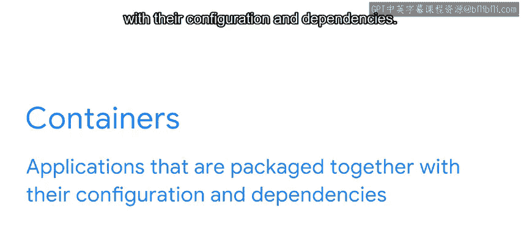
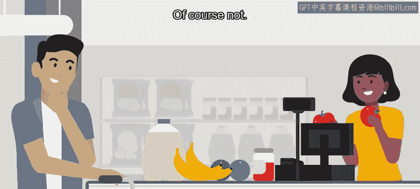
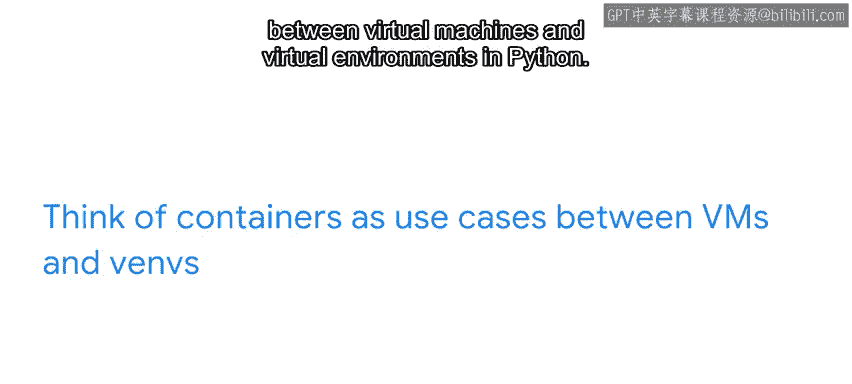

# 谷歌《用Python进行IT自动化办公3、4、5、6课（Git、debug、云端、实践）Google IT Automation with Python》中英字 - P135：18_什么是容器.zh_en - GPT中英字幕课程资源 - BV1LW4y1F7XW

Hello again， ready to build on what we've been talking about Me too。 in this video。

 we're going to explore containers， so let's get into it。

We briefly mentioned containers in moduleule1， defining them as applications that are packaged together with their configuration and dependencies。

But what exactly does that mean？Say you're shopping for the ingredients to make your world famous baked potatoes。

 you buy milk， sour cream， chili peppers， pimentos， spices， and four big potatoes。

But you don't carry them separately to the car making multiple trips， do you？Of course not。

The grocery store puts them in a container like a bag。

Your ingredients are packaged together so you can transport them to your home and create your gourmet masterpiece。

Containers are not just for packaging。They're also used for sharing the application you're working on。

 posting an application to a server for review。Testing different instances of the same application and handling the key parts of a complex system architecture separately。

Let's take our example a step further。What if you wanted to make your baked potatoes at a friend's house or at the party that you're going to？

It isn't a problem because everything that you need is in the container you got from the store。

 The recipe works in any kitchen。The same is true in Python。

Containers allow applications to run the same way， no matter what environment you run them in。

Say you're sharing your application with the programming peer。

You don't want to make them download all of the Python libraries and dependencies you use to create the application。

 so you package the application's virtual environment or VN in a container。Then you send it to them。

 exporting it as a requirements text file， which is a one for one listing of all required libraries and dependencies alongside a Docker file。

 We'll talk about Docker in detail in a later video。

Containers bridge the gap between virtual machines， VMs， and Python virtual environments。

 Think of containers as use cases between virtual machines and virtual environments in Python。

Using containers is basically like packing up part of your computer and giving it to someone else。

A common problem with writing， and software is that different servers or peer computers may not be set up in quite the same way yours is。

So even though everything works perfectly on your computer， it might not work correctly on theirs。

 it might not work at all。With containers， you can virtually pack up everything that made the software work on your computer。

And give them what they need to use the software as intended。

It's essentially allowing them to run the application using a snapshot of your system。

 you could also run a small database inside of a container and connect to that database with another program。

Containers give programmers the ability to test client server applications without using another computer or without running up an expensive cloudbell。

As a programmer， you can write your own containers or adapt an existing container or container template to meet the needs of your project。

We'll talk more about containers in the video on Docker web apps for now。

 let's quickly review what we just went through。Containers allow you to assemble a package that contains an application。

 as well as its configuration and dependencies in a virtual environment that's essentially a snapshot of the computer you use to create it。

 The version of Python used， the libraries， configurations， and everything else。

So it can be run anywhere else， including the internet。

 regardless of a particular computer or servers operating specs。

That's the kind of power containers give you。It's a power that'll grow even stronger when you use them with Docker。

 which is coming up next。 We'll see you there。