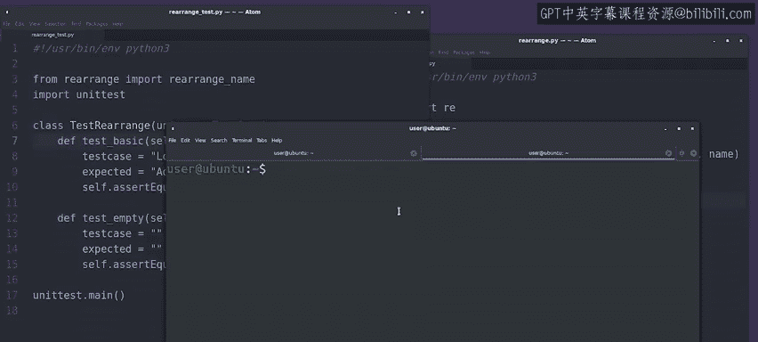
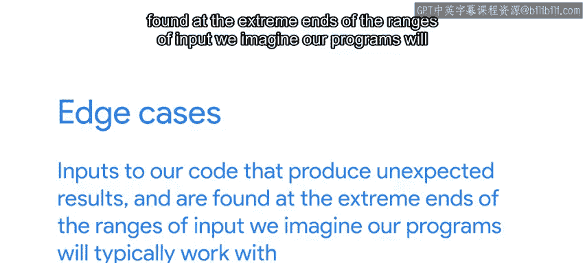
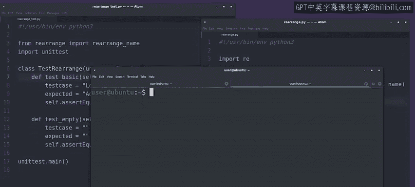

# 谷歌《用Python进行IT自动化办公1、2课（Python、控制操作系统）｜Google IT Automation with Python》中英字幕 - P135：61_边缘案例.zh_en - GPT中英字幕课程资源 - BV1gw411E7E1

By now， we know how to write automatic tests in Python。 Our test suite includes only one test case。

 though。 we need to make it grow。Choosing test cases can be an exercise and creativity。

Coming up with different ways， a piece of code might break can actually be super fun。

 We'll usually test that our code works in the general case。😊。

But we should also see what happens when we give it some input that we may not expect it to run into under normal operations。

For example， what would happen in our function if we gave it an empty string。

Let's add a test for that and see。In this case， we're testing for an empty input string。

We're saying that we expect our function to return an empty string when it receives an empty string。

We checked this behavior by using the assert equal function。Allright， let's run this。

Oh look， our tests failed， we cut a problem with our code。

Let's take a closer look at the information that the failure gives us。 After all。

 that's what errors are for， right， This error tells us that the test called test empty failed。

 and we see that it failed with a type error saying that none is not subscriptible。Interesting。

 we've just discovered an edge case。Edge cases are inputs to our code that produce unexpected results and are found at the extreme ends of the ranges of input we imagine our programs will typically work with。

Edge cases usually need special handling and scripts in order for the code to continue to behave correctly。

 In our rearranging example， we can handle this edge case by performing a simple check of the result variable before operating with it。

😊，With this change， if we use our function with normal input。

 we'll still get a result that we got before。If we try to use an empty string。

 we'll catch it if our check and return the original empty string instead。

Whether or not we handle this kind of error depends on how we want the scripts to behave。

In our specific case， returning the original value makes sense when we can't rearrange it。

But sometimes you might actually want your program to crash with an error rather than to go on as if nothing happened。

Remember that it's bad for automation to fail silently。

Other kinds of edge cases usually include things like passing zero to a function that expects a number or negative numbers or extremely large numbers。

These types of conditions are good to consider when writing your test。

 since they can cause your code to crash or behave in unexpected ways。

Sometimes it pays to be a pessimist。 You can see how it might require some creativity to come up with these examples。

The upside is that when writing automatic tests， once you've come up with an example。

 it's there to stay。So now that we've fixed our code to behave correctly with this edge case。

 let's run our test suite again and see if the problem is fixed。

Yes， our tests pass。 We fix a bug in our code。 And by adding an automatic test。

 we can make sure that it won't happen again。 Can you think of other test cases that we might want to add to our test suite。

 We'll look into a couple more in the next video。😊。

