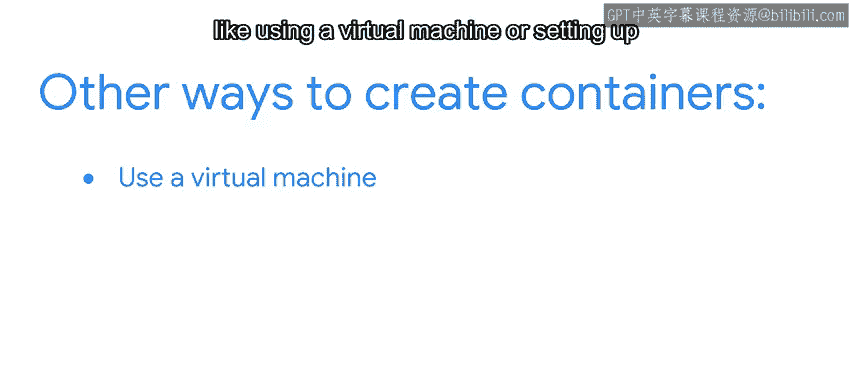

# 谷歌《用Python进行IT自动化办公3、4、5、6课（Git、debug、云端、实践）Google IT Automation with Python》中英字 - P136：19_Docker Web 应用.zh_en - GPT中英字幕课程资源 - BV1LW4y1F7XW

Now that you know what containers are and what they're used for。

 you're probably wondering what happens next。 Well， next， we're going to cover Docker。

Docker is an industry standard container tool。 It's an open source platform you can use to build。

 deploy， run， update and manage containers。In other words。

 it streamlines the process of converting an application into a container。To review。

 to share or post an application packaged in a container， you have to send two fs。

A requirements dot text file and a Docker file， which is sometimes called a Docker image。

 The names are used interchangeably。Docker itself is an application that runs off the command line。

 It reads the Docker file。 Then the Docker file reads the requirements text file。Finally。

Docker launches the runtime engine for Python， along with all of its dependencies and runs the Python script in isolation。

It's like uploading part of your computer to another computer or to a server in the cloud。😡。

To clarify， containers are often shared over the Internet rather than past from person to person。

This is called Sha Docker Web apps For Docker web apps。

 you upload the container to a server so people can connect to it remotely。In the Docker file。

 you would specify that it's a web enabled application。

An example of a Docker web app is one where you were running a Docker image like a database on your computer。

 and it allows traffic from other computers as well。When you share a container with a Docker file。

 it's important to set expectations with the individual or individuals you're sharing the container with。

This is especially true if they aren't familiar with Docker。The first time you run a Docker file。

 it has to download and install the Python runtime file for the version of Python used to create the application。

But only once。If you share other containers with those same parameters。

 it will simply run the Python script。Since Docker is open source， you can use it for free。

 there aren't any licensing requirements。But there is a Docker version that offers enterprise and subscription plans for a fee。

 that will save your Docker images on a private cloud and allow you to manage all of your Docker images。

 But buying a plan is only one option。 Docker support is built into the Google Cloud platform。

 So you can simply upload your images there。😊，In addition。

 many network storage devices and cloud backup servers like Buffalo and Western Digital include support for Docker。

Although Docker is a relatively new tool， it has become practically synonymous with creating containers。

Mostly because it's simpler than the other methods for creating containers。

 like using a virtual machine or setting up a virtual environment like VM or Conda。

If you're not using Docker yet， give it a try。 Let's take a quick review in case you've forgotten why you should。

Docker is an industry standard tool for converting applications to containers。

It allows you to easily post and share your containers with peers and reviewers。

 It runs your Python scripts in isolation， which is like uploading your computer to another location。

😊，And let's not forget that DACA requires no licensing fees and is preconfigured on many servers and network storage devices。

Always remember that programming is a collaborative activity。

 and Docker makes it easier for you to collaborate。

This video is really just an introduction to using Dockers with containers。

Over the next several readings and videos， you'll have an opportunity to dig deeper。

 I hope you're as excited as I am。😊。