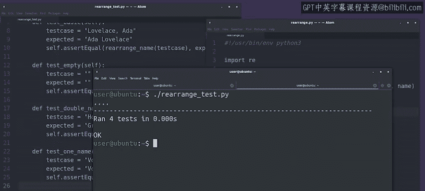

# 谷歌《用Python进行IT自动化办公1、2课（Python、控制操作系统）｜Google IT Automation with Python》中英字幕 - P136：62_其他测试案例.zh_en - GPT中英字幕课程资源 - BV1gw411E7E1

Up to now， we've added a basic case and an edge case to our test suite。When we added the edge case。

 it caused our function to generate an error because we didn't handle this correctly。

And so we fix it by changing our function。Can you think of some more examples that will make our function misbehave？

Remember， when we first wrote the function， we came across names with spaces or dots that will make our regular expression not match。

We fixed that already， but it's still a good idea to add a test case to make sure that our code still works how we expect it to。

In this case， we're testing that someone with more than one given name still gets their name properly rearranged。

Let's run our test suite and see if it passes or not。All right。

 we now have three tests and all of them pass。To find more bugs。

 we need to exercise our creative muscles and think of other examples that might cause our code to fail。

How about someone who has only one name？In this case， this person only has one name。

 so there is no comma in our string。We expect the result to be the same name we provided to the function Will that work？

Let's check and find out。Whoops， this one failed。 bad news forvoltaire。

The test output in this case looks slightly different than before。

It shows the name of the tests that failed， which is test one name。But now。

 instead of giving us a type error， we see an assertion error。

 which means the original and expected values don't match。

It looks like our function return an empty string instead of the original name。

That's because there's a bug in our code。And what do we do when we have a bug in our code？

We squash it。When we checked if the result was none。

 we returned an empty string which made our previous tests pass。

What's happening now is that we're passing a name that doesn't include a comma。

 which makes a result variable none， and so the function is returning an empty string。

The fix for this is pretty simple。 Instead of returning an empty string when the result is none。

 we'll return the original name variable。So that should be enough， right？

Let's save our changes and run the test suite again。

Binggo， we fix all the bugs and all our tests pass。

One of the great things about running tests in a suite like this is that we now know that all the test cases we wrote were handled correctly。

 our code works for basic names， empty strings， double names， and single names。

If we found another case that made our test break， we could add it to the suite， fix the bug。

 and then run the whole suite again， being assured that all the other cases are still working。

 You should take a moment and reflect on what you've already learned in this module。

 It's super impressive， and it's going to fit nicely into your I T toolkit。😊，Coming up。

 a cheat sheet includes all the syntax we've been seeing about writing unit tests。

 plus pointers for more information that you might find useful。After that。

 you'll have a chance to write some interesting tests yourself。

