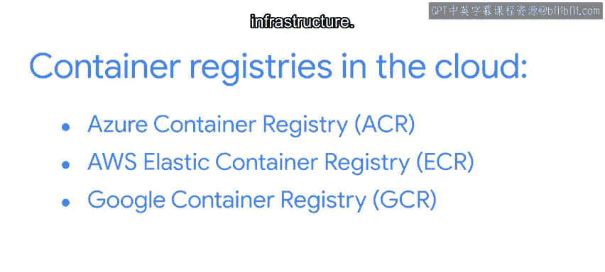
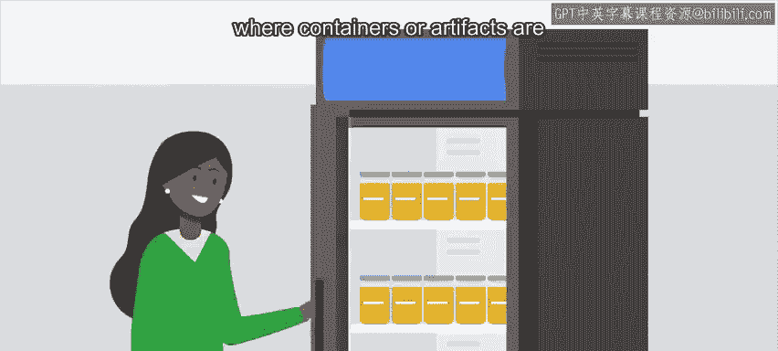
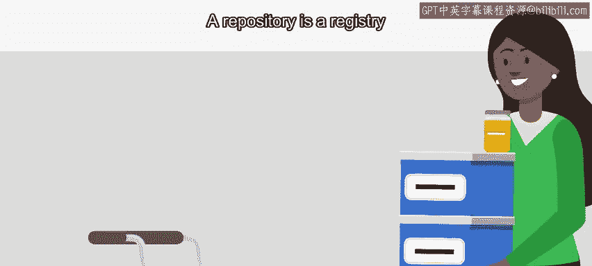
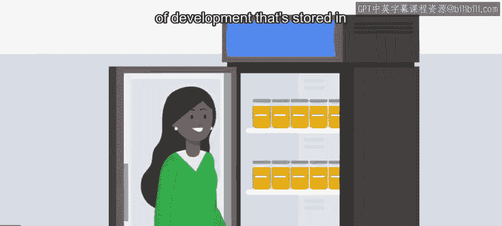

# 谷歌《用Python进行IT自动化办公3、4、5、6课（Git、debug、云端、实践）Google IT Automation with Python》中英字 - P137：20_容器和制品注册表.zh_en - GPT中英字幕课程资源 - BV1LW4y1F7XW

Hello again， we've been talking， and you've been reading a lot about containers and the advantages they give you as a programmer for collaborating。

 sharing， and even getting reviews for your Python applications。😡，In this video。

 we're going to talk about organizing and managing containers。

 specifically about container and artifact registries。

You might hear these called container repositories or container registries， which can be confusing。

 so let's start by defining our terms。A container registry is a place where container images are stored。

 along with programming interface paths and access control rules， like for Docker web apps。

They're organized for efficient access。A container repository is a container registry that also manages container images and associated artifacts。

For example， say you have a new PC running Windows 11。

The Microsoft Reggistry contains all of the artifacts associated with the Windows 11 operating system。

But Microsoft's registry also manages the images and artifacts to do things like push updates to you and everybody else who has a PC with Windows 11。

So it would be more accurate to call that registry a repository， make sense。

Now let's talk about artifacts， which are one of the dependencies in an application container。

An artifact is a byproduct of the software development process。In other words。

 it's an item that's produced during programming， such as a Docker image or a compiled version of your code。

Artifacts enable you to distribute your code so other people can use it like the Windows 11 updates that we mentioned。

😡，Containers and artifacts typically have different registries， which makes sense。

A container can hold several artifacts， but an artifact has a specific purpose or use。

It's typically stored in a registry so that it can be accessed and used as needed。

There are three container registries in the cloud that you should be aware of。

Azure Contain Reggiiststry， ACR， which is a Microsoft Azure service that allows you to store， manage。

 and deploy container images。AWS Elastic container Reggistry， ECR。

 which is an Amazon Web services registry that allows you to store。

 manage and deploy container images on AWS。Google Contain Reggistry， GCR。

 which is a private container registry service provided by Google Cloud Platform or GCP that allows you to store。

 manage and deploy container images using GCP infrastructure。

All three offer features like authentication， access control， and image georeplication。

They all also offer registries for artifact storage。If you're programming for a company。

 you'll be using the registries there subscribed to if you're on your own。

Take some time to look into these providers to see which is the best option for you。

Consider both the advantages and disadvantages of each service。

Make sure you research your options carefully for the different services。

 looking at both the features and security protocols before making a decision。

Which is the best registry for you。Do some research and try them out when you get a chance。Now。

 let's review。A registry is a place where containers or artifacts are stored and organized。

A repository is a registry or a collection of registries that allows you to manage containers or artifacts。

An artifact is a byproduct of development that's stored in a registry to be accessed and used as needed。

And again， as a reminder。Carefully consider registry services before you commit。

Registries are especially important for managing containers and artifacts in a Devopps workflow。

 so we'll talk more about that later in the course。

We'll pick this discussion back up when we get there until next time。

