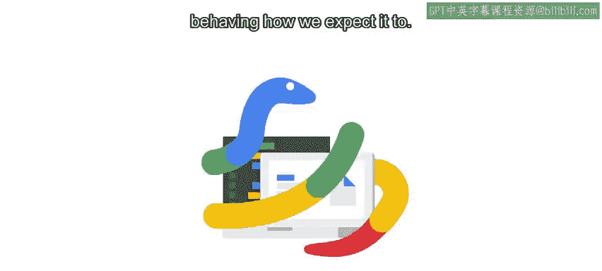
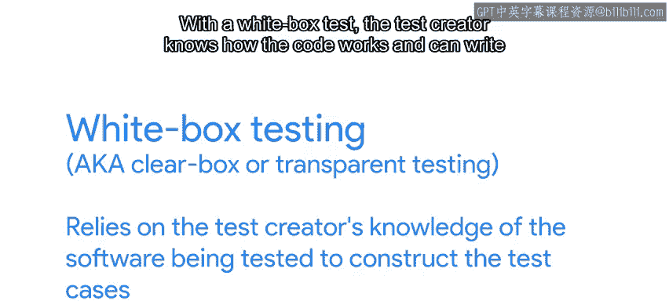
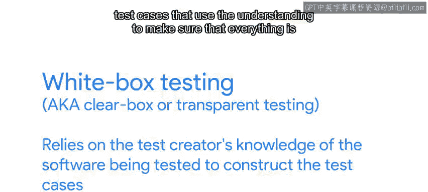
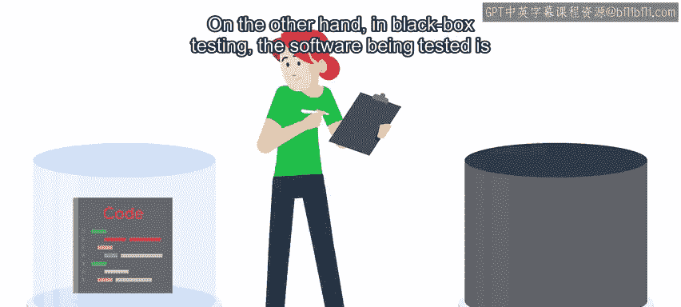
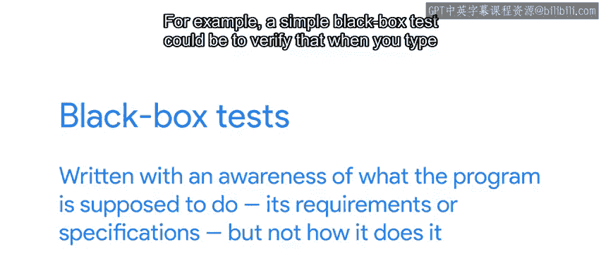

# 谷歌《用Python进行IT自动化办公1、2课（Python、控制操作系统）｜Google IT Automation with Python》中英字幕 - P137：63_黑盒测试与白盒测试.zh_en - GPT中英字幕课程资源 - BV1gw411E7E1

🎼。う。

There are lots of different tests that we can use to make sure our software is behaving how we expect it to。

We've explored unit tests in detail， which are both simple to write in a very powerful way to catch bugs。

But there's a lot more software testing。One interesting concept is whether our test is a white box test or a black box test。

White box testing， also sometimes called clearearbox or transparent testing。

 relies on the test creator's knowledge of the software being tested to construct the test cases。

With a white box test， the test creator knows how the code works and can write test cases that use the understanding to make sure that everything is performing the way it' expected to。

 on the other hand， in black box testing， the software being tested is treated like an opaque box。

In other words， the tester doesn't know the internals of how the software works。

 black box tests are written with an awareness of what the program is supposed to do。

 its requirements or specifications， but not how it does it。

For example， a simple black box test could be to verify that when you type www。google。

de in your browser， the Google search page for Germany is returned。

You might not know how Google servers process your request。

 but you know what the end result should be， both white box and black box tests have their own advantages。

White box tests are helpful because a test writer can use their knowledge of the source code to create tests that cover most of the ways that the program behaves。

Black box tests are useful because they don't rely on the knowledge of the how the system works。

This means their test cases are less likely to be biased by the code。

They usually cover situations not anticipated by the programmer who originally wrote the script。

Not all tests that we write need to fall into one category or the other。

We can write unit tests that are either white or black box。

 depending on which testing methodology is chosen。If the unit tests are created before any code is written。

 based on specifications of what the code is supposed to do。

 they can be considered black box unit Test。If unit tests are written alongside or add through the code has been developed。

 the test cases are made with a knowledge of how the software works， they are white box tests。

One way isn't strictly better than the other， since each gives you a different path to make your code more reliable。

Not everything is so black and white， or as we'd say in the coding world， binary。

 As an IT specialist， you might need to test that software ran by others。

 behaves the way you expect it to。To do this， you can use a combination of black box and white box tests。

Let's say that you have an online catalog of products that are sold by your company。

You could have a black box test that verifies that the details for a product are displayed when you open the page for a specific product。

Apart from that， you could have white box test that calls the different functions used by that page。

 checking that the prices are displayed in the right currency。

 that the description is correctly wrapped and so on。Next up。

 we'll talk about other kinds of testing beyond unit Test and what roles they play in improving the quality and reliability of your scripts。

