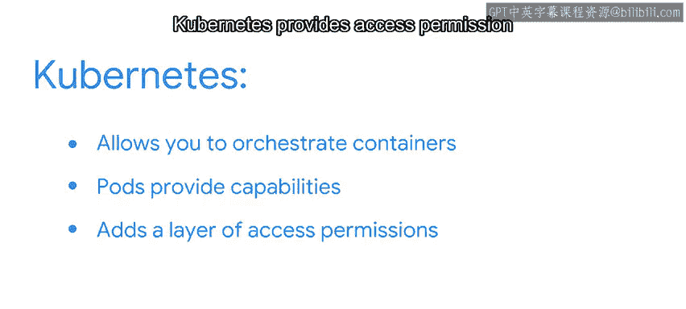

# 谷歌《用Python进行IT自动化办公3、4、5、6课（Git、debug、云端、实践）Google IT Automation with Python》中英字 - P138：21_Kubernetes 概览.zh_en - GPT中英字幕课程资源 - BV1LW4y1F7XW

Hello again。Ever notice that some people just don't like to share？In this section。

 we'll go over how we can use resource management and scale it so that individuals who don't like to share have a lesser chance of hoarding all the resources to the detriment of others。

Say you're posting a Docker image on a cloud server to share your application with 20 users。

 Theres really nothing on the server side to protect your app from a few extremely enthusiastic users monopolizing all the server bandwidth。

 The result， some users get slow， glitchy service。Anticipating the problem。

 many programmers post multiple docker images of the same application to make sure everybody gets the best。

 Fast service。 But what about updating the application， addressing bugs， adding features。

Every change you make also has to be added to those 20 instances up in the cloud。

Kubernetes is a tool that addresses issues like this。Kubernetes， abbreviated as K8s。

 is an open source platform that gives programmers the power to orchestrate or manage containers。

Think of it as a school of fish or more aptly a pot of whales。

Containers you use and name in K8s are deployed as pods in the cl。

A pod is a logical group of one or more containers that are scheduled and run together on a single worker node。

 a host within a Kubernetes cluster。 Cons in a pod share the same namespace on the network and the same I P address and resources。

 so they can communicate with one another。 This makes deployment efficient。

You can do a lot of things with the Kubernetes pod， you can scale it。

 which means adding more replicas of your pod， like the 20 we needed in the greedy user example。

Better still， you can update all of those replicas at the same time， just by updating your pod。

You can roll back a pod and its replicas if you need your users to go back to the pre update version because you found a bug。

This allows you to fix the bug and send out a new update。

Kubernetes also allows you to list all of your pods and replicas and to check descriptions and logs to look for trends or uncover information based on usage。

Or you can expose your deployments to the outside world。

 providing a second layer of access permissions on top of the access provided by Docker。

This second layer allows you to automate load balancing。Once you expose your deployment。

 you can use a special server to communicate with all of your clients。

 rerouting each contact to the most unused Docker image in the pod at that time。

 so everyone gets the best access to better understand the relationship between Docker and Kubernetes。

Imagine Docker is a shipping container。 It lets you package each application and its dependencies in a separate crate within a container。

 just like shipping containers allow you to package goods for transport。In this example。

 Kubernetes is the port， orchestrating how the containers and packages are handled and directing them to the right place。

As you can see， Kubernetes gives you the ability to automate container deployment across the cloud to best accomplish the goals of your application strategy。

But be advised。 The power comes at a cost。 The learning curve is steep。

So unless you need all of that power and efficiency。

 you might want to use a lesser deployment method。That's a call you and your IT department will need to make。

We're going to give you a lot of Kubernetes information throughout this module。

 so let's quickly review the basics before you move on。😡。

Kubernetes is an open source platform that gives programmers the power to manage containers。

A Kubernetes pod is one or more containers scheduled and run together on a single worker node or host。

Pods can be scaled， rolled back， and dug into for trends in log information。

Kubernetes provides access permission on top of what Docker provides。

Kubernetes is an important tool for the right application。Kubernetes makes it easy to share data。

 resources， and applications with other teams and users。This helps improve collaboration， efficiency。

 and productivity。We'll talk more about these pods next time。

