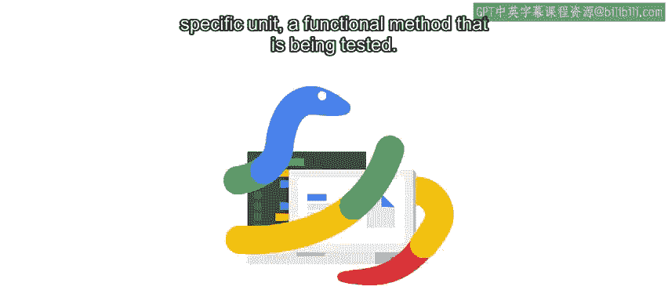
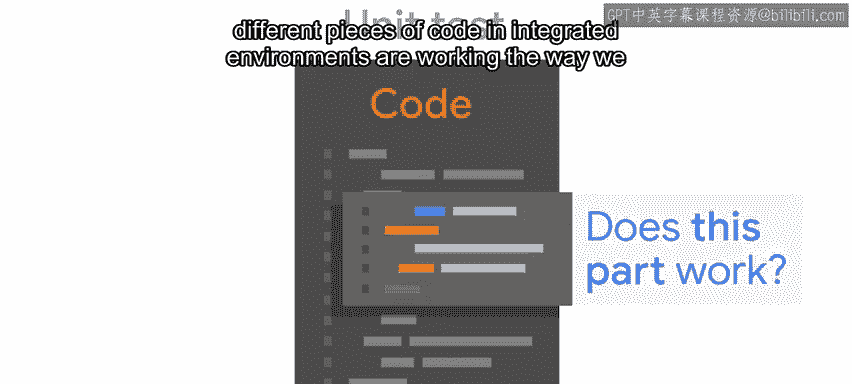
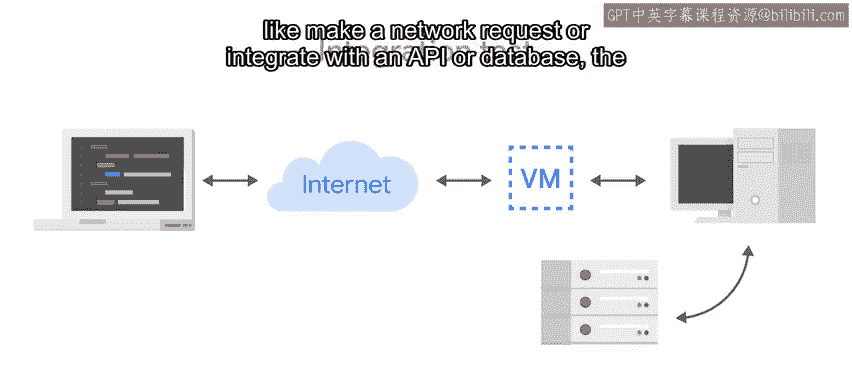
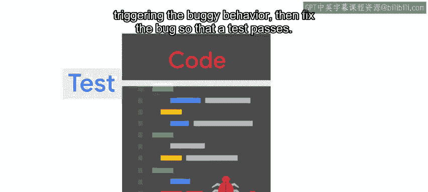
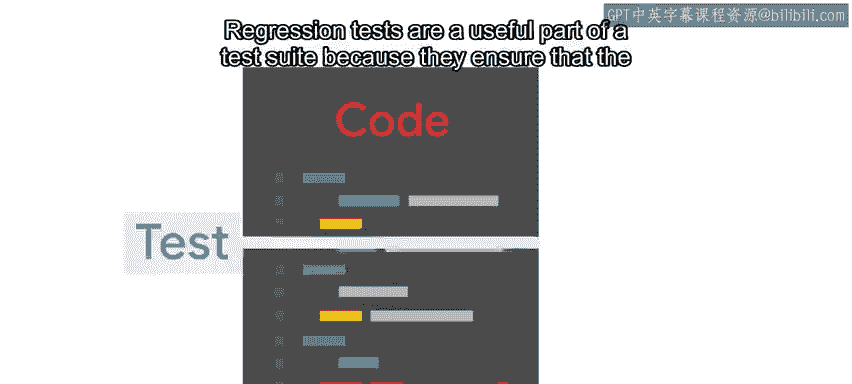
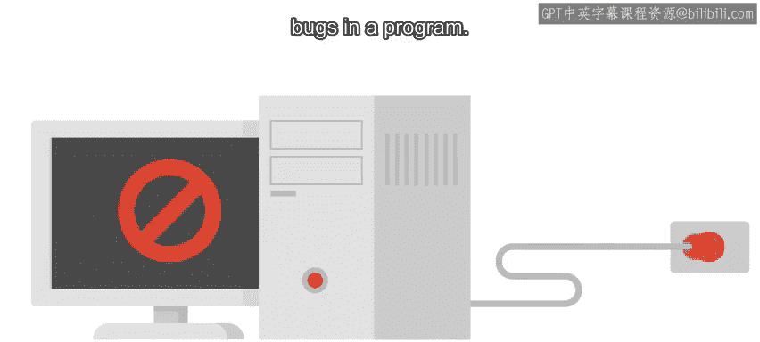
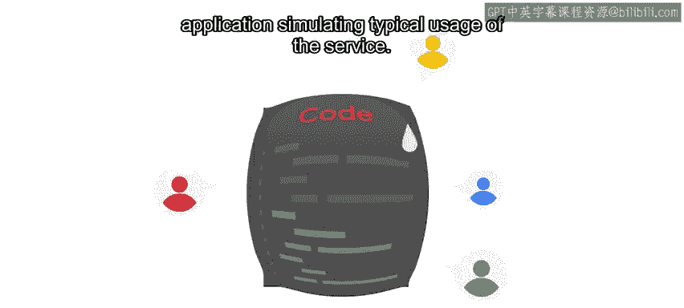

# 谷歌《用Python进行IT自动化办公1、2课（Python、控制操作系统）｜Google IT Automation with Python》中英字幕 - P138：64_其他测试类型.zh_en - GPT中英字幕课程资源 - BV1gw411E7E1

🎼。う。

When we looked at unit tests， we called out that they should focus on one specific unit。

 a function or method that's being tested。This allows the test to verify that the unit provides expected functionality regardless of the rest of the environment。

On the other hand， integration tests verify that the interactions between the different pieces of code and integrated environments are working the way we expect them to。

 while unit tests shouldn't cross boundaries to do things like make a network request or integrate with an API or database。

 the goal of an integration test is to verify these kinds of interactions and make sure the whole system works how you expect it to。

Integration tests usually take the individual modules of code that unit Test verify。

 then combine them into a group to test。Depending on what our program does and how it interacts with the rest of the systems involved。

 we might need to create a separate test environment for our test。

 which runs a test version of the software that we're trying to verify。

We might be able to run our test against the actual version of our system that's running。

 but that's only if our code doesn't make any changes to the production environment。

Whenever your company is deploying a system that's somewhat complex。

 having integration tests will help make sure that all the pieces come together the way you expect them to。

These tests usually take a bit more work to set up because you'll need to make sure that you have the test versions of all relevant systems。

But they might help catch issues that unit tests won't detect。

 so the extra effort is definitely worth it。 For example。

 if the service you're trying to test interacts with a database。

 you'll want to set up a separate test database with a test user and a test tables。

This lets you run all tests you need in an environment that you can control without risking modifying the production database。

 a variant of unit tests are regression tests。They're usually written as part of a debugging and troubleshooting process to verify that an issue or error has been fixed once it's been identified。

Say our script has a bug and we're trying to fix it。

 a good approach to doing this would be to first write a test that fails by triggering the buggy behavior。

 then fix the bug so that the test passes。

Regression tests are a useful part of a test suite because they ensure that the same mistake doesn't happen twice。

The same bug can't be reintroduced into the code because introducing it will cause the regression test to fail。

Smoke test， sometimes called build verification Test。

 get their name from a concept that comes from testing hardware equipment。

Plug in the given piece of hardware and see if smoke starts coming out of it。

 when writing software smoke tests serve as a kind of sanity check to find major bugs in a program。

Smoke tests answered basic questions like， Does the program run。

 these tests are usually run before more refined testing takes place。

 since if the software fails a smoke test you can be pretty sure none of the other tests will pass either。

As they say， where there's smoke， there's fire。For a web service。

 a smoke test will be to check if there's a service running on the corresponding port。

For an automation script， the smoke test would be to run it manually with some basic input and check that the script finishes successfully。

Other types of tests are low tests。These tests verify that the system behaves well when it's under significant load to actually perform these tests。

 we'll need to generate traffic to our application， simulating typical usage of the service。

These tests can be super helpful when deploying new versions of our applications to verify that performance doesn't degrade。

For example， we might want to measure the response time of our website while there are 100 requests per second on our pages or 1000 or 10。

000。The actual numbers will depend on the expectations of how much traffic our website will receive。

Taken together， a group of tests of one or many kinds is commonly referred to as a test suite。

A good diversity of test types can create a more robust test suite that helps ensure your scripts and automation do what you tell them to。

There are many more kinds of tests out there， we've only touched on a few of the most common types。

 if you're interested in learning more about the ways software can break and how to test for that。

 all kinds of books and articles have been written on the subject。Speaking of tests。

 we have a huge and difficult test coming up。Just kidding。Up next。

 we'll learn about a technique called test driven development。

