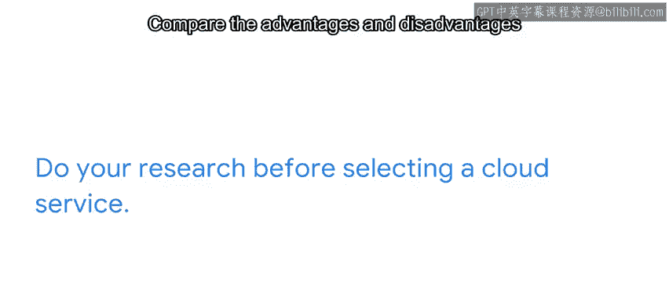

# 谷歌《用Python进行IT自动化办公3、4、5、6课（Git、debug、云端、实践）Google IT Automation with Python》中英字 - P139：22_GCP 上的 Kubernetes.zh_en - GPT中英字幕课程资源 - BV1LW4y1F7XW

The cloud or not the cloud。That's the question every programmer has to answer when using Kubernetes。

As you've seen， Kubernetes is a powerful tool for organizing， sharing and managing containers。

 allowing programmers to scale， duplicate， push updates， roll back updates and versions。

 handle version control and more。😊，But what if it could be even better， Ho again。This time around。

 we're going to explore what better means when it comes to using Kubernetes on the Google Cloud platform or GCP。

As an open source program， Kubernetes is very flexible。Programmers can run it on their own computers。

 directly on the Google Compute engine， GCE， or on GCP using the Google Kubernetes engine GKE。

 which is a managed service dedicated to improving Kubernetes use for its users。

You can run Kubernetes on other cloud providers as well。

Most have engines similar to GKE designed to improve Kubernetes functionality。

Running Kubernetes on the Google Cloud with GKE offers a web based interface that gives programmers immediate visibility into their containers and projects and how they're being managed。

 Most open source tools don't provide such an interface。

 So it's up to each individual user to create their own interface or use a third party interface like GKE to make Kubernetes more efficient for them。

G， K E provides a dashboard that features at a glance of visibility into your Kubernetes use。

 such as how many people are using it at the moment and other usage statistics。

 automatic cluster provisioning， scaling and upgrades using G K E allows you to simply copy and paste in Docker files instead of uploading them through a terminal。

 It also handles security patches and updates to Kubernetes software automatically。Without GKE。

 these tasks would fall to the programmer or their DevOs team。

This means a systems developer who doesn't have a dedicated DevOs team can manage their infrastructure from a single web portal using GKE as their DevOps solution。

We'll talk more about DevOs later in the certificate。

Think of GKE as an extra layer of management that makes it easier for Python programmers like you to take a better advantage of Kubernetes' capabilities。

And as you become more experienced in Python and other programming languages。

 GK E can help you use Kubernetes even more efficiently by automating common tasks and creating advanced deployment triggers。

But do your research， Comp the advantages and disadvantages of G K E and other such engines。

 reviewing how well their cost and capabilities align with your goals or your company's goals before selecting a service like G K E。

Remember， Kubernetes is a tool for optimizing the management of deploying your Docker containers and projects。

😡，Using Kubernetes in the Google Cloud with GKE gives you a web based interface or dashboard。

 so you can view and manage your containers and projects more efficiently。

G KE doesn't unlock any hidden capabilities of Kubernetes， but it does make using it easier。

 as well as handling security and updates。Circlling back to our original question。

 the cloud or not the cloud。The choice is truly up to you。

