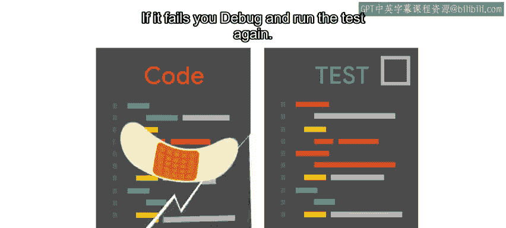
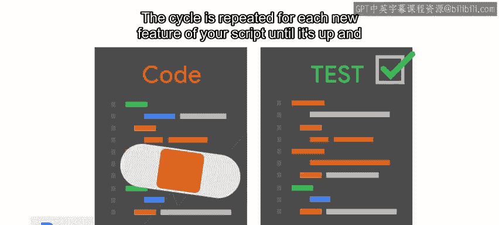

# 谷歌《用Python进行IT自动化办公1、2课（Python、控制操作系统）｜Google IT Automation with Python》中英字幕 - P139：65_测试驱动开发.zh_en - GPT中英字幕课程资源 - BV1gw411E7E1

🎼。う。

You might expect that most testing happens after the code has been written。

This seems like a natural progression First you write your script。

 then you write tests that verify that the script does what you want it to do。

But this isn't always the best approach。A process called Test driven development。

 or PDDD Call for creating the test before writing the code。This might seem a bit counterintuitive。

 but it can make for more thoughtful well written programs。

When presented with a new problem that can be solved by automation。

 your gut instinct might be to fire up your code editor and start writing。

But creating some tests first， make sure that you've thought about the problem that you're trying to solve and some different approaches that you might use to accomplish it。

Writing a test first also helps you think about the ways your program could fail and break。

 which can lead to some valuable insights and even change the approach you take for the better。

The test driven development cycle typically involves first writing a test and running it to make sure it fails。

 After all， you haven't read the code to make it pass yet。Once you verified it fails。

 you write the code that will satisfy the test， then run the test again。

If it passes， you can continue on to the next part of your program。 If it fails。

 you debug and run the test again。 The cycle is repeated for each new feature of your script until it's up and running。

 So before you write your next Python program， you might want to think about the kinds of tests you can create to make sure it's working as you expect。

There are all kinds of resources out there if you'd like to learn more about how you can create code using the test driven development approach。

Lots of them are Python centric， but the principles can be applied to any language you need to create in。

Hopefully， you can see the benefits of writing tests to validate the code you write。

 and you've gained some understanding about the different testing techniques available。Remember。

 that good tests help make any automation and scripts you write more robust。

 resilient and less buggy。Having reliable automation makes life better for everyone。

Many companies take testing a step further and combine it with their version control systems and development processes。

When engineers submit their code， it's integrated into the main repository and tests are automatically run against it to spot bugs and errors in a process called continuous integration。

Although useful， setting up a continuous integration process can be a big undertaking。

We'll talk more about it in a later course。In the meantime。

 if you use unit tests to validate the code you right。

 you're already on your way to a more reliable and robust automation up next。

 a reading summing up all the different types of tests we mentioned。

 followed by a quick quiz to make sure you're on track。

