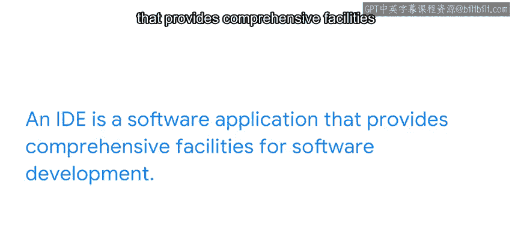

# 谷歌《用Python进行IT自动化办公1、2课（Python、控制操作系统）｜Google IT Automation with Python》中英字幕 - P13：12_代码编辑器和 IDE 概览.zh_en - GPT中英字幕课程资源 - BV1gw411E7E1

Now that we've covered some Python coding basics， we'll introduce you to some of the coding tools。

 coding tools can help you develop， write， debug and visualize your code In this video。

 we'll cover the basics of code editors and integrated development environments or IDdes。

Code editors are tools used to make writing code easier with a code editor， you can write。

 debug and execute programs in Python。 code editors provide features including syntax highlighting。

 automatic indentation， error checking and auto completion。😊，Overall。

 code editors help define the code's structure and function。

 This allows you to write code more efficiently。 They also make it easier to understand variables。

 commands， functions and loops。😊，VS code， Jupiter Notes。

 and COab are some of the code editors we will cover in the next few videos。

Ides have more features than code editors。 The difference between a code editor and an I D E is that a code editor is like a text editor。

 Ides provide direction in writing code and allow you to see how the code executes。

You can think of a code editor like a landline phone。

 You can dial numbers and make phone calls with it。 An I D E is more like a smart phone。

 You can still make phone calls， but it has additional features that allow you to make video calls。

 send text messages， browse the internet and use lots of other applications。😊。

An IdeE is a software tool that simplifies the process of creating a new software application。

 An Ide E is a software application that provides comprehensive facilities for software development。

😊。

Ides always include a code editor。 IDdes allow you to develop code more efficiently by bringing multiple tools into one environment。

 You'll be able to edit， build， test and package all in one application。

 They also allow you to program applications more quickly without having to add manual integration and configuration。

😊，Coming up， we will cover Idle。 Idle is an Ide E that comes with Python automatically。

 It's an excellent beginner level I D E， because it's very simple to use。

 It may not be great for larger projects， but it's excellent for gettinging to know how to use an I D E。

😊，Now， let's dive into some of the code editors and IDEs that you can use as you continue in your Python learning journey。

