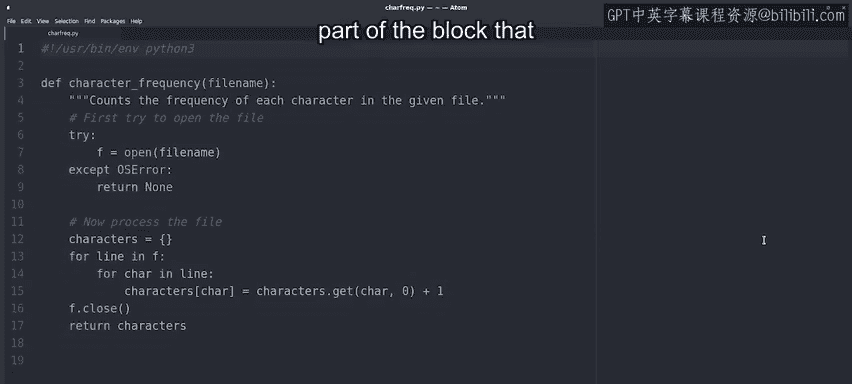
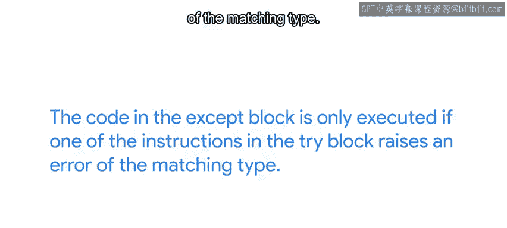

# 谷歌《用Python进行IT自动化办公1、2课（Python、控制操作系统）｜Google IT Automation with Python》中英字幕 - P140：66_try except 构造.zh_en - GPT中英字幕课程资源 - BV1gw411E7E1

Along our journey learning Python， we've encountered errors generated by the interpreter a bunch of times。

We've seen examples of type error， index error， value error， and others。Up to now。

 whenever the interpreter threw one of these at us， we changed our code to avoid the error。

 That's a common approach。 since whenever the interpreter raises one of these errors。

 the program stops。And we don't want our scripts to come to an end before they're done doing their work。

Sometimes it's easy to make a verification with the conditional to avoid the error。

 like in our earlier example of the rearranged name function where we checked if the result from our regular expression search was none and did something different in that case。

Other times， there are so many things that could go wrong that checking for all of them becomes challenging。

Say you had a function that opened the file and did some processing on it。

What if the file doesn't exist？What if the user doesn't have permissions to read the file or what if the file is locked by a different process and can't be opened right now？

We could check all of these conditions， but what if there's yet another thing that could cause the open function to raise an error。

 in a case like this， a better approach is to use the try accept construct。

Let's look at how it works in an example。Our character frequency function here reads the contents of a file to count the frequency of each character in them to do that。

 the first step is to open the file。 In this example。

 we've put the call to the open function inside a try accept block。 What this does is first。

 try to do the operation that we want， which in this case is to open the file。😊，If there's an error。

 it then goes into the accept part of the block that matches the error and does whatever cleanup is necessary here we have only one accept block for the OS error error type。

 but there could be more blocks if the functions called could raise other types of errors。

 so when writing a try accept block， the important thing to remember is that the code in the accept block is only executed if one of the instructions in the try block。

 raise an error of the matching type。

In this case， in the accept block， we're returning none to indicate to the calling code that the function wasn't able to do what was requested of it。

Returning none when something fails is a common pattern， but not the only one。

 We could also decide to set a variable to some base value， like 0 for numbers。

 empty string for strings， empty list for list and so on。

It all depends on what our function does and what we need to get that work done。

The important point is that when we have an operation that might raise an error。

 we want to handle that failure gracefully by using the try Ac lock。

The operation could be opening a file， converting a value to a different format。

 executing a system command， sending data over the network， or any other action that might fail。

 and isn't trivial to check with a conditional。To use a try accept block。

 we need to be aware of the errors that functions that we're calling might raise。

This information is usually part of the documentation of the functions。Once we know this。

 we can put the operations that might raise errors as part of the tribe block and the actions to take when errors are raised as part of the corresponding accept block。

You're probably asking yourself。How do I raise my own errors？Lucky for you， that's up next。

 we'll dive into how to raise our own errors when necessary。

