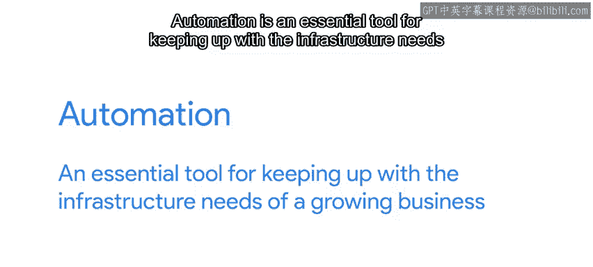

# 谷歌《用Python进行IT自动化办公3、4、5、6课（Git、debug、云端、实践）Google IT Automation with Python》中英字 - P141：24_什么是规模.zh_en - GPT中英字幕课程资源 - BV1LW4y1F7XW

In this course， we'll focus on making our work scale。So what do we mean when we talk about scale？

Being able to scale what we do means that we can keep achieving larger impacts with the same amount of effort。

When a system scales well， an increase in the amount of work it needs to do can be accommodated by an increase in capacity。

For example， if the web application your company provides is scalable。

 then it can handle an increase in the number of people using it by adding more servers to serve requests。

In short， a scalable system is a flexible one。Adding more computers to the pool of servers that are serving the website can be a very simple or very hard operation。

 depending on how your infrastructure is set up。To figure out how scalable your current setup is。

 you can ask yourself questions like，Will adding more servers increase the capacity of the service？

How are new servers prepared， installed， and configured？

How quickly can you set up new computers to get them ready to be used。

 Could you deploy 100 servers with the same I T team that you have today。

 or would you need to hire more people to get it done faster。

Would all the deployed servers be configured exactly the same way？

Scaling isn't just about website serving content， of course。

If your company is rapidly hiring a lot of new employees。

 you'll need to have an onboarding process that can scale as needed。

And as you keep adding new computers to the network。

 you'll need to make sure that your system administration process can scale to the growing needs of the company。

This can include tasks like applying the latest security policies and patches。

 while making sure users needs still get addressed。

 all while more and more users join the network without new support staff to back you up。

If making this happen sounds a bit like magic right now。

 remember that we're here to share the secret ingredient with you， automation。

Automation is an essential tool for keeping up with the infrastructure needs of a growing business。

By using the right automation tools， we can get a lot more done in the same amount of time。

For example， we could deploy a whole new server by running a single command and letting the automation take care of the rest。

We could also create a batch of user accounts with all the necessary permissions based on data already stored in the database。

 eliminating all human interaction。Automation is what lets us scale。

 It allows a small IT team to be in charge of hundreds or even thousands of computers。 Okay。

 so what does that look like in practice？There's a bunch of different tools that we can use to achieve this。

Up next， we'll talk about a type of tool called configuration management that can help us automate how we manage the computers in our fleets。

