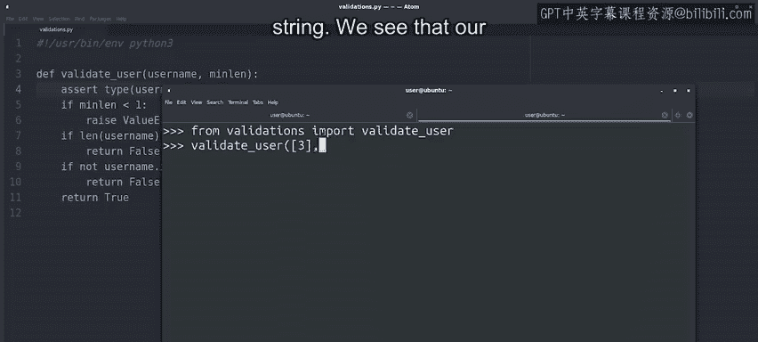

# 谷歌《用Python进行IT自动化办公1、2课（Python、控制操作系统）｜Google IT Automation with Python》中英字幕 - P141：67_引发错误.zh_en - GPT中英字幕课程资源 - BV1gw411E7E1

In the last video， we looked into how to handle errors when they're raised by the functions that we call。

 In some cases， we might want to raise and error ourselves。

This usually happens when some of the conditions necessary for a function to do its job properly aren't met and returning none。

 or some other base value isn't good enough。Let's look at this through an example。

 sayy we had a function that verifies whether a chosen username is valid。

 One of the checks this function does is verify that the provided name is at least a certain amount of characters with the minimum value received by a parameter。

Something like this。In this function， we're first checking that the username variable has at least min Lang characters。

After checking that， we verify if there are any non alphanumeric characters in the string。

 which is another criteria for validating a username。If all the checks pass。

 we return true to indicate that the username chosen is valid。

This code works as long as the provided values are sensible。

What would happen if the min L variable is0 or a negative number？

Our function will allow an empty username as valid， which doesn't make much sense。

To prevent this from happening， we can add an extra check to our function。

 which will verify the received parameters are sane。In this case。

 returning false would be misleading because it's not necessarily that the username is invalid。

 but the provided min L value doesn't make sense， so let's add a check to verify that MinLang is at least one and raise an error if that's not the case。

Cool， as you can see， the keyword to generate an error in Python is rays。

We can erase a bunch of different errors that come already prebuilt with Python。

 or we can create our own if the standard ones aren't good enough。In this case。

 we're raising a value error， a type of error that we've come across before to indicate that there was a problem with one of the values of the parameters。

Let's save our code and then try it out in the interpreter。Success。

 we imported our function and called it with an invalid parameter。

 Our function successfully raised an error， just like we wanted。😊。

I bet you didn't expect that there'd be a point where getting an error would mean you're doing things right。

 huh？Let's also try calling it with valid parameters to see if those work。Okay， that seems to work。

What if instead of passing the string， we pass something different as a username to validate？

Let's try a few examples first， let's try a number。Oh oh， in this case。

 the Python interpreter raised an error because our code is trying to use the length function and we can't do that with integers。

Let's start passing a list which does have a length function。First， an empty list。

Because this list is shorter than the minimum length， our code returned false。Now。

 let's try it with a list of one element。HaSo in this example。

 we got a different error because we were trying to use the I Al nu method。

 which is not available on list。We managed to get three different possible results when passing a value that wasn't a string。

Depending on how our function is going to be used， this could be okay。

It's usually the responsibility of whoever's calling a function to call it the right parameters。

 But in some cases， we might want to do this explicitly by checking that we're receiving a value that makes sense to that function。

 So let's look at an alternative to the raise keyword that we can use for situations when we want to check that our code behaves the way it should。

 particularly when we want to avoid situations that should never happen。This is the assert keyword。

 This keyword tries to verify that a conditional expression is true， and if it's false。

 it raises an assertion error with the indicated message。Let's add an assertion to our function。

We've added an assertion that verifies that the type of the username variable is STR。

 which we know is a name that the interpreter uses for strings。

If the function is called with a username parameter， that's not a string。

 an error will be raised with the message we provided。Let's try this out， first。

 we'll need to close our interpreter and restart it to import the modified module。All right。

 let's start calling our function with something that's not a string。

Aha， we see that our function now raises an error type assertion error if the first parameter isnt a string。

 As we've called out， we usually don't need to check the types of our parameters。

Depending on what our function does， it might be perfectly okay for it to allow scripts to call it with parameters of different types。

 Assions can be super helpful if we're debugging some code that's not behaving the way we expect it to。

We can add them at any point where we want to ensure that the variables contain the values and types that they should。

Or when we think that something that shouldn't happen is happening。Heads up， though。

Assertions will get removed from our code if we ask the interpreter to optimize it to run faster。

 So as a rule， we should use rays to check for conditions that we expect to happen during normal execution of our code。

And assert to verify situations that aren't expected， but that might cause our code to misbehave。

By now， we've seen how we can handle errors when the code we call generates them and how we can raise our own errors when we want our code to signal that something hasn't gone well。

This is complex stuff， and it's okay if it takes a little while for it to sink in。As usual。

 we'll include a cheat sheet and give you plenty of opportunities to practice your newly acquired air handling skills。

Up next， we'll look into how we can add tests to verify that our function raises the errors that it needs to raise。

