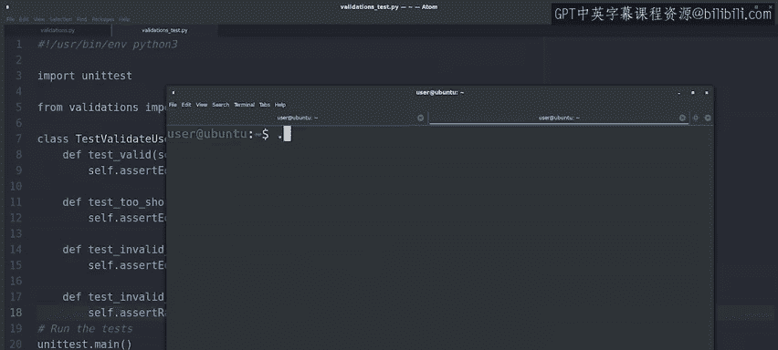

# 谷歌《用Python进行IT自动化办公1、2课（Python、控制操作系统）｜Google IT Automation with Python》中英字幕 - P142：68_测试预期错误.zh_en - GPT中英字幕课程资源 - BV1gw411E7E1

In earlier videos， we looked into how we can create unit tests for our functions for both the basic cases and the edge cases。

 We called out that we should try to cover lots of different possible cases to make sure that our function behaves correctly in all of them。

😊，With some edge cases like the negative value of minland in our earlier example。

 the expectation is that the function will raise an error， and we want to be able to test that too。

 So how do we do that。Well， we use the Ast raises method provided by the unit test module。

Let's check this out by adding a couple of test cases to the test suite for our validate user function。

 this is the existing test suite。As you can see， we've got a few test cases checking that the function is working correctly when it receives same parameters。

We now want to add some other cases for when it receive parameters that don't make sense。

 like a negative value for Minland or a username thats list instead of a string。Let's do that now。

We can see that the assert raises method works a little bit differently than the assert equaled method that we used before。

In this case， we need to first pass the error that we expect the function to raise。

 then the function name followed by any parameters that need to be passed to that function。

Behind the scenes， this method is calling the function that we want to test using the try accept block and checking that it does raise the error that we said it would raise。

Okay， let's run this test suite and verify that our code works correctly。

All clear with that， you now know how to test your code to verify that it does what it should and how to test that it raises the right error when that's what you expect。

 Com up， a cheat sheet covering all the air handling syntax that we just saw in these videos。

 followed by another opportunity for you to test your skills。

