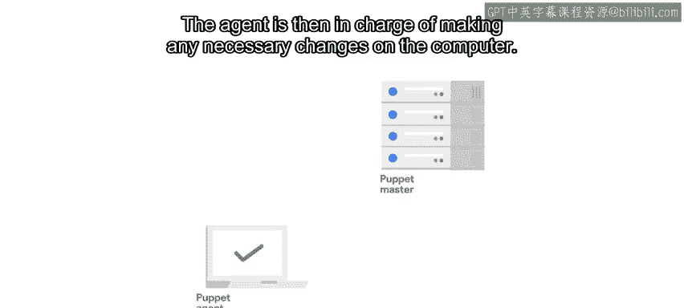
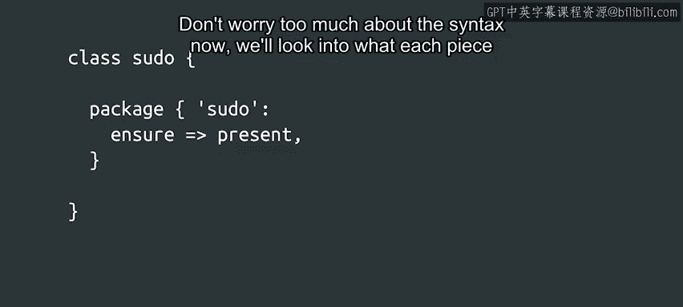

# 谷歌《用Python进行IT自动化办公3、4、5、6课（Git、debug、云端、实践）Google IT Automation with Python》中英字 - P144：27_什么是 Puppet.zh_en - GPT中英字幕课程资源 - BV1LW4y1F7XW

As we called out a couple times already， in this course。

 we'll be learning how to apply basic configuration management concepts by using puppet。

Puppet is the current industry standard for managing the configuration of computers in a fleet of machines。

Part of the reason why Puppet is so popular is that it's a cross platform tool that's been around for a while。

It's an open source project that was created in 2005 and has gone through several different versions。

As it's evolved， the tool has incorporated feedback from its users to make it more and more useful。

 The latest available version at the time of this Google courseurse went live is Puppet 6。

 which came out in late 2018。We typically deploy puppet using a client server architecture。

 The client is known as the puppet agent， and the Ser is known as the puppet master。

When using this model， the agent connects to the master and sends a bunch of facts that describe the computer to the master。

The master then processes this information， generates the list of rules that need to be applied on the device。

 and sends this list back to the agent。The agent is then in charge of making any necessary changes on the computer。

 Puppet is a cross platform application available for all Linux distributions， Windows and Mac OS。

This means that you can use the same puppet rules for managing a range of different computers。

 What are these rules that we keep talking about。Let's check out a very simple example。

This block is saying that the package pseudo should be present on every computer where the rule gets applied。

If this rule is applied on 100 computers， it would automatically install the package in all of them。

 This is a small and simple block， but can already give us a basic impression of how rules are written in puppet。

Don't worry too much about the syntax。 Now。 we'll look into what each piece means in future videos。

 There are various installation tools available， depending on the type of operating system。

Puppet will determine the type of operating system being used and select the right tool to perform the package installation On Linux distributions。

 there are several package management systems like apt， Yum and DNF。

Puppet will also determine which package manager should be used to install the package。On MacOS。

 there's a few different available providers depending on where the package is coming from。

The Apple provider is used for packages that are part of the O。

 while the Macports provider is used for packages that come from the Macports project for Windows。

 will'll need to add an extra attribute to our rule。

 St where the installer file is located on the local desk or a network mounted resource。

 Puppet would then execute the installer and make sure that it finishes successfully。

 If you use chocolate to manage your Windows packages。

 You can add an extra chocolatety provider to puppet to support that。

 We'll add a link to more information about this in our next reading。 using rules like this one。

 We can get puppet to do a lot more than just install packages for us。 We can add。

 remove or modify configuration files stored in the system or change registry entries on Windows。

We can also enable， disable， start or stop the services that run on our computer。

 We can configure Chme jobs or scheduled tasks， add， remove or modify users and groups。

 or even execute external commands if that's what we need。There's a lot to say about puppet。

 We won't go into absolutely every detail， but we'll cover the most important concepts in this course。

The goal is to get you started with what you need to know about configuration management in general and puppet in particular。

We'll also give you pointers to find out more information on your own Up next。

 we'll check out the different resources we can use to define our rules。

