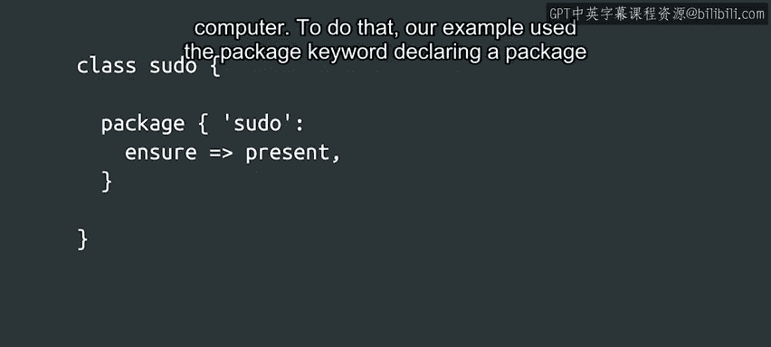
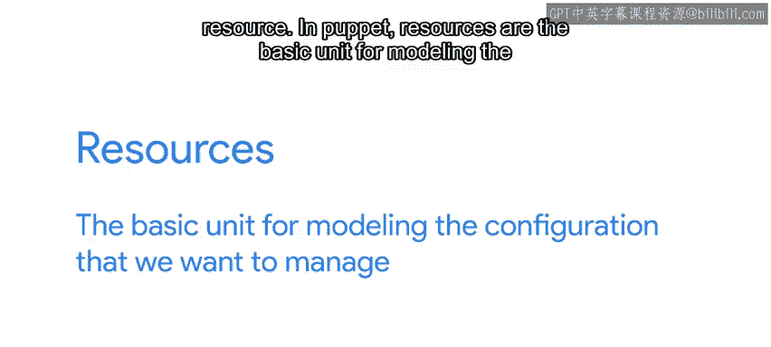
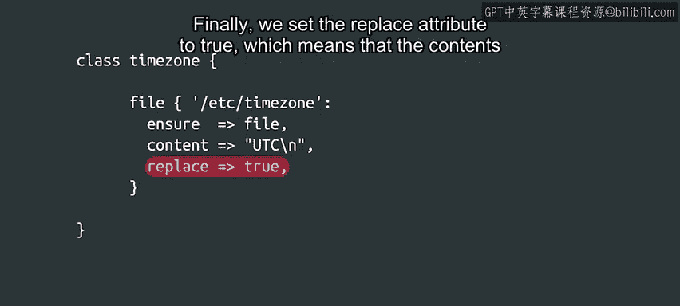
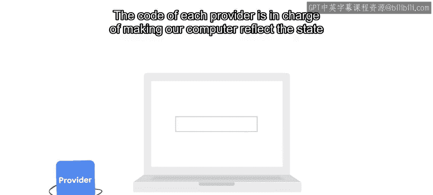

# 谷歌《用Python进行IT自动化办公3、4、5、6课（Git、debug、云端、实践）Google IT Automation with Python》中英字 - P145：28_Puppet 资源.zh_en - GPT中英字幕课程资源 - BV1LW4y1F7XW

In our last video， we saw an example that installed the pseudo package in a computer。To do that。

 our example used the package keyword， declaring a package resource。

In puppet， resources are the basic unit for modeling the configuration that we want to manage。

In other words， each resource specifies one configuration that we're trying to manage。

 like a service， a package， or a file。Let's look at another example。In this case。

 we're defining a file resource。This resource type is used for managing files and directories In this case。

 it's a very simple rule that ensures that Etsystl。d exists and is a directory。

Let's talk a little bit about syntax In both our last example and this one。

 we could see that when declaring a resource in puppet。

 we write them in a block that starts with the resource type。 in this case， file。

The configuration of the resource is then written inside a block of curly braces right after the opening curly brace。

 we have the title of the resource followed by a colon。

After the colon come the attributes that we want to set for the resource in this example。

 we're once again setting the insure attribute with directory as the value。

 but we could set other attributes too。Let's check out a different file resource。 In this example。

 we're using a file resource to configure the contents of Etsy time zoneone。

 a file that's used in some Linux distributions to determine the time zone of the computer。

This resource has three attributes。 First， we explicitly say that this will be a file instead of a directory or a simlink。

Then we set the contents of the file to the UTC time zone。Finally。

 we set the replace attribute to true， which means that the contents of the file will be replaced。

 even if the file already exists。

We've now seen a couple examples of what we can do with the file resource。

There are a lot more attributes that we could set， like file permissions。

 the file owner or the file modification time。We've included a link to the official documentation in the next reading where you can find all the possible attributes that can be set for each resource。

 How do these rules turn into changes in our computers。

When we declare a resource in our puppet rules， we're defining the desired state of that resource in the system。

 The puppet agent then turns the desired state into reality using providers。

The provider used will depend on the resource defined and the environment where the agent is running。

Puppet will normally detect this automatically without us having to do anything special When the puppet agent processes a resource at first decides which provider it needs to use。

 then passes along the attributes that we configured in the resource to that provider。

The code of each provider is in charge of making our computer reflect the state requested in the resource。

In these examples， we've looked at one resource at a time up next。

 we'll see how we can combine a bunch of resources into more complex puppet classes。

I'll supply the felt and scissors。