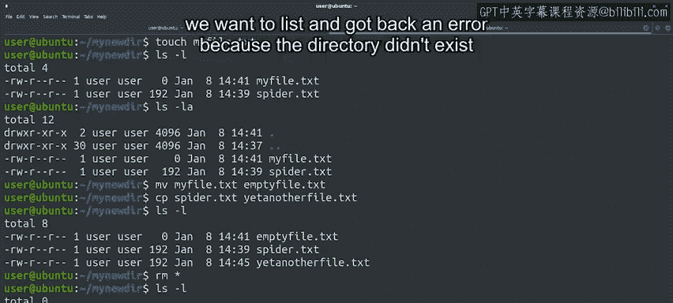

# 谷歌《用Python进行IT自动化办公1、2课（Python、控制操作系统）｜Google IT Automation with Python》中英字幕 - P145：71_基本 Linux 命令.zh_en - GPT中英字幕课程资源 - BV1gw411E7E1

We've already used a bunch of Linux commands by now。 So hopefully， these commands aren't too foreign。

You may remember that Echo is command used to print messages to the screen。

Cat is a command for showing content of files。 LS is a command to list content of a directory。

 C H mod is a command to change permissions of a file and so on。 As we called out before。

 a lot of these commands come from Muix。Back in the 70s。

 when designing how these programs should behave， the philosophy was that they should do one thing and do it very well。

 which means we have a lot of commands， each for doing specific thing。We'll go through them quickly。

 but as usual， we'll provide a cheat sheet afterwards that you can use as a reference。

You have plenty of time to review these commands and practice on your own。So， let's get started。

To create a new directory， we use theMakeDR command。To change into that directory。

 we use the CD command。As you might notice， these commands don't print anything to the screen。

This is normal and to be expected。A lot of the commands that we use don't print anything when they succeed。

 They only print something， if they fail。To check that the CD command succeeded。

 we can use a command like PWD to print the current working directory。Okay。

 we have a directory which is empty。We can copy files using the CP command。For example。

 we can copy the Sp。 TXT file that we have in the parent directory。H， what are all those dots？

These are shortcuts that we can use to refer to some special directories。

The dot dot shortcut reverses the parent directory。 the previous directory and the absolute path。

 while the dot shortcut reverses the current directory。

 So this command is copying the Sp dot Tx T file located in the previous directory to this directory。

 Does that connect the dots。 We can also create an empty file using the touch command。

So by now we have two files in our directory， the spider。txc file that we copied， and the myfiile。

txc that we created using the touch command。Let's look at the contents of our directory using the LS L command。

Nice， we've now called the LS command using the dash L command line argument。Remember。

 command line arguments let us change the behavior of commands， making them do what we want。

Without any arguments， LS would just list the names of the files contained in directory。

By passing the dash L， we get a lot of extra information distributed in a bunch of columns。

Pop quiz time。What are these columns？The first column indicates the permissions of the file。

The second column is the number of i notess that points to the file。

The third and fourth columns indicate the owner and the group to which the file belongs。

Then comes the size of the file， the date of last modification， and finally the name。In our case。

 we have the file that we copied， which has 192 bytes and another file that we created using the touch command。

 which has zero bytes。Let's check out another LS command line argument by calling LS L A。

The dash a flag shows hidden files， which are the ones that start with a dot。In this case。

 the only ones are the shortcuts that we called out earlier。

The dot shortcut for the current directory and the dot dot shortcut for the parent directory。

The sizes of these directories are related to the amount of files in them。To rename or move a file。

 we use the MV command。To copy a file， we use the CP command， like we mentioned earlier。

We've now renamed my file。 Txt to emptyfiile。txt and created a new copy of the Spid。txt file。

Each of these commands use the same format。The first parameter is the old file。

 and the second parameter is a new file。Let's look at the contents of our directory now。

We see that we now have two copies of our file with 192 bytes。

 and the empty file is now called emptyfilile。txT。To delete these files， we can use the RM command。

 we can either go one by one or we can delete them all together using the star。

The star is a placeholder that gets swapped out by the names of all the files in our directory。

So our directory is once again empty。Now let's get rid of it。First。

 we need to change to the previous directory。We do that using CD dot dot。Again。

 dot dot is the way we use to identify whatever was a previous directory。Alright。

 now we can delete the directory using R M D。This command only works on empty directories。

 so it wouldn't work if we had left any files in it。This time， when calling the LS command。

 we passed the name of the directory that we wanted to list and got back in error because the directory didn't exist anymore。

Did it ever really exist at all？Really makes you think。Anyway。

 that was a quick overview of some of the commands we have in Linux to operate with files and directories。

There are tons of other commands to talk about， but not enough time to talk about them all。

We'll mention some of them in the next few videos and put more info about them in the cheat sheet。

Make sure to investigate and practice using them all on your own。

 Remember that reading the documentation for any given system command can help you learn more about what it does。

On Uni Space System， this documentation can usually be found in manual or Man pages using the Man command。

Let's keep moving Up next， we'll talk about a different aspect of the command line interaction。

How to redirect I O streams。 See you there。