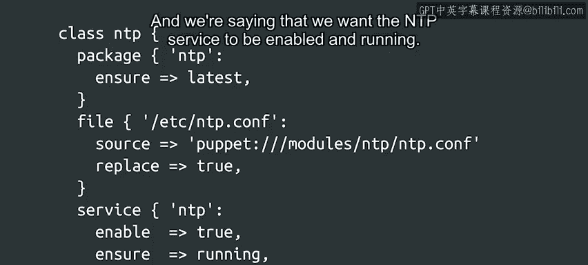

# 谷歌《用Python进行IT自动化办公3、4、5、6课（Git、debug、云端、实践）Google IT Automation with Python》中英字 - P146：29_Puppet 类.zh_en - GPT中英字幕课程资源 - BV1LW4y1F7XW

In the examples of puppet code that we've seen so far。

 we've declared classes that contain one resource。You might have wondered what those classes were for。

We use these classes to collect the resources that are needed to achieve a goal in a single place。

For example， you could have a class that installs a package。

 sets the contents of a configuration file， and starts the service provided by that package。

Let's check out an example like that。In this case， we have a class with three resources， a package。

 a file， and a service。All of them are related to the network time protocol or NTP。

 the mechanism our computers use to synchronize their clocks。

Our rules are making sure that the NTP package is always upgraded to the latest version。

We're setting the contents of the configuration file using the source attribute。

 which means that the agent will read the required contents from the specified location。

And we're saying that we want the NTP service to be enabled and running by grouping all of the resources related to NTP in the same class。

 We only need a quick glance to understand how the service is configured and how it's supposed to work。

This would make it easier to make changes in the future since we have all the related resources together。

 it makes sense to use this technique whenever we want to group related resources。 For example。

 you could have a class grouping all resources related to managing log files or configuring the time zone。

Or handling temporary files in directories。You could also have classes that group all the settings related to your web serving software。

 your email infrastructure， or even your company's firewall。

 We're just getting started with Puppets's basic resources and seeing how they can be applied。

In further videos， we'll be learning a lot more about common practices when using configuration management tools。

 but before jumping into that， we've put together a reading with more information about puppet syntax。

 resources， and links to the official reference。Then we've got a quick quiz to check that everything is making sense。

