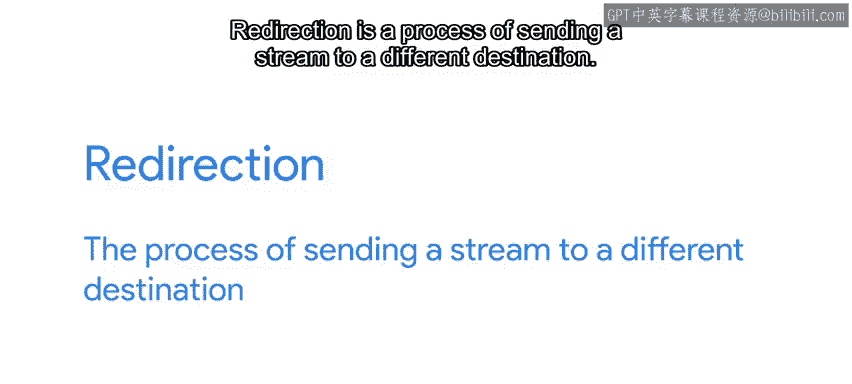
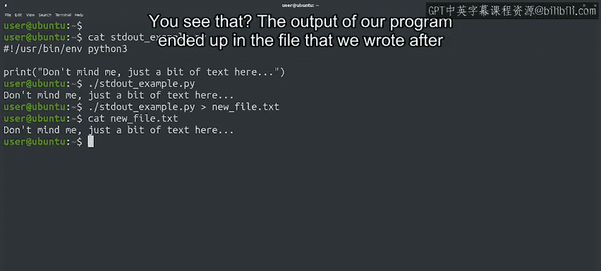
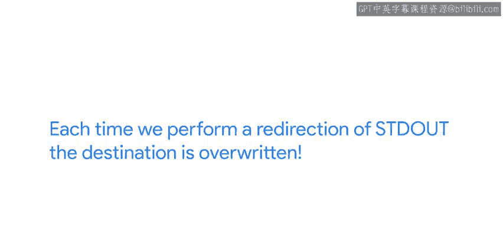
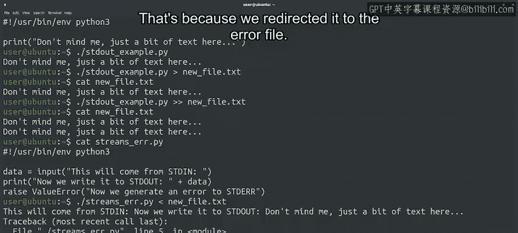

# 谷歌《用Python进行IT自动化办公1、2课（Python、控制操作系统）｜Google IT Automation with Python》中英字幕 - P146：72_重定向流.zh_en - GPT中英字幕课程资源 - BV1gw411E7E1

So now that we've covered a few basic Linux commands。

 let's talk more about what we can do with IO streamreams and Bsh。In an earlier video。

 we talked about the standard IO streams。 By default。

 the input is provided by the keyboard at the text terminal and the output and error are shown on the screen。

 This is the case not only for our Python scripts， but for all system commands。

We can change this default using the process called redirection。

Redirection is a process of sending a stream to a different destination。

This process is provided to us by the operating system and can be really useful when we want to store the output of a command in a file instead of just looking at it on a screen to redirect the standard output of a program to a file。

 we use the greater than symbol。😊，For example， take the following Python program。

 which just prints a single line of text using the print function。

If we run this program without redirection， the text will be sent to the display using the STD out normally。

But now if we use the greater than character to redirect the output instead。

 something else happens entirely。When we run it this way， the STD out from SCDoutexle。

 Pi script is redirected to a file called New fileile。txT。If that file doesn't exist， it's created。

Let's look the contents of newphi。txt using the CA command。You see that？

The output of our program ended up in the file that we wrote after the greater than symbol， beware。

 just like we saw earlier with the W file mode used by the open function。

 each time we perform a redirection of STD out， the destination is overwritten。

So we need to be super careful when using this redirection that we're not overr a file with valuable contents。

If we want to append the redirected standard out to a file。

 we can use the double greater than sign instead of a single greater than。 Isn't that great。

In a similar way， we can also redirect the standard input。

Instead of using the keyboard to send data into a program。

 we can use the Lesband symbol to read the contents of a file。

Let's try this out with a new version of the Stamtopt P file that we saw in an earlier video。Okay。

 now let's redirect the contents of our new file to this script。Awesome， in this case。

 we don't see the input on the screen in the STD in portion。

 This is expected because the input was read from a file。

 So it only appears in the STD out portion where we see that it read one of the two lines。

This is also expected because the input function only reads until it encounters a new line character。

It can also be useful to redirect STDR to capture errors and diagnostic messages from a program。

This can be done by using the character combination2 greater than similar to how we redirected STD out before。

 Let's execute our stream example again this time redirecting the air output to a separate file。

So this time we don't see the error message on the screen。

 that's because we redirected it to the error file。

 Let's see if we can find any goodies in the contents of that file。

Aha， there's our error。If you're wondering about the number two。

 it represents the file descriptor of the STD Ustreamam。In this context。

 you can think of a file descriptor as a kind of variable pointing to an IO resource， in this case。

 the STD Earthstreamam。0 and1 are the file descriptors for STDN and STD out like we called out already。

 none of this is exclusive to Python。 We can operate in the same way with all other commands。

 For example， we can create a file using the echo command and redirecting its output to the file that we want to create。

Boom， and as usual， we can see the contents of our new file using our friend Cat。😊，Allright。

 so now we've seen how we can redirect input and output to files。

 How about redirecting between programs。 That's coming up next in our next video。😊。

