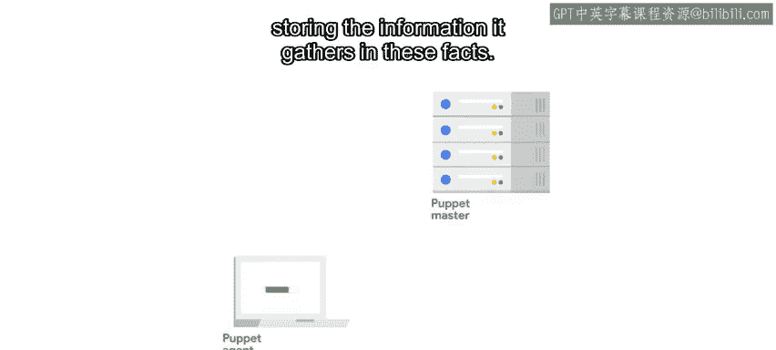
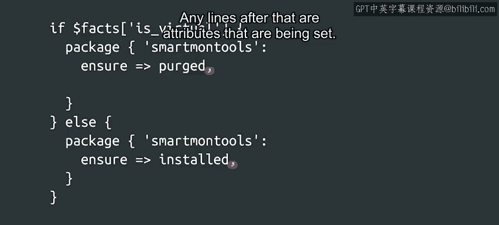

# 谷歌《用Python进行IT自动化办公3、4、5、6课（Git、debug、云端、实践）Google IT Automation with Python》中英字 - P147：30_什么是领域特定语言.zh_en - GPT中英字幕课程资源 - BV1LW4y1F7XW

Up until now， we've seen examples of very simple puppet rules that just define one or more resources。

These resources are the building blocks of puppet rules。

 but we can do much more complex operations using Puppets's domain specific language or DSL。

Typical programming languages like Python， Ruby， Java。

 or Go are general purpose languages that can be used to write lots of different applications with different goals and use cases。

On the flip side， a domain specific language is a programming language that's more limited in scope。

Learning a domain specific language is usually much faster and easier than learning a general purpose programming language。

 because there's a lot less to cover。 You don't need to learn as much syntax or understand as many keywords or take into account a lot of overhead in general。

 In the case of puppet， the DSL is limited to operations related to when and how to apply configuration management rules to our devices。

For example， we can use the mechanisms provided by the DSL to set different values on laptops or desktop computers。

 or to install some specific packages only on the company's web servers on top of the basic resource types that we already checked out。

 Puppets's DSL includes variables， conditional statements and functions。Using them。

 we can apply different resources or set attributes to different values。

 depending on some conditions。 Before we jump into an example of what that looks like。

 let's talk a bit about puppet facts。Facts are variables that represent the characteristics of the system when the pupp agent runs。

 it calls a program called factor， which analyzes the current system。

 storing the information it gathers in these facts。 Once it's done。

 it sends the values for these facts to the server。

 which uses them to calculate the rules that should be applied。

Puppet comes with a bunch of baked in core facts that store useful information about the system。

 like what the current OS is， how much memory the computer has。

 whether it's a virtual machine or not， or what the current IP address is。

If the information we need to make a decision isn't available through one of these facts。

 we can also write a script that checks for the information and turns it into our own custom fact。

Let's check out an example of a piece of puppet code that makes use of one of the built in facts。

This piece of code is using the Is virtualrual fact together with a conditional statement to decide whether the smart Montos package should be installed or purged。

This package is used for monitoring the state of hard drives using smart。

 so it's useful to have it installed in physical machines。

 but it doesn't make much sense to install it in our virtual machines。

We can see several of the characteristics of puppet's domain specific language in this block。

So let's spend a little time looking at all the elements of syntax here。First， facts is a variable。

All variable names are preceded by a dollar sign in puppets's DSL。In particular。

 the facts variable is what's known as a hash in the puppet DSL。

 which is equivalent to a dictionary in Python。This means that we can access the different elements in the hash using their keys。

In this case， we're accessing the value associated to the I virtualrual key。Second。

We see how we can write a conditional statement using FL enclosing each block of the conditional with curly braces。

And finally， each conditional block contains a package resource We've seen resources before。

 but we haven't looked at the syntax in detail， so let's do that now。

Every resource starts with the type of resource being defined， in this case。

 package and the contents of the resource are then enclosed in curly braces。

Inside the resource definition， the first line contains the title， followed by a colon。

Any lines after that are attributes that are being set。

We use equals greater than to assign values to the attributes。

 and then each attribute ends with a comma。

We've now covered a large chunk of puppets's DSL syntax。

 If you look back to what it was like to learn your first programming language。

 you'll probably notice how much less syntax there is to learn here。

That's typical of the domain specific languages used by configuration management tools。

While each tool uses their own DSL， they're usually very simple and can be learned very quickly Up next。

 we'll talk about a few other principles behind most configuration management tools。

Whenever you're ready， let's dive in。