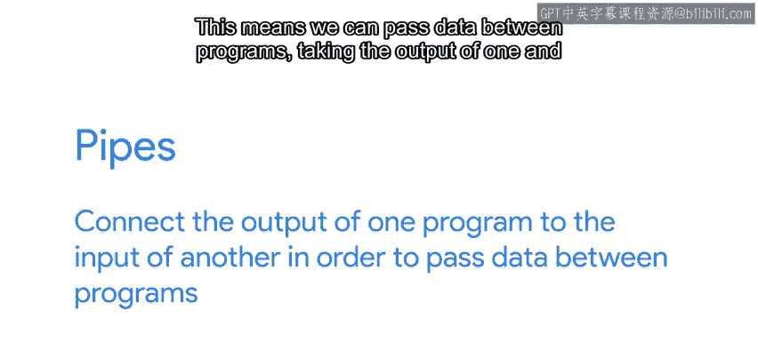
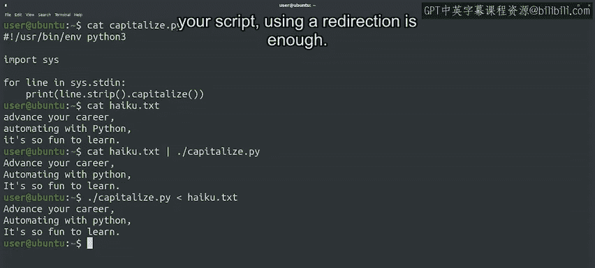

# 谷歌《用Python进行IT自动化办公1、2课（Python、控制操作系统）｜Google IT Automation with Python》中英字幕 - P147：73_管道和管道线.zh_en - GPT中英字幕课程资源 - BV1gw411E7E1

On top of the redirection to and from files that we saw in the last video。

 there's another powerful way to perform IO streamre redirection called piping。Using pipes。

 you can connect multiple scripts， commands， or other programs together into a data processing pipeline。

Pipes connect the output of one program to the input of another。

 This means we can pass data between programs， taking the output of one and making it the input of the next pipepes are represented by the pipe character。

Using pipes is an extremely useful tool。 It allows us to create new commands by combining the functionality of one command with the functionality of another without having to store the contents in an intermediate file。

 So let's work on our plumbing， shall we？ Here's an example。😊，Here。

 the output of the LS L command is connected to the input of the lesss command。

 which is a terminal paging program。This example can be pretty useful when you want to look at the content of a directory containing lots of files。

 the list of files generated by LS is piped to less， which displays them one page at a time。

We can scroll up or down using the page up， page down or arrow keys。

And once we're done looking at the files， we can quit with Q。But it doesn't have a stop there。

 It's possible to connect a lot more than just two programs using pipes。

We'll check this out using a more elaborate example。That's a complex command line。

 Let's go through it step by step。We're first using CAAT to get the content of our spider。

txc file those contents are then sent to a command called TR。

 which gets its name from the word translatelate。It takes the characters in the first parameter。

 in this case， it's a space and then transforms them into a character in the second parameter。

 In this case， it's a new line character。So basically。

 what we're doing is putting each word in its own separate line Hooray for organization。 Next。

 we pass the results of the sort command through a pipe。This command sorts results alphabetically。

The sorter results are then passed to the unique command， which displays each match once。

 and by using the dash C flag， it prefixes each unique line with the number of times it occurred。

 This output is passed via pipe to the sort command once more This time with the dash and R flag。

 which sorts results numerically and in reverse order from most to least hits。

The output is finally passed to the head command， which prints the first 10 lines to STD out。Whoa。

 that's a lot to process。But when you break it down， it makes a lot of sense， right？

The point isn't to memorize all these commands， but to know that we can pipe as many commands as we need to do exactly what we want。

 You can use your Python scripts and pipelines， too。

Python can read from standard input using the STDN file object provided by the Ss module。

This is a file object like the one we obtained using the open function。 and like your local library。

 this file object is already open for reading。 Let's say we want to write a script that reads each line of the input and then prints the line with the first character in uppercase。

To do this， we'll take advantage of the capitalize string method。It looks something like this。

In this script， we're iterating over the contents of the assist。sD In fileile。

 remember that when we iterate a file object， we go through it line by line。

For each of the lines of a file， we first use the strip method to remove the new line character at the end。

 then capitalize method to make the first character of the line uppercase。

 and then we print it out to standard output。 Now， let's use a script to capitalize a file that we have in our computer called Haiku。

 TxT。Let's see the contents of it， using cat。Shakespeare couldn't have said it better。 Now。

 let's use a pipeline to capitalize our haiku by combining the output of a cat command with our capitalize script。

The CAAT command sends the contents of the Haiku。 Txc file to standard output。

 which we redirect to our script using a pipe。Our capitalize script uses the cis STD In fileile object to iterate through each line of standard input。

 printing the capitalized version to standard output It's truly poetic， isn't it。

 We should also call out that we don't need to use a pipe to get the contents of the Haiku。

 Txc file into standard input of our script。Instead。

 we use the redirection operator we saw in the last video like this。As a rule。

 if you just need to get something from standard input into your script。

 using a redirection is enough。

But if you want this to be part of a bigger pipeline of commands。

 you'll need to combine them with pipes。For example。

 if we only want to capitalize the lines that match a certain pattern。

 we could first call GrP and then connect it with the pipe to our script with a little practice creating pipelines is a fast and powerful way to perform lots of system administration tasks。

When a system command doesn't exist with a functionality that you need。

 you can write a Pi script to fill in the gap and include it in your pipeline。

Understanding how to redirect IO streams can come in handy in many situations and when writing code2。

We'll see plenty of more examples of this down the pipe， get it， pipe。Okay， sorry。 Up next。

 we'll dive into the different ways we can send signals to the running processes on our computer。

