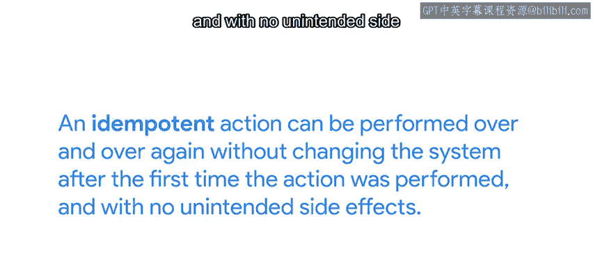
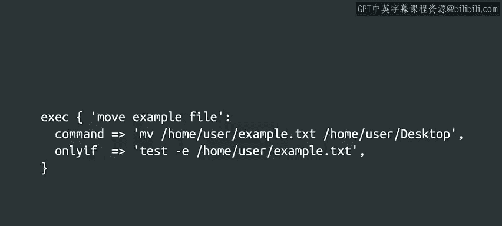

# 谷歌《用Python进行IT自动化办公3、4、5、6课（Git、debug、云端、实践）Google IT Automation with Python》中英字 - P148：31_配置管理的驱动原则.zh_en - GPT中英字幕课程资源 - BV1LW4y1F7XW

Up to now， we've seen a few examples of what puppet rules look like。

 including a bunch of different resources and even a conditional expression。

 you might have noticed that in all the examples we've checked out。

 we were never telling the computer the steps it should follow in order to do what we wanted。Instead。

 we were just declaring the end goal that we wanted to achieve。

Like going to a drive through and ordering a burger， we didn't make it， but there it is。

The providers that we mentioned earlier， like apt and Ym are the ones in charge of turning our goals into whatever actions are necessary。

 We say that puppet uses a declarative language because we declare the state that we want to achieve rather than the steps to get there。

 Traditional languages like Python or C are called procedural。

 because we write out the procedure that the computer needs to follow to reach our desired goal。

Coming from a procedural language like Python， it might take some time to get used to writing declarative code like the ones used for puppet。

 and that's okay。Just remember that when it comes to configuration management。

 it makes sense to simply state what the configuration should be。

 not what the computer should do to get there， say you're using a resource to declare that you want a package installed。

 you don't care what commands the computer has to run you install it。

 you only care that after the configuration management tool has run， the package is installed。

Another important aspect of configuration management is that operations should be item potent。

In this context， an idpotent action can be performed over and over again without changing the system after the first time the action was performed and with no unintended side effects。

Let's check this out with an example of a file resource。

This resource ensures that the Etsy I file has a set of permissions and a specific line in it。

Fulillfilling this requirement is an item potent operation。

If the file already exists and has the desired content。

 then puppet will understand that no action has to be taken。If the file doesn't exist。

 then puppet will create it。If the contents or permissions don't match， it will fix them。

And no matter how many times the agent applies the rule。

 the end result is that this file will have the requested contents and permissions。

Item potency is a valuable property of any piece of automation。If a script is idpotent。

 it means that it can fail halfway through its task and be run again without problematic consequences。

Say you're running your configuration management system to set up a new server。 Unfortunately。

 the setup fails because you forgot to add a second disk to the computer and the configuration required two disks。

If your automation is item potent， you can add the missing disc and then have the system pick up from where it left off yay。

Most puppet resources provide item potent actions， and we can rest assured that two runs of the same set of rules will lead to the same end results。

An exception to this is the exactec resource， which runs commands for us。

The actions taken by the exact resource might not be item potent since a command might modify the system each time it's executed To understand this。

 let's check out what happens when we execute a command that moves a file on our computer。First。

 we'll check that the example。txt file is here， and then we'll move it to the desktop directory。

This worked fine now， but what happens if we run the exact same command again after it's been executed once？

We receive an error because the file is no longer in the same place。 In other words。

 this was not an item potent action， as executing the same action twice produced a different result and the unintended side effect of an error。

If we were running this inside puppet， this would cause our puppet run to finish with an error。

So if we need to use the exact resource to run a command for us。

 we need to be careful to ensure that the action is item potent。We could do that， for example。

 by using the only if attribute like this。Using the only if attribute。

 we specified that this command should be executed only if the file that we want to move exists。

 This means that the file will be moved if it exists and nothing will happen if it doesn't。

 By adding this conditional， we've taken an action that's not item potent and turned it into an item potent 1。

Another important aspect of how configuration management works is the test and repair paradigm。

This means that actions are taken only when they are necessary to achieve a goal。

 Puppet will first test to see if the resource being managed like a file or a package actually needs to be modified。

If the vial exists in the place we want it to， no action needs to be taken。

If a package is already installed， there's no need to install it again。

This avoids wasting time doing actions that aren't needed。 And finally。

 another important characteristic is that puppet is stateless。

 This means that there's no state being kept between runs of the agent。

 Each puppet run is independent of the previous one， and the next one。

Each time the puppet agent runs， it collects the current facts。

The puppet master generates the rules based just on those facts。

And then the agent applies them as necessary。We're just getting started with what configuration management is and what it looks like in Puppet。

 but hopefully you're starting to see how understanding these basic concepts and how turning them into practical rules can help you manage a small army of computers。

Up next， there's a reading with links to more information about the concepts we've covered。

 followed by a quick quiz。 You've got this。