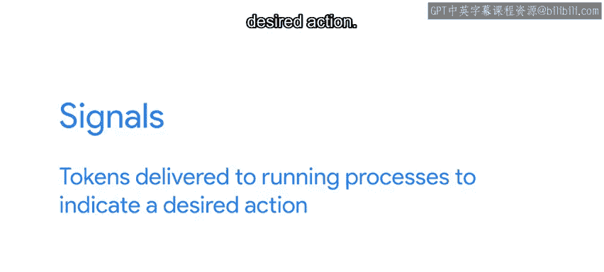
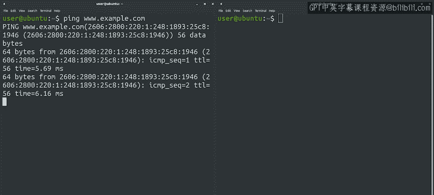

# 谷歌《用Python进行IT自动化办公1、2课（Python、控制操作系统）｜Google IT Automation with Python》中英字幕 - P148：74_发送进程信号.zh_en - GPT中英字幕课程资源 - BV1gw411E7E1

When dealing with the operating system， we usually have a bunch of different processes that we use to accomplish what we want。

 and like any well oiled machine， we generally need these processes to communicate with each other。

For example， we might have a program that starts a background process and wants to terminate after a timeout。

One way of communicating this is through the pipelines we learned about in the last video。

 Another way of communicating is through the use of signals。

 Signals are tokens delivered to running processes to indicate a desired action。

Using signals， we can tell a program that we wanted to pause or terminate。

We can also cause it to reload its configuration or to close all open files。

Knowing how to send these signals lets us interact with processes and have more control over how they behave。

There are a bunch of different ways that we can send these signals。For example。

 let's execute the pin command in our terminal。The P command is now running。

 sending ICM packets to a machine over the network once per second。

And it will keep running forever unless we interrupt it。To do that。

 we can use the control C combination。See how when we interrupt it。

 the program doesn't just end abruptly。First， it prints a summary of what it did and what the results were。

 It's very polite under these circumstances。What's happening behind the scenes is the process received a signal indicating that we wanted it to stop。

 When that signal is received， the process does whatever it needs to finish cleanly。

The signal that controls C sands is called Sig int。It's just one of many signals that we can send。

Another keyboard combination that we can use to send a signal is control Z。 Let's try this one out。

So our ping is running once more。 This time we'll interrupt it with control Z。U， oh， this time。

 the process didn't finish properly。 We get a message saying that it stopped。What's going on。

 The signal that we sent is called Sig stop。 This signal causes the program to stop running without actually terminating。

 But don't worry， we can make it run again by executing FG。

The FG command makes our program run once more。And it'll keep going until we interrupt it either with controlr C。

 control Z， or some other signal。Let's stop it now with control C。😡，By pressing C C this time。

 we've made the program finish cleanly。To send other signals。

 we can use a command called kill Yikes By default。

 kill will send a signal called Sig term that tells the program to terminate。

Since kill is a separate program， we need to run it on a separate terminal。

 and we also need to know the process identifier or PID of the process that we want to send a signal to。

To find out the PID that we want to send a signal to。

 we'll use the PS command which lists the currently running processes。

Depending on what options that we pass， it'll show different subsets of processes with different amounts of detail。

 For this example， we'll call PS A X， which lists all the running processes in the current computer。

And then we'll use the Grep command to only keep lines that contain the name of the process that we're looking for。

 Sound good。Okay， let's try this out。We'll run ping on one terminal and then find its PID and kill it from a second terminal。

Cool， so our PS and G commands found that the PID for the running P command is 4619。

 We can now use this identifier to send the signal that we want using the kill command。

We've now sent the SIG term signal and the process was terminated。Ala is the process。

Notice how in this case， we didn't get the nice summary at the end。 The program just finished。

As you might expect， there is more signals that we can send。

 and they might cause programs to react differently。Many long running programs， for example。

 will reload their configuration from disk if we send them a signal。 This way。

 we can let the program know that there's an important change in the configuration and it can get applied without the program having to stop to reread it。

Programs that provide web services might also receive a signal to tell them that they should finish dealing with any currently open connections and then terminate cleanly once it's done。

 understandingstand what these signals are and how to send them will let you interact with the processes on your system that you're in charge of and make them behave as you want。

Coming up， a couple of readings to put all of this information in one place。

 We'll list all the system commands that we came across and some that will' encounter later on。

We'll also list other resources that you can use if you want to learn more。As we've said before。

 you don't need to memorize any of this。 You'll get better by using them in our practice exercises and by experimenting on your own。

To wrap this up， there'll be a quiz to let you practice your understanding of these concepts。

 The anticipation is killing me。