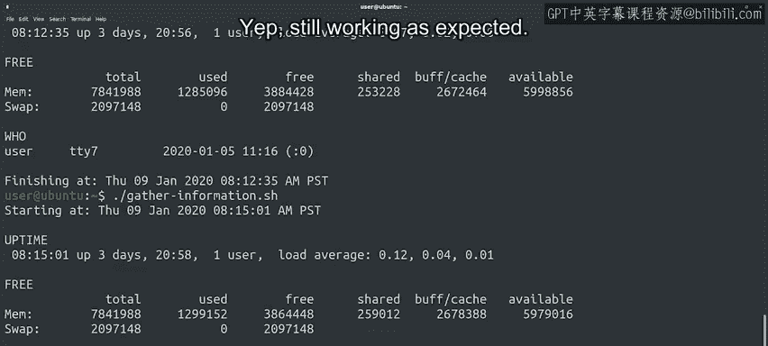

# 谷歌《用Python进行IT自动化办公1、2课（Python、控制操作系统）｜Google IT Automation with Python》中英字幕 - P149：75_创建 Bash 脚本.zh_en - GPT中英字幕课程资源 - BV1gw411E7E1

We mentioned in earlier videos that bash is the most commonly used shell on Linux。

Bash is not only the interpreter that runs our commands， it's also a scripting language。

We can use Bsh to write simple scripts when we need to use a lot of commands。In the next few videos。

 we'll learn how to write these scripts and why they're useful。

 Let's starve an example of why you would even want to do this In your job， as an IT specialist。

 you sometimes need to debug a computer that's not behaving correctly。

There are lots of commands that can tell you what's going on in there to help you with your debugging。

For example， the PS command can list all the current running processes。

The free command can show you the amount of free memory。

 The uptime command can tell you how long the computer has been on and so on。

 Any time you need to debug a computer， you can manually run these commands one by one。

 followed by as many commands as you can think of that might be helpful。

But that already sounds tedious， just describing it。

 What if instead you can run a single command that can gather all of this information in just one shot。

Well， I have some good news for you。We can do this by creating a bash script that contains all of the commands that we want to call。

 one after the other。Let's start with a simple version of a script like that。

The script we're seeing here is calling three main commands， Uptime Free and Who。

 which lists the users currently logged into the computer。

It uses the echocho command to print some other information and to make the output a bit more readable by leaving empty lines between the commands。

We're also calling the date command to print the current date。To call this command。

 we're using a special notation by putting the command inside dollar sign parentheses。

This indicates that the output of the command should be passed to the echo command and be printed to the screen。

Now let's execute our bash script and see what happens。Yay， our script is working as expected。

 The starting and finishing times are the same because there are so few operations we're doing that it takes the computer less than a second to complete them。

Not too shabby。Once we add more operations to gather other information， it might take a bit longer。

 so that's a simple script。We can keep adding more and more commands to it to make our information gathering command get everything that's relevant for debugging。

Now see that as the script is written right now， there' is one command per line。

 That's a common practice， but it's not the only way。

We could also write the commands on the same line using semicolonons to separate them。

Let's see what that looks like。And now let's execute it to check that it still works the same as before。

Yep， still working as expected。

All right， that was our first spa script。That wasn't too bad。 Was it， Belve it or not。

 you've now learned how to write scripts in two different programming languages， Python and bash。

Pretty cool，hu。 We're just getting started。 There's a lot more coming up in the next few videos。😊。

