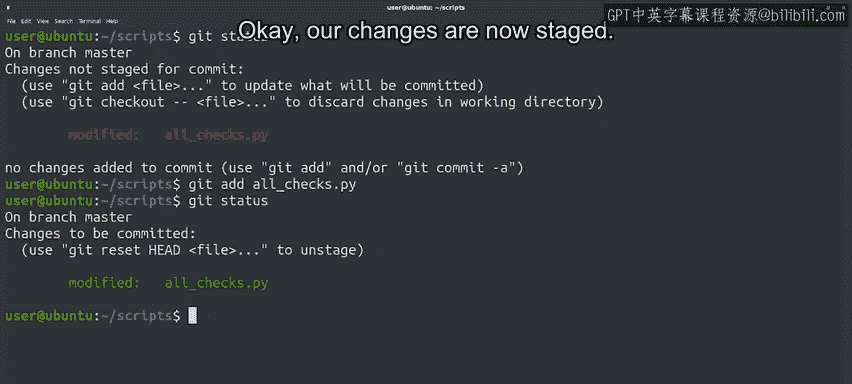

# 谷歌《用Python进行IT自动化办公3、4、5、6课（Git、debug、云端、实践）Google IT Automation with Python》中英字 - P14：13_Git 基本工作流.zh_en - GPT中英字幕课程资源 - BV1LW4y1F7XW

In earlier videos， we discussed some of the basic concepts involved in working with Git。

We saw that each repository will have a git directory， a working tree and a staging area。

 and we called out that files can be in three different states， modified， staged， and committed。

Let's review these concepts one more time by looking at the normal workflow when operating with Git on a day to day basis。

 First， all the files we want to manage with Git must be a part of a Git repository。

We initialize a new repository by running the git in it command in any file system directory。

 For example， let's use the make di command to create a directory called Scs and then change into it and initialize an empty git repository in it。

Our shiny new Git repository can now be used to track changes to files inside of it。

 but before jumping into that， let's check out our current configuration by using the Git Config L command。

There's a bunch of info in there， and we won't cover all of it for now。

 pay special attention to the user do email and the user dot name lines。

 which we touched on briefly in an earlier video。This information will appear in public commit logs if you use a shared repository for privacy reasons。

 you might want to use different identities when dealing with your private work and when submitting code to public repositories。

We'll include more details about changing this information in our next reading。Okay。

 our repo is ready to work。But it's currently empty。Let's create a file in it。

We'll start with a basic skeleton for a Python script。

 which will help us demonstrate the git workflow。 As with any Python script。

 we'll start with the Shibang line For now， we'll add an empty main function。

 which we'll fill in later。 And at the end， we'll just call this main function。Alright。

 we've created our file。 This is a script that well want to execute。 So let's make it executable。

 And then let's check the status of our repo using Git status command。As we called out before。

 when we create a new file in a repository， it starts off as untracked。

We can make all kinds of changes to the file， but until we tell Git to track it。

 Git won't do anything with an untracked file。Do you remember what command we have to use to make Git track our file？

That's right， We need to call the Git add command。This command will immediately move a new file from untracked to stage status。

And as we'll see later。It will also change a file in the modified state to stage state。

Remember that when a file is staged， it means it's been added to the staging area and it's ready to be committed to the Git repository to initiate a commit of stage files。

 we issue the Git commit command。When we do this， it will only commit the changes that have been added to the staging area。

 untracked files or modified files that weren't staged will be ignored。

Calling Git commit with no parameters will launch a text editor。

 This will open whatever has been set as your default editor。

If the default editor is not the one you'd like to use， there are a bunch of ways to change it。

 we'll include more info about changing the default editor in the next reading。For now。

 let's edit our message with Na， which is the current default for this computer。

We'll say that our change is creating an empty all checks pie file， then save and exit。Vila。

 we've just recorded a snapshot of the code in our project， which is stored in the Git directory。

 Remember that every time we commit changes， we take another snapshot。

 which is annotated with a commit message that we can review later。😊，Okay。

 that's how we add new files， but usually we'll modify existing ones。

 So let's add a bit more content to our script to see that in action。

 We'll add a function called check reboot that will check if the computer is pending a reboot。

To do that， we'll check if the run/lash reboot dash requiredqui file exists。

This is a file that's created on our computer when some software requires a reboot。And of course。

 since we're using OS。path that exists， we need to add import OS to our script。All right。

 we've added a function to our file。Let's check the current status using Git status again。

Our file is modified， but not staged to stage our changes， we need to call Git add once again。Okay。

 our changes are now staged。

What do we need to do next？You got it。We have to call Git commit to store those changes to the Git directory this time we'll use the other way of setting the commit message。

We'll call git commitmitM and then pass the commit message that we want to use。So in this case。

 we'll say that we've added the check underscore reboot function。With that。

 we've demonstrated the basic Git workflow， we make changes to our files， stage them with Git add。

 and commit them with Git commitmit。Are you starting to feel more comfortable with this process and see how it fits within the rest of your tasks？

If there's anything that's not totally clear yet， remember that the only way to get familiar with these concepts is practice。

Feel free to try these examples out on your computer as we go along until you get comfortable with these commands。

Up next， we'll talk more about how to write useful commit messages。

