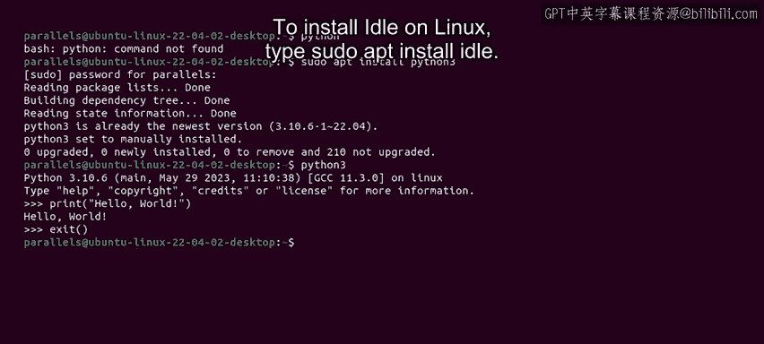
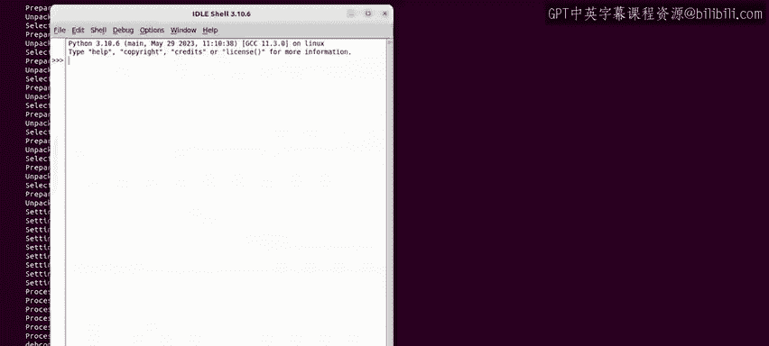
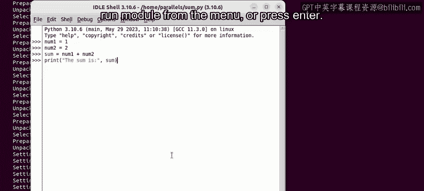

# 谷歌《用Python进行IT自动化办公1、2课（Python、控制操作系统）｜Google IT Automation with Python》中英字幕 - P14：13_使用命令行.zh_en - GPT中英字幕课程资源 - BV1gw411E7E1

Let's get started with our first coding tool。In this video you'll learn how to write Python scripts at the command line along with the Python GuI iddL。

 the command line is used to tell your computer what to do you can use it to access servers。

 move files， change directories and write scriptris In this video we'll show you how to use the command line and idL on the Linux operating system。

If you're using another operating system， you can refer to the reading titled Use the command line Now let's go over the command line on Linux OS access the Linux terminal by clicking on it or using control alt T This will allow you to check for Python type Python Python comes pre-instled on most Linux systems If the command does not found you can install Python by writing pseudo apt installst Python 3 Next it will ask you for your password。

Type your password and press enterter。Python version 3 will begin installation Once installation is complete。

 you can begin writing Python code from the terminal。

 simply type Python 3 to use the interactive mode。Let's try out interactive mode using a print statement。

Type print，Hello world and press En， you will see the outputHello world to exit interactive mode。

 we will typeEx open parentheses Close parentheses。

You can also write Python scripts using Linux with IDL IDL allows you to write Python script with ease on your local machine IdL is an integrated development and learning environment for the Python programming language。

Python IdL is included with Python installations on Windows and Mac you can download idL using your package manager on Linux Python IL is an interactive interpreter or file editor that allows you to easily write Python scripts and programs。

IdL provides syntax highlighting， code completion， and automatic indentation。

To install IDdL on Linux， type pseudoApppt installst IDdL。

Once installation is complete， type idle to open the interpreter and begin coding。

Now we can write a Python file。Once you've completed writing your Python code in the file。

 go to file Save as give your Python file a name in this example， we will name our file sum。pyy。

Hit save。To run the Python code in the file you saved。

 click Run Run module from the menu or press enterter。

Now you know how to use the command line to begin writing Python code remember。

 whichever operating system you're using， you'll be able to run Python from the command line。

 using a text editor like IdL and running Python from the command line is best for executing and debugging individual scripts ort PY files。

Next， let's explore some other code editors and IDEs， I'll see you over in the next video。

