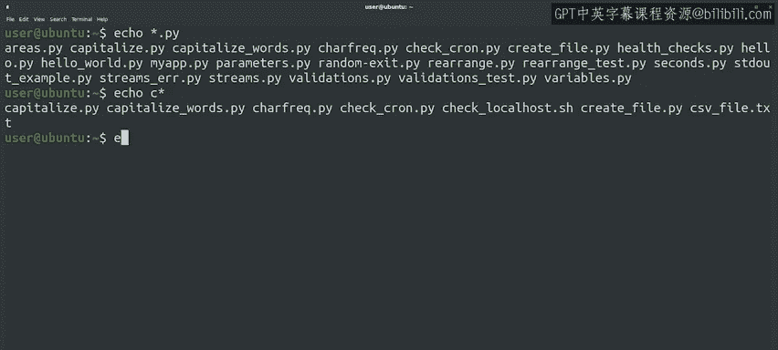

# 谷歌《用Python进行IT自动化办公1、2课（Python、控制操作系统）｜Google IT Automation with Python》中英字幕 - P150：76_使用变量和通配符.zh_en - GPT中英字幕课程资源 - BV1gw411E7E1

Like we said in an earlier video， bash is a fully powered scripting language。

 not just a way of executing commands one after the other。We can assign variables。

 do conditional operations， execute loops， define functions， and so much more。

 so much that we'll only get to cover the very basics in these next few videos。

Let's start with variables。Much like Python， Bsh lets us use variables to store and retrieve values。

 In an earlier video， we looked at environment variables。

These are variables that are set in the environment in which a command is executing。

 We mentioned that we set these variables using the equals sign。

And when we want to access the value of a variable in bash。

 we need to prefix the name of the variable with the dollar sign。

On top of the predefined environment variables， we can also define our own variables for our scripts。

To do that， we just assign a value to the name of the variable that we want to define。Nice。

 but heads up， there can be no spaces between the name of the variable and the equal sign。

 or between the equal sign and the value。If we try to define a variable and leave a space at one side or the other。

 the shell will complain that it can't find the command with the name that we're assigning。

My bad Also， remember that any variable that you define in your script or in the command line is local to the environment where you define it。

 If you want commands from that environment to also see the variable。

 you need to export them using the export keyword。Okay。

 let's now modify our script to gather info and add a variable to it。

 We'll use it to make our script look nicer by adding lines in between each of the commands。

To do this， we'll define a variable called line and we'll put a bunch of dashes in it。And now。

 instead of leaving empty lines， we'll print this variable to separate our commands。

And now let's try executing the modified script。Perfect， there you have it。

 We set and use the variable in our bash script。 Let's move on to another interesting feature available in bash。

 called Gs。😊，Globs are characters that allow us to create list of files。

The star and question mark are the most common globs。Besides being extremely fun to say， Glos。

 using these Gs， lets us create sequences of file names that we can use as parameters to the commands we call in our scripts。

You've probably come across them before， but let's do a quick recap of how we can use them。In Bsh。

 using a star in the command line will match all file names that follow the format that we specify。

Let's check out a few examples。We can see that when we write star。 pi。

 the shell turns it into a list containing all the file names to end with pi in the current directory。

We can also put the star at the end of an expression to get the list of all files at start with a certain prefix。

In this case， we get all the files in the current directory that start with the letter C。

We can also use a star with no prefix or suffix， which would match all the files in the current directory。

Alternatively， the question mark symbol can be used to match exactly one character instead of any amount of characters。

And we can repeat it as many times as we need。For example。

 we can get the Python files with five characters in their name by using the five question marks together。

Using Gbs like this lets us create a list of files that we might operate on。

 like calling other commands and passing this list。If you want to use this functionality in Python。

 it's available through the GLB module。That might sound like something an alien might say。

 but it's actually pretty powerful。And of course， there's a lot more we can do with batchsh scripting Coming up in the next video。

 we'll talk about conditional execution。😊。