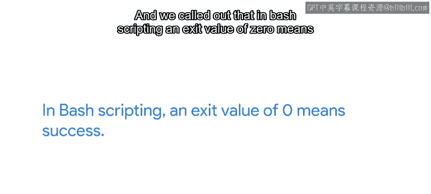
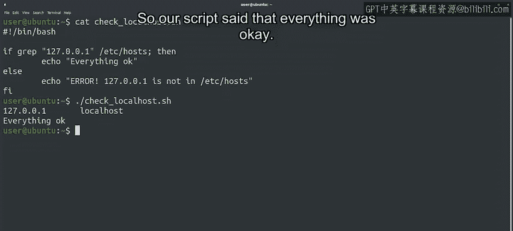
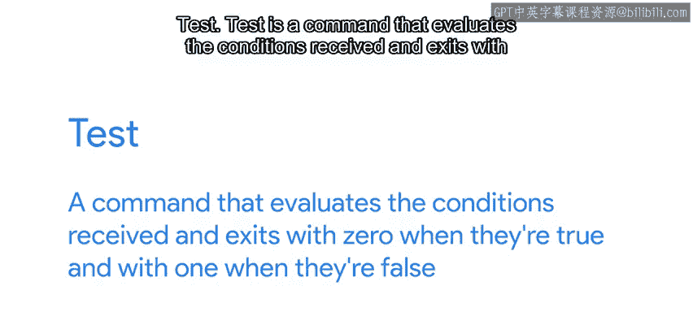
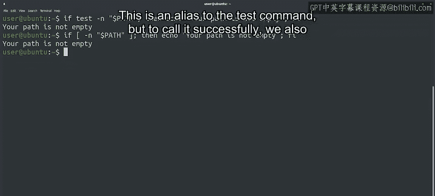
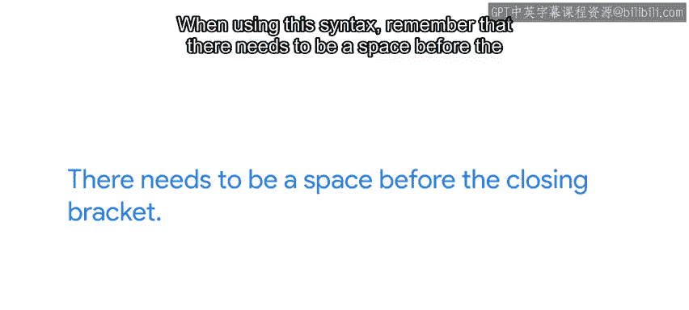

# 谷歌《用Python进行IT自动化办公1、2课（Python、控制操作系统）｜Google IT Automation with Python》中英字幕 - P151：77_Bash 中的条件执行.zh_en - GPT中英字幕课程资源 - BV1gw411E7E1

One of the main concepts of programming is being able to branch the execution according to a condition。

In other words， making our program behave in different ways depending on one or more values。

In Python， we use the if block and the condition is an expression that has to evaluate to true or false。

In batchsh scripting， the condition used is based on the exit status of commands。

Do you remember what we discussed earlier about the exit status of commands？

We mentioned that we check the exit status of command using the dollar signed question mark。

And we called out that in batch scripting， an exit value of zero means success。

This logic is used by the ifF operator in Bsh。To create a conditional expression。

 we're going to call a command and if the exit status of that command is0。

 then the condition will be considered true， say we want to verify that the s ety shost file contains an entry for 127。

0。0。1， which it should。Knowing that GrP will return an exit status of zero when it finds at least one match and different than zero if it doesn't find a match。

We can use it to do this verification。Check out the script。Let's look at the syntax of the if block。

We start with the if keyword followed by the GrP command that we'll use to check for success。

At the end of the command， we have a semicolon followed by the word then。

After that comes the body of the conditional Make sense。 we're using indentation like in Python。

 this is a good style choice and it makes the code more readable， but it's not mandatory and bash。😡。

It's possible to write this in one line， and sometimes we might do that when the amount of code is small enough。

In general， though， it's nice to have commands in separate lines and use indentation to clearly show the body of the conditional。

We also have an else block for when the command doesn't finish successfully， and finally。

 our conditional block finishes using the FiI keyword。

 You can see how some things are the same as in Python。 It uses the if and else keywords。

 It checks the condition and branches the execution according to the value of the condition。

But other things are different。We need to write semicolon then before we can start the body and we need to end the block with FI paying attention to these similarities and differences will make it easier for you to get acquainted with new programming languages。

😡，Okay， let's run our script and see what it does。 Here we go。

The first line in the output is the one generated by our Grp command， because by default。

 Grb prints the lines that match the expression that we give it。

The second line of the output is the one that was generated by our script。So in this case。

 the Grep command called by our script found the line in the file and exited with a value of zero so our script said that everything was okay。

If Gp hadn't found that line， it would have exited with a value different than zero。

 and we would have received a different message。There is plenty of other conditions that we might want to check in our scripts if a file exists。

 if two strings are equal， if a number is less than another number and so on to help us with evaluating these conditions。

 there's a command called test。 Test is a command that evaluates the conditions received and exits with zero when they're true and with one when they're false。

Let's check out an example。 In this case， it's short enough that we can write everything in one line。

We're using the dash and option for the test command。

 which checks if a string variable is empty or not。In this case， path isn't empty。

 so we get the message Using the test command like this is so common。

 there's another way of writing it， which looks more like other programming languages。

 and something like this。In this case， the command we're calling is the opening square bracket。

This is an alias to the test command。But to call it successfully。

 we also need to include a closing square bracket。

When using this syntax， remember that there needs to be a space before the closing bracket。

 there's plenty of other things that we can check with test， but we won't cover them in these videos。

We'll include some of them in the upcoming cheat sheet。

 and you can also see all of them by looking at the manual page for test。So by now。

 you have a rough idea of what a bash script looks like。 You're doing really good。And remember。

 you can always review the contents if something isn't clear。

There's a lot of topics that we haven't covered yet like working with loops or managing command line arguments。

 but before we jump into that， let's do a quick quiz。

