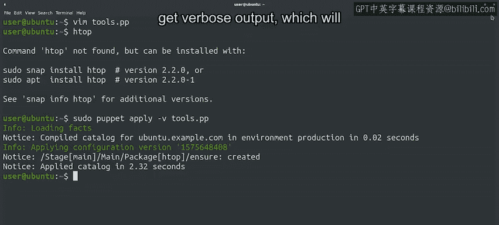
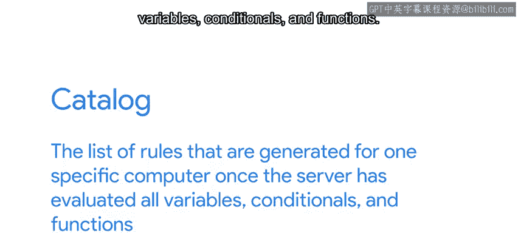
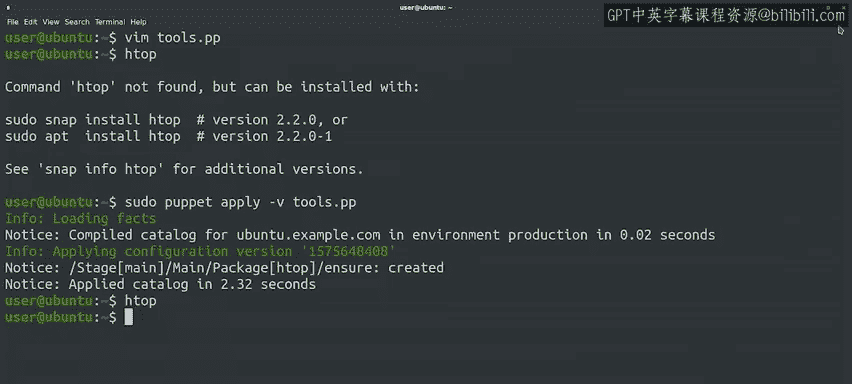

# 谷歌《用Python进行IT自动化办公3、4、5、6课（Git、debug、云端、实践）Google IT Automation with Python》中英字 - P152：35_本地应用规则.zh_en - GPT中英字幕课程资源 - BV1LW4y1F7XW

Up to now， we've been getting to know puppet syntax and understanding the different resources available。

 It's now time for the next step， trying out some puppet rules on our local computer。

In an earlier video， we called out that puppet is usually deployed in a client server architecture。

 but that's not the only way we can use puppet， we can also use it as a standalone application run from the command line。

This is common when testing new configurations， and it can be the preferred configuration for complex setups。

 where connecting to a master is no longer the best approach when using a standalone puppet。

 the same computer process as the facts calculates the rules that need to be applied and makes any necessary changes locally。

 So to get started with our puppet deployment。 let's first install puppet。

 and then we can start experimenting with running rules locally in later videos。

 well check out how to create a client server deployments。As we've called out。

 puppet is available on a number of different platforms。

 we can either install it from the package management system available in the OS or download it from the official website。

 Both options work fine and the best one to choose will depend on our specific needs for this exercise we'll just go with a puppet packages provided by the Uuntu distribution We'll do that by installing the puppet master package using pseudo app install puppet master。

Alright， we now have the package installed and can start trying out a few rules we'll begin by creating the simplest possible puppet file。

 we can make it more complex as we improve our deployments For this example。

 we want to use puppet to make sure that some useful tools for debugging problems are installed on each computer in our fleet。

To do this， we first have to create a file where we'll store the rules that we want to apply in puppet lingo。

 these files are called manifests and they must end with the dot PP extension。

So we'll create a new file called To。pp， and in this file we'll create a package resource。😡。

We'll start by managing the HT package， which is a tool similar to top that can show us some extra information。

We'll state that we want puppet to ensure that we have this package present on our computer。Cool。

 that was simple。 That's all we have to do。 This resource will take care of installing the package for us。

Let's save the file and try it out， but before actually applying the rules。

 we want to check that the command isn't present yet。Right， Htop isn't installed yet。

 Let's fix that by running our rules using pseudo puppet applyvtools。pp。

The D V flag tells puppet that we want to get verbose output。

 which will tell us what's going on while puppet is applying the rules in the file that we pass to it。

 so here， Puppet first told us that it was loading the facts， then that it compiled a catalog。

After that， it told us that it was applying the current configuration。

Then that it installed the package we requested， and finally。

 it let us know that it finished applying this catalog。You're probably wondering。

 what's a catalog we called out in an earlier video that after loading all facts for a computer。

 the server calculates which rules actually need to be applied。For example。

 if a packet should only be installed when a certain condition is met。

 this condition is evaluated on the server side based on the gathered facts。

The catalog is the list of rules that are generated for one specific computer once the server has evaluated all variables。

 conditionals and functions In this example， the catalog will be exactly the same as our code because the code didn't include any variables。

 functions or conditionals。

More complex sets of rules can lead to different catalogs， depending on fact values。

 it's now time to check if our rules actually worked。

 Let's try running the HTO command again now that puppet has installed it for us。Yes。

 this time it worked。 If our computer was misbehaving。

 we could now use this tool to get a better idea why。 But fortunately。

 our computers on its best behavior。 So we'll exit now using Q。

 Let's see what happens if we try to apply the puppet rules again Now that the package is installed。

😊。

HaPuppets's smart， it noticed that the package is already installed。

 so it didn't try to install the package again。This means it applied the catalog much faster because nothing had to be changed。

 We've now seen how to write a puppet resource in a manifest file and then use puppet apply to apply those rules to one computer。

Up next， we'll check out how we can manage relationships between different puppet resources and what that looks like when applied。

