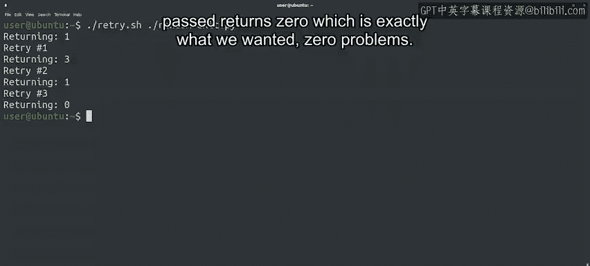

# 谷歌《用Python进行IT自动化办公1、2课（Python、控制操作系统）｜Google IT Automation with Python》中英字幕 - P152：78_Bash 脚本中的 while 循环.zh_en - GPT中英字幕课程资源 - BV1gw411E7E1

Welcome back。Let's take a moment to quickly recap everything you've learned so far in this module。

We started by looking at some of the most common Linux commands you learned about redirecting streams。

 pipes and pipelines， and signaling processes。Then you got your first taste of the bash programming language。

 including how to create a script， use variables in Gs， and perform conditional execution。

That's a lot of new interesting concepts that will help you get the most out of the systems that you work with。

But we aren't done yet。 Let's dive into some more advanced bash concepts before we wrap up this module。

Are you ready？Good， let's do it。Bash provides similar looping structures to the Python。

 We can iterate while a condition is true using a while loop and iterate over a list of elements using a for loop。

Although， of course， the syntax for these loops is slightly different。As a quick reminder。

 loops are what makes the computer do repetitive tasks for us。

Anything from working with a bunch of numbers to processing the contents of a file line by line。

Our computer doesn't care how many times we ask it to do what we want。

 It'll keep doing them until it's done。 No coffee breaks。So sad。

Let's check out a simple while loop in bash。In this script。

 we're using the variable N to print messages， counting from one to 5。

 The condition for the while loop uses the same format as the condition for an if block。

In this example， we check if the variable n is less than or equal to5 using the dash LE operator。

The loop itself starts with the do keyword and finishes with a done keyword。

To increment the value of the variable n， we're using a bash construct of double parentheses that lets us do arithmetic operations with our variables。

It seems complicated， but when you take a step back， it all comes together。

Let's execute this and see what happens。Okay， so that works。

 but what about making our loop a bit more interesting？When using wild loops and bash groupss。

 it's common to have a loop that retryries command a number of times until it succeeds。

This is really useful with commands that use network connections or that access resources that might be locked。

These commands can fail for external reasons， and they are likely to succeed after a retry or two。

To simulate a command that sometimes succeeds or sometimes fails。

 we have a small Pion script that will return an exit value pick at random from a range that we give it。

Do you see what the script is doing， It uses random R int to generate a value between 0 and 3。

 Then it prints the selected value and exits with it。Let's check this script out。Cool。

 so we see that we get a value in the 0 to three range。 Which value we get will depend on each call。

 That's okay。 We want to simulate a command that sometimes fails and sometimes succeeds。Now。

 let's have a look at our batchsh script that'll retry the command。

This script is a bit more complex than the earlier one， but not by much。

One interesting difference is that we're getting the value of a command line argument using the dollar sign1。

This is what we use in Bsh to access the first command line argument。In Python。

 we get the same information using Cis RGV1。So we store the parameter in the variable called command and then we execute the while loop until either the command succeeds or the n variable reaches a value of5。

In other words， if the received command fails， we'll retry up to five times in the body of the while loop。

 we first sleep a few seconds， then increment the variable and print the number of free try attempts。

So why do we call the sleep command， This is no time for rest。

The idea here is that if the command we're calling is failing due to CPU usage。

 network or resource exhaustion， it might make sense to wait a bit before trying again。

So the more we try， the more we wait， we need to let our computer catch a breather and recover from whatever is making our command fail。

In our simulation， the command fails randomly， but this retry script works with any other commands that could fail for a wide range of reasons。

To try this out， we'll need to call a retry script with the random exit command as a parameter like this。

We can see how our script keeps executing until the command that we passed returns zero。

 which is exactly what we wanted， zero problems。

This last example is a real world use case for while loops in bash and includes a few more advanced topics。

 so it can definitely feel complex。But don't let that stop you。

 rewatch this video as many times as it takes and practice the scripts that we covered。

Once you're ready， you can meet me over in the next video where we'll look at four loops in bash。

