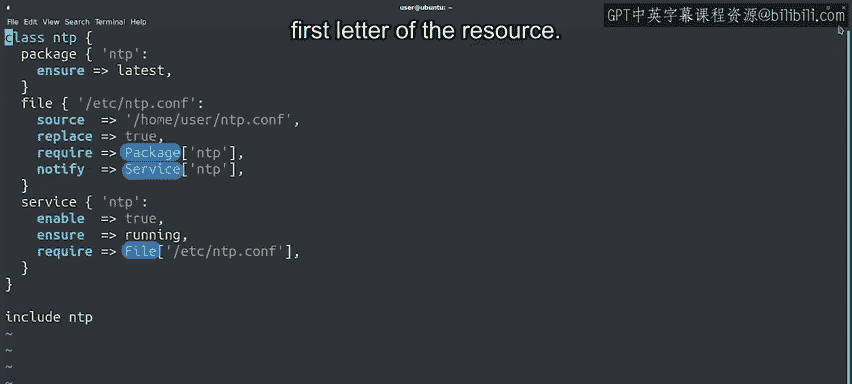
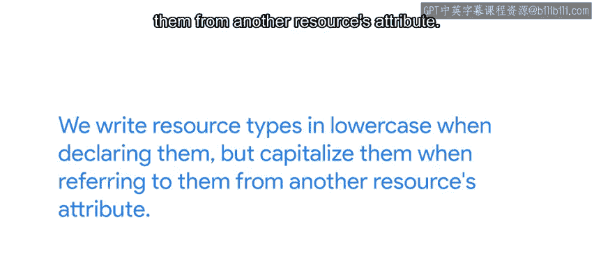
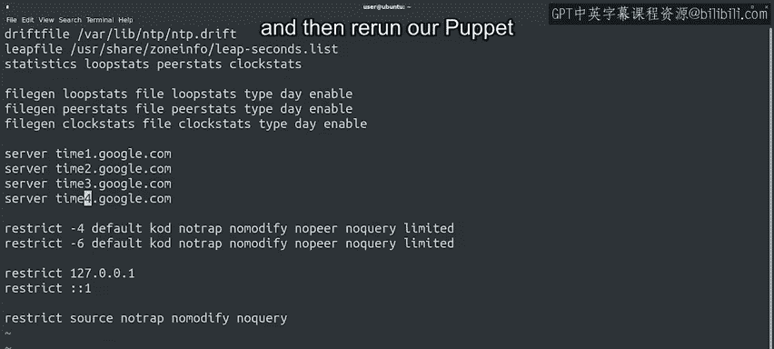

# 谷歌《用Python进行IT自动化办公3、4、5、6课（Git、debug、云端、实践）Google IT Automation with Python》中英字 - P153：36_管理资源关系.zh_en - GPT中英字幕课程资源 - BV1LW4y1F7XW

In our last video， we wrote a very simple manifest， which we then applied locally。

That was a great way to practice applying puppet rules， but it was super simple。

 Let's challenge ourselves with something a bit more tricky。

 The puppet manifests that we use to manage computers in our fleet usually include a bunch of different resources that are related to each other。

You're not going to configure a package that's not installed and you don't want to start a service until both the package and the configuration are in place Puppet lets us control this with resource relationships Let's check this out in an example。

 we have a file called NTP。PP that has a bunch of resources related to the NTP configuration like the one we've seen in an earlier video。

😡，This time， on top of declaring the resources that we need to manage。

 we're also declaring a few relationships between them。

We say that the configuration file requires the NTP package and the service requires the configuration file this way Puppet knows that before starting the service。

 the configuration file needs to be correctly set and before setting the configuration file。

 the package needs to be installed。We're also declaring that the NTP service should be notified if the configuration file changes。

That way， if we make additional changes to the contents of the configuration file in the future。

 the service will get reloaded with the new settings。If you look closely。

 you might notice that the resource types are written in lowercase。

 but relationships like requirequire or notify use uppercase for the first letter of the resource。

 This is part of puppet syntax。 We write resource types in lowercase when declaring them。

 but capitalize them when referring to them from another resource's attribute。

If this sounds confusing right now， don't worry， it might take a while to wrap your head around it。

 but it will eventually click。Now， one last thing， at the bottom of the file we have a call to include NTP that's how we tell puppet that we want to apply the rules described in a class。

For this example， we put the definition of the class and the call to include the class in the same file。

Typically， the class is defined in one file and included in another。

 We'll check out examples for this in later videos。 All right， let's apply these rules locally。Great。

 our rules have run， and in the verboos output， we can see that it did a bunch of things。First。

 it installed the package。 Then it checked that the configuration file needed to be updated。

 and so it changed its contents。Finally， after changing the contents of the configuration。

 Puppet knew to restart the NTP service。We see here how our puppet rules have translated into a few different actions。

 That's cool， but it's about to get even better。 Let's make a change to the configuration file by editing the NTP do co file in this directory。

😊，This is the configuration file used by the NTP service。

 It's currently using a bunch of servers from NtP。org， but instead of those servers。

 we want to try out the NTP servers provided by Google。 These are called time1。google。

com and then time 2 Time3 and time 4。All right， we've made the change。

 we'll save with colon WQ and then rerun our puppet rules with the new configuration file。

Awesome， puppet updated the configuration file with the new contents and then refreshed the service so it loaded the config Su In this video。

 we've seen how we can apply a puppet manifest that includes a class with a bunch of resources。😊。

We grouped all of the information related to the NTP service in a manifest specific to it。

 which is common practice when dealing with puppet rules。

 we want to keep related operations together and separate things that are unrelated Up next we'll look into how we can do that using puppet modules。

